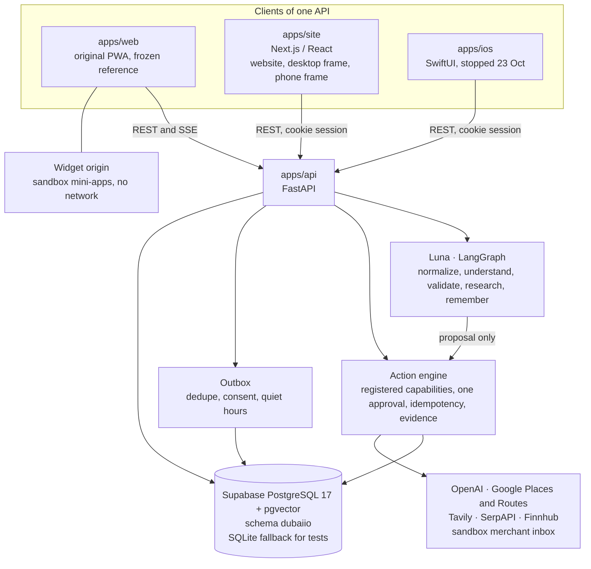

# Dubai-io

**A personal assistant for everyday life and work in Dubai.** It remembers the context you gave it, prepares the next step, and brings you the decision that needs you. A status such as Confirmed, Booked, Paid, Filed, Verified or Delivered appears only after a merchant action or a verified provider response.

Contest entry for **Best Personal AI Agent** (Create AI Agents Championship). The portal date checked in the plan is a **January 2027** submission (prototype, pitch deck, demo video) and a Grand Final in the **first week of May 2027**.

## Why it exists

People who live and work in Dubai already have chat, maps, calendars and local services. Those tools answer questions. They do not hold a deadline, an approval of exactly what gets shared, or a merchant's confirmation, then follow up only because you asked.

The product started as a visitor companion: a late-night arrival at DXB, a shirt that has to be ready by morning, and a bag left in a taxi. On 22 Oct 2026 the founder rejected that as the identity. Arriving and losing something remain situations the assistant must handle. The audience is someone whose ordinary life and work happen in Dubai. The first pilot is a single tester on the existing cookie session. Household and team use are later choices, not the current product.

The pitch the plan locks in:

> DubaiIO helps keep your everyday life and work moving: it remembers the relevant context, prepares useful next steps and brings you decisions that need you.

It coordinates and follows through with your permission. It does not claim to replace Google, Careem or DubaiNow, and it does not claim a live government integration.

Two facts the demo is allowed to lean on, from the plan's evidence notes: Dubai taxis logged 104,000+ lost items in 2025 (about 3,000 of them passports), and recovery depends on the details the companion actually stored; the Metro stops around midnight and Terminal 2 has no station, so a late ride recommendation has to say so. Laundry prices and concierge waits in the research notes are labelled as reported, not measured.

## What it does

Luna, a LangGraph assistant, reads the conversation and proposes. It does not mutate orders, tasks or profile facts. Every side effect goes through a deterministic action engine after a user tap (an approval) or a merchant tap (the sandbox inbox).

The order path is one approval of a fixed published price. There is no quote, bid or negotiation. The card lists the shop, the items, the total and exactly which fields are shared. The merchant accepts, declines or changes the ready time. If the ready time misses the deadline you stated, the assistant says so and asks for an earlier time at the same price. "Confirmed" is the shop's word, not the model's.

When no registered adapter exists, the draft stays and the screen shows the blocker. Government and civic actions (Salik, DEWA, RTA, Tasjeel, fines, police reports, donations) follow that same rule: a real adapter, an explicit approval, and provider evidence. A prepared RTA lost-property report is a handoff, not a filing.

| Rule | What you see |
|---|---|
| Truth in status | LLM text never changes status. An ambiguous send becomes `UNKNOWN_STATUS`, with no automatic resend. |
| Provenance | Prices, balances, ratings, dates and counts carry `provenance` and `as_of`. Fixture numbers render a **Demo data** pill. |
| Memory | Facts you state are "You told me". Inferences are hypotheses under "I noticed", with Confirm, Edit, Not true and Forget. An unconfirmed hypothesis may re-rank options, with a visible "Because…" chip. It does not pre-fill a field, appear on an approval card, trigger a message or set a status. |
| Sensitive traits | Health, religion, ethnicity, nationality-as-trait, gender, sexuality and politics are never inferred. |
| Proactive messages | Reminders and triggers come from the scheduler and outbox. Each one is deduplicated, consented, quiet-hours aware (23:00–07:00 Dubai), and stored as a normal chat message. A trigger you did not cause is labelled **Demo trigger**. |
| Widgets | A merchant mini-app loads from a separate origin inside `<iframe sandbox="allow-scripts">`, with `connect-src 'none'`. It may send `order.request` only. The host rebuilds the total from its own catalog. |

## Key capabilities

Dates below are the docs' own checkpoints, through **2 Nov 2026**. "Built" means the docs record it as implemented and tested on the surface named. It does not mean production hosting, a physical-device sign-off, or a live provider key.

### Built in the API and the original mobile app

The original app is `apps/web`, a vanilla HTML/CSS/ES-module PWA served by the API. It is frozen at tag `mobile-pwa-baseline-2026-10-23` and is the reference for the new phone experience.

- Persistent chat, cards and sessions that survive reload.
- Luna intents for the airport guide, nearby places, fixed-price service offers, lost property, order status, sourced answers and market quotes. Civic questions are refused and pointed at the official portal. Research answers come only from cited sources.
- DXB arrival guide that advances only on what you confirm. "I'm lost" resumes from a landmark you pick. The guide does not invent an indoor position, belt, gate or queue.
- Ride recommendation from time and terminal, with a live Google Routes ETA labelled as an estimate.
- Talabat-style service list (closest, rating, price-from, turnaround). Each row opens its own sandboxed mini-app at a fixed price.
- Merchant sandbox (`/merchant.html`): accept, decline, ready time, deadline check, and a deduplicated reminder.
- Lost-item recovery from the trip details you saved (time, pickup, plate, roof colour). The report is prepared, not filed. Staged replies are labelled staged. Collection is the available choice; delivery is shown as unavailable.
- Manual tasks and a Today view, source-linked tasks, reviewed chat edits, project workspaces, and a pull-only news strip of attributed headlines.
- Decision cards for real stops (approve a send, unknown outcome, missed deadline), result cards, a deterministic morning brief, consented check-backs, and Auto / Ask / Learn modes. A send or a share still needs a tap.
- Visible memory: profile facts, temporal interests ("You, over time"), and a recommender that separates this visit from a longer-term preference (two distinct options, visits six hours apart).
- Demo-grade community: chat threads, contacts, an in-app call log that hands off to the phone dialer (`tel:`), a feed with stories, communities, posts and comments. Seeded people and posts are labelled Demo.
- Live provider calls where keys exist: OpenAI, Google Places and Routes, Tavily (SerpAPI fallback), SerpAPI product search, Finnhub quotes. Prayer times use Aladhan. Missing keys stay honestly unavailable.

### Built in the React app, and under founder review

`apps/site` is the app that is meant to become the website, the desktop app and the phone app from one React codebase. An earlier marketing site on this path was rejected. The unified shell replaced it.

As of the 2 Nov status file, the contest spine on this app is review-ready:

- Live Google Places in chat (device location, Marina fallback) and a "Gyms near Marina" starter.
- Live Google Shopping (UAE) via SerpAPI: a photo grid of up to five stores, and a still-photo "Try it on" sheet (Vertex or OpenAI, or an honest blocker).
- Memory lite: clothing size and area, shown as "You told me", with "Because…" chips on shopping.
- An interactive in-app map and a dashboard strip near you. Weather uses the same pin.
- Sidebar domain bots: Lifestyle, Career, Social, Household, Money, Travel. Demo threads for cases such as the taxi recovery remain.

The same status file lists three surfaces as the open review work: a shared result template for places, shopping, mail and sources; temporal memory endpoints under `/api/memory/`; and a mail profiler at `/api/mail/needs-reply`. Live Gmail needs OAuth and `gmail.readonly`. `DEMO_MAIL=1` serves a fixture "Needs a reply" card.

Plan 1 of the unified app (shell, task threads, greeting and composer, Assistant/Community switch, onboarding, `?desktop` and `?device` frames) is recorded as merged. The plain URL is the website. `/?devices` is the iPhone frame, with an Original/New toggle planned so the frozen PWA stays reachable. Packaging with Capacitor and Tauri or Electron is a later plan.

### Designed, and not claimed as shipped

- Phone-core port of the airport guide and taxi recovery into the React app, community and chats ported to that app, a Services quality uplift, full dashboard workspaces, and the full temporal memory engine. Plans 2–8 are parked pending founder review.
- Five residence journeys (schools and a home, an insurance clinic, a Mamzar day, a lost bag, guests tonight) and a fixture resident, "Sam Resident". These are card-by-card scripts. Demo data stays labelled.
- A builder MCP for coding agents, and a UAE Pass sandbox that would draft a bill payment and then stop.
- Production accounts, hosted deployment, a real merchant on video, a live flight-landed feed, purchasing, and background geofencing.
- **Universal Connector Framework.** A separate in-flight branch is adding it. This README does not describe it as shipped. What is in tree today is narrower: Google identity OAuth is implemented and unconfigured; Gmail, Calendar and Outlook are new slices that need keys and consent. Identity scopes are not mailbox access.

Native SwiftUI (`apps/ios`) stopped on 23 Oct 2026. The first slice remains in the tree for history: onboarding, Luna chat, the sandbox catalog, Google Places on a Google map, and a Safari sheet for third-party links. It is not at feature parity, and the home screen still carried visitor copy when Swift work stopped.

## Architecture



Order states, in short: `DRAFT` → `AWAITING_APPROVAL` → `DISPATCHING` → `SUBMITTED` → `ACCEPTED` → `READY` → `COMPLETED`, with `DECLINED`, `CANCELLED`, `BLOCKED` and `UNKNOWN_STATUS` where the docs define them. Approval binds a snapshot hash, a revision and the exact effect. Drift returns 409.

Anonymous cookie sessions own their actions, profile and threads. Merchants see only their own orders and the fields that were approved. Provider keys stay on the server. Browser snapshots hold plain text and structured data, never raw HTML or OAuth tokens.

Conversation memory is a LangGraph checkpoint scoped to the session owner. A profile fact the user replaces is closed with a validity window. `profile_facts.embedding` is reserved; semantic recall over it is not built. The longer memory engine modelled on the founder's temporal-note design (events, entities, hybrid search, a context pack) is specified and parked, with a lite slice started for size, area and `/api/memory/*`.

## Tech stack

| Layer | Choice |
|---|---|
| API | Python 3.13, FastAPI, Pydantic v2, LangGraph, OpenAI SDK |
| Original mobile app | HTML, CSS, ES modules. Served by the API. |
| Unified app | Next.js 16.4 / React 19.3, TypeScript, CSS modules, `lucide-react`. Vitest and Playwright are the approved test tools. |
| Native client | SwiftUI, iOS 26, a local `DubaiIOCore` package. Stopped. |
| Data | Supabase CLI 2.121.0, PostgreSQL 17, pgvector, private schema `dubaiio`. SQLite is the test and offline fallback. SQL is written once; `app/db.py` translates placeholders. |
| ML extras | Redis cache and a Celery worker image. Dev and tests run inline (`CELERY_EAGER=1`). Sentiment and embedding models are optional; missing models degrade to keyword search and an honest empty analysis. |
| Maps and answers | Google Places, Photos, Static Maps, Routes. Tavily, SerpAPI, Finnhub, Open-Meteo, Aladhan. |
| Identity | Cookie session for the single tester. Supabase Auth and Google sign-in are deferred. Google API keys are separate from OAuth. |

## Repository

```
apps/api/    FastAPI + LangGraph, fixtures, tests
apps/web/    Original mobile PWA — frozen reference, tag mobile-pwa-baseline-2026-10-23
apps/site/   The React app: website, and later desktop and mobile shells
apps/ios/    SwiftUI client — stopped 23 Oct, kept as history
supabase/    Migrations and local project config
docs/        Status, backlog, plans, service cases, references
design/      Screen references
```

Product domains in the React sidebar are Household, Places & trips, Services, Work & admin, and General, with the coarser Lifestyle / Career / Social / Household / Money / Travel bots on the contest spine. Service categories are a short fixed list (laundry, AC, and the rest of the registry). Projects remain multi-chat workspaces and do not replace domains.

Look: white, accent `#357F92`, a soft haze on the home greeting, no shadows, plain assistant text, a tinted user bubble, white rounded action boxes. Dark mode is Graphite and comes after light mode is polished. The app does not copy DubaiNow's layout, government emblems or ministry logos.

## Status and roadmap

Latest written snapshot: **`docs/status.md` and `handoff.md`, 2 Nov 2026.** `PLAN.md` the same day records an empty agent queue and a contest spine waiting on founder review. Plans 2–8 and the residence-companion phases past the lite memory work are parked until that review.

**In the tree and documented as working, with the limits in those files:**

- The action engine, Luna, the sandbox merchant loop, tasks, decisions, projects, headlines, demo community, and the original PWA.
- The React shell and the 2 Nov contest spine (Places, Shopping try-on, size and area, map and dashboard).
- Local Supabase as the selected database. A 21 Oct checkpoint imported review data into schema `dubaiio`. On 22 Oct, reads succeeded and new test-schema writes stalled. The verified suites after that are SQLite. Hosted Postgres, production identity and recovery of an older unhealthy volume are still open.

**Next, when the founder unparks it:**

1. Finish founder review of the live Places, Shopping, map and memory-lite spine.
2. Plan 2: embed the original app at `/?devices`, and port the phone home, the DXB guide and taxi recovery into the React app.
3. Port community, chats and calls; raise Services to the quality of the original Feed (the one sanctioned visual exception).
4. Dashboard workspaces that already have keys (weather, prayer, news) and an honest connectors gallery.
5. The temporal memory engine, then connectors and the investigation loop (mail, calendar, notes) with a draft in the originating account and an approval before any send.
6. Capacitor (iOS and Android) and Tauri or Electron, then retire `apps/web` only after parity and an explicit founder approval.
7. Submission package: deck, demo video, a tunnel or host, and a small user test. One real merchant is a May-final goal. The sandbox merchant is the current proof.

**Explicitly later:** civic retrieval with citations, background geofencing, a ticket wallet, media memory, Arabic RTL, live AR try-on, affiliate marketplace feeds. **Out of the product:** fake success statuses, invented positions or prices shown as real, a DubaiNow look, and any quote or bid. Licensing the approvals engine as SaaS is an idea only, with no landing page and no commitment.

## Run locally

Ports in the docs move with the machine. On the Mac that wrote the previous README, ports 8000, 8010 and 8020 belonged to other apps, so this recipe uses **8002**. The 2 Nov handoff uses **8030** for the API and serves the original app at `/index.html`. Pick the free port and point the React app at it.

API, original app, and merchant sandbox:

```sh
cd apps/api && .venv/bin/python -m uvicorn app.main:app --host 0.0.0.0 --port 8002
# Original app + API:   http://localhost:8002
# Merchant sandbox:     http://localhost:8002/merchant.html
```

2 Nov recipe, from `handoff.md` and `docs/status.md` (the Windows line clears `DATABASE_URL` so the API uses SQLite):

```sh
cd apps/api && .venv/bin/python -m uvicorn app.main:app --port 8030
# Original app:         http://localhost:8030/index.html
```

```powershell
cd apps/api; $env:DATABASE_URL=' '; .\.venv\Scripts\python.exe -m uvicorn app.main:app --port 8030
```

React app. `NEXT_PUBLIC_API_BASE` defaults to `http://localhost:8000` in the site README; set it to the API you actually started.

```sh
cd apps/site && NEXT_PUBLIC_API_BASE=http://localhost:8002 npm run dev -- --port 3000
# Website:              http://localhost:3000
# Desktop frame:        http://localhost:3000/?desktop
# Phone frame:          http://localhost:3000/?devices
```

```sh
cd apps/site && npm run build && npm run start -- -p 3040
```

ML cache. The compose file publishes Redis on **6380** because 6379 was the Mac's system Redis:

```sh
cd apps/api && docker compose -f docker-compose.infra.yml up -d redis
```

iOS, historical. Swift work is stopped. The package resolves on the arm64 simulator slice:

```sh
# Open apps/ios/DubaiIO.xcodeproj, pick a Simulator, Run.
# On a device, localhost is the phone. Use http://<computer-ip>:<api-port>.
swift test --package-path apps/ios/Core
```

Supabase is a dedicated local project (`dubai-io`): API 15421, Postgres 15422, Studio 15423. Setup, the write-stall limit, and the warning never to reset the old volume are in [`supabase/README.md`](supabase/README.md).

Optional keys live only in `apps/api/.env` (never commit them): `OPENAI` / Luna model settings, Google Places, `TVLY_API_KEY`, `SERPAPI_KEY`, optional `FINNHUB_API_KEY`, `GOOGLE_MAPS_BROWSER_KEY`, `VERTEX_PROJECT` for try-on, and `GOOGLE_OAUTH_CLIENT_ID` / `SECRET` / `REDIRECT_URI` plus `OAUTH_TOKEN_KEY` for live mail. `TRYON_FIXTURE=1` and `DEMO_MAIL=1` keep those paths on fixtures.

## Tests

Counts below are the ones this README has carried. They were not re-run for the rewrite. A later handoff (2 Nov 2026) records the API suite at **249 passed / 11 skipped**, and the unified app at **20 unit + 36 end-to-end** tests. Live model cases stay skipped unless `RUN_LIVE=1`. The same API suite on Postgres is `TEST_DATABASE_URL=$DATABASE_URL`.

```sh
cd apps/api && .venv/bin/python -m pytest -q tests        # 227 passed, 11 live skipped
for t in ../web/tests/*.test.mjs; do node "$t"; done     # 9 web suites
cd ../site && npm run build                               # website build
swift test --package-path apps/ios/Core                   # 15 iOS contract tests
```

Every workflow is expected to ship with fixtures plus a happy path and a failure path. A green build is not design acceptance: the founder reviews a staged preview.

## Documentation

Start here, in this order:

| Doc | What it is |
|---|---|
| [`CLAUDE.md`](CLAUDE.md) | Router and the ten product rules |
| [`docs/status.md`](docs/status.md) | Current state, 2 Nov 2026 |
| [`handoff.md`](handoff.md) | Run-book and the latest session notes |
| [`PLAN.md`](PLAN.md) | Scope locks, the demo arc, what is in, later, and out |
| [`ARCHITECTURE.md`](ARCHITECTURE.md) | Contracts, state machine, memory, Luna, security |
| [`docs/request-backlog.md`](docs/request-backlog.md) | Founder requests, in order |
| [`docs/plan/unified-app-design.md`](docs/plan/unified-app-design.md) | The one-codebase website, desktop and mobile design |
| [`docs/implementation-plan.md`](docs/implementation-plan.md) | Nested tasks and acceptance gates |
| [`docs/user-app-review-guide.md`](docs/user-app-review-guide.md) | A twenty-minute pass over the original app |
| [`docs/references/api-catalog.md`](docs/references/api-catalog.md) | Which providers are live, ready, partner-gated, or out of scope |
| [`docs/references/ios-swift-plan.md`](docs/references/ios-swift-plan.md) | Native and website client contracts |
| [`docs/services/cases.md`](docs/services/cases.md) | Service cases. New ideas go through [`docs/services/intake.md`](docs/services/intake.md) |
| [`cursor-plan.md`](cursor-plan.md) | Session spine for the contest work |

Deeper plans live in [`docs/superpowers/plans/`](docs/superpowers/plans/) and [`docs/plan/`](docs/plan/). The residence-companion brief, demo resident and five journey scripts are under [`docs/superpowers/specs/`](docs/superpowers/specs/). Independent reviews in `docs/references/` are preserved as evidence. They do not override the founder locks in `PLAN.md`.
