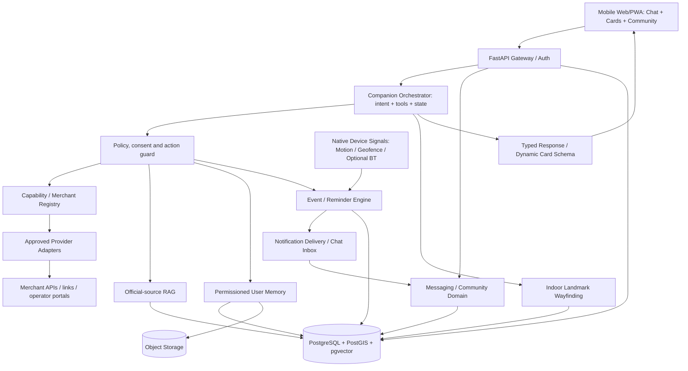

# Dubai-io — System Architecture (Proposed)

**Audience:** core developers and AI implementation agents.  
**Design target:** one simple user interface, a modular backend that accommodates services, community, media and civic knowledge as capabilities arrive.

## 1. Topology



**Rule:** Tool calls return structured results; a separate presentation layer maps them to safe, typed cards. The LLM must not generate executable UI or write arbitrary SQL against production databases.

## 2. Modules and boundaries

| Module | Responsibility | Boundary |
|---|---|---|
| Identity & consent | User sessions, granted permissions, data sharing approvals | Explicit opt-in; minimal attributes |
| Companion core | Intent, plan, conversation state, tool selection, safe response | Single orchestration graph initially |
| Capability registry | Search providers/services/actions and status | Definitions, not unrestricted execution |
| Provider connectors | Call approved APIs, merchant dashboards or deep links | Timeouts, retries, receipts, idempotency |
| Typed UI renderer | Compare, map, form, citation, offer, status, timeline | Schema validation before rendering |
| Mini-app host (WeChat-inner-HTML) | Sandboxed iframe host, manifest-pinned HTML widgets, capability-scoped postMessage bridge, widget lifecycle + watch persistence | Manifest version pin; allowlisted bridge methods only; no direct tool/DB access from HTML |
| Verified knowledge | Official-source retrieval and cited answers | Dates, jurisdiction, no unsupported penalties |
| Messaging | 1:1/group chat and media history (later) | Membership-based read access |
| Community | Posts, comments, moderation, local discovery (later) | Human authenticity and abuse controls |
| Personal memory | Preferences, past tasks, user-imported media (later) | Ownership, retention, erase/index cleanup |
| Trigger engine | Scheduled reminders, provider events and consented context events | Source confidence, relevance, dedupe, opt-out, no continuous intrusive surveillance |
| Notification delivery | Store assistant-generated event messages in chat history; push where permitted | User preferences, retries, quiet hours and deep links |
| Native context bridge (later) | Geofence, activity transition, possible car Bluetooth disconnection | OS permissions, battery budgets, no silent continuous tracking |
| Indoor landmark guidance (later) | Venue floor graph, entrances, nearby shops, route steps | Licensed/current geometry, manual floor and landmark confirmation |
| Parking memory (later) | Inferred parking candidate, user confirmation, photo and recall | Never claim GPS determines parking bay/floor |

## 3. Suggested lean stack

- **Frontend:** Next.js / React PWA, React component library for typed action cards. Use push/foreground events for the web MVP; **reliable background motion/geofencing requires a native iOS/Android bridge or native app**, not a browser-only PWA.
- **Backend:** FastAPI + Pydantic, REST and optionally WebSocket/SSE for chat streaming/events.
- **Agent:** LangGraph or equivalent single stateful tool graph; escalate to specialized agents only when needed.
- **Data:** PostgreSQL as system of record; PostGIS for geography; pgvector for initial embeddings.
- **Jobs:** Redis + background worker (or PostgreSQL-backed worker initially).
- **Media:** S3-compatible object storage; keep binary files out of the vector index.
- **Observability:** structured logs, trace IDs, tool latency, cost, failure types, action audit log.
- **Security:** secrets manager, provider allowlist, input validation, rate limits, audit trails and scoped access.

## 4. Domain model (minimal conceptual tables)

| Table/entity | Important fields / relationships |
|---|---|
| `users` | id, locale, consent flags, settings |
| `conversations`, `messages` | owner/member scope, role, content ref, timestamp, retention |
| `user_context` | user_id, key, value/ref, source, confidence, expiry, permissions |
| `providers`, `services` | verified flag, locality, category, terms, pricing source/freshness |
| `capabilities` | provider_id, operation, JSON schema, execution adapter, state |
| `service_requests` | user_id, capability, quote/booking status, confirmation evidence |
| `actions`, `action_events` | idempotency key, approval, provider response, audit history |
| `places` | canonical identity, coordinates/geography, permitted source refs |
| `knowledge_sources`, `knowledge_chunks` | issuer, source URL, version date, jurisdiction, chunks and embeddings |
| `media_assets`, `media_segments` (later) | owner scope, object URI, time_start/end, embedding, deletion state |
| `community_posts`, `comments` (later) | author, parent, place/topic, moderation state |
| `itineraries`, `trip_items`, `checklist_items` | planned activity, temporal context, checklist, links to related services |
| `subscriptions`, `notification_events` | trigger type, user consent, scheduled_for, dedupe key, ttl, source, severity |
| `notification_deliveries` | channel, inbox message id, push delivery/receipt state, sent_at, failure |
| `location_observations` (optional, short retention) | coarse location, timestamp, accuracy, provenance, consent scope |
| `venues`, `venue_levels`, `venue_pois`, `venue_edges` (later) | licensed floor maps, navigable links, accessibility, version, source |
| `parking_memories` (later) | user id, candidate/confirmed flag, venue, floor, pillar, photo reference, time, expiry |
| `tickets` | owner/group scope, issuer, external order ID, document/QR asset, validity and revocation state |

Use data migrations and access-control tests. Don't build unused modules simply because a table appears here.

## 5. Context and memory hierarchy

1. **Live session context:** current request, language, immediate location if shared; expires quickly.
2. **Trip context:** itinerary, budget, group needs and recent decisions; time bounded.
3. **Profile preferences:** opt-in persistent preferences and preferred area; editable and erasable.
4. **Conversation history:** retrievable only by relevant conversation members.
5. **Personal document/media vault (later):** user-owned files and timestamped segments, with independent permission controls.
6. **Community knowledge:** public/permissioned posts with attribution; never treated as official authority.

Never imply a particular location, travel event, or insurance entitlement merely from an embedding. Require actual metadata or user confirmation.

## 6. Agent execution model

```text
USER INTENT
  -> classify task & urgency
  -> resolve context; ask for essential missing input when needed
  -> choose tool(s) from APPROVED capabilities
  -> retrieve/calculate results with source, timestamp, confidence
  -> prepare plan + estimated cost + required permissions
  -> present typed action cards
  -> ask approval for purchase, share, booking, submission or consequential change
  -> execute via adapter / trusted handoff
  -> verify provider acknowledgement
  -> persist status, action evidence and task memory
  -> update user and schedule eligible follow-up
```

Execution must be constrained by user permissions, permitted provider endpoints and fixed timeouts. Do not use model-generated payment or credentials endpoints.

## 7. Lifecycle of an action

`DRAFT -> OPTIONS_READY -> AWAITING_APPROVAL -> SUBMITTED -> PROVIDER_ACKNOWLEDGED -> QUOTED -> CONFIRMED -> COMPLETED`

Also allow `FAILED`, `CANCELLED`, `EXPIRED`, `UNKNOWN_STATUS` and recovery transitions. A handoff to an external page is **not** a confirmed booking. `UNKNOWN_STATUS` is preferable to a fabricated success. Status enum is owned by `04-SERVICE-INTEGRATION-STANDARD.md §6`; do not fork it here.

## 8. Typed UI cards

Examples: `service_comparison`, `route_option`, `merchant_offer`, `action_approval`, `action_status`, `citation_answer`, `video_moment`, `community_summary`, `reminder`, `delivery_window`, `trip_checklist`, `ticket_wallet`, `indoor_route_step`, `parking_photo_prompt`, `parking_recall`, `html_widget`.

Each card has `type`, `schema_version`, `title`, `content`, `source_attribution`, `as_of`, and typed `actions[]` with `requires_approval` when relevant (canonical field name; `approval_required` is deprecated alias). Only registered action IDs are executable. `html_widget` cards additionally carry `manifest_version`, `sandbox_policy`, and `bridge_scopes`; HTML never calls tools directly.

## 9. Media memory — later but designed for

- Media upload -> object storage -> timestamp-aware preprocessing (frames/clips) -> multimodal embeddings -> user-scoped vector index -> retrieval + verifier -> clip playback.
- Retrieval at 7.4 seconds **cannot be guaranteed** from coarse one-frame-per-second indexing. Use finer candidate segments / temporal reranking.
- Media search must respect ownership, group membership, consent and deletion; encrypted group chats require compatible client-side indexing or user-authorized processing, never silent server-side decryption.
- Model naming, license and benchmarks must be rechecked before implementation.

## 10. Scalability principle

**Adding an L1 discoverable service should be data work. Adding L4 payment/transaction execution is an integration and compliance project.**

Use per-provider capability manifests and reusable validation, not a new hard-coded LLM prompt for each company.

## 11. Proactive companion event and message architecture

```text
Verified provider webhook / User itinerary / Scheduled time / Permitted device signal
  -> ingest immutable event with source, timestamp, correlation id and TTL
  -> evaluate consent, confidence, relevance, fresh state and quiet hours
  -> optionally check trip plan + user memory + actual provider/ticket records
  -> compose concise message + safe typed card (LLM optional)
  -> persist message to the user's authorized conversation/inbox
  -> deliver local/system push if permissions and OS conditions allow
  -> on user action: open ticket/map, mark completed, snooze, or correct context
  -> audit, deduplicate, expire and update task state
```

Event families: `provider.delivery_window_updated`, `trip.departure_soon`, `trip.possible_departure`, `destination.approaching`, `ticket.present_suggested`, `parking.possible_stop`, `parking.user_confirmed`, `parking.recall_requested`, `venue.landmark_selected`.

**Never create messages that assert success based only on predictions.** Clearly distinguish provider-confirmed delivery windows from estimates, actual booking documents from generated illustrations, and inferred movement from user-confirmed states.

### Example event record (illustrative, not live telemetry)

```json
{
  "event_id": "evt_example_001",
  "type": "trip.departure_soon",
  "user_id": "user_demo",
  "trip_id": "trip_demo",
  "scheduled_for": "2026-10-09T08:50:00+04:00",
  "source": "user_confirmed_trip_plan",
  "confidence": 1.0,
  "dedupe_key": "trip_demo:departure_10min",
  "permissions_required": ["trip_reminders"],
  "expires_at": "2026-10-09T09:05:00+04:00"
}
```

Delivery considerations: notification permissions may be revoked; delivery windows may change; no repeated pings for stable state; rate limit per user; quiet hours except user-designated high-priority events; avoid revealing sensitive destination/ticket details on a shared lock screen. Use timezone-aware scheduling and resilient retries, not LLM polling.

## 12. Native location, motion and possible parking detection

- A backend cannot observe accelerometer signals by itself. A consented native mobile component receives OS motion/activity and geofence changes and transmits **minimal derived events**, not constant raw sensor streams.
- Candidate pattern: `IN_VEHICLE` -> stationary near a known destination -> `ON_FOOT` (optional car Bluetooth disconnection). It's an inference; one stop could be traffic, a ride-share drop-off or a passenger leaving.
- Ask: “Did you park here? Save a parking photo?” Capture **camera photo**, venue, manual floor/pillar and optional coarse parking-zone coordinates. The user may reject the inference.
- A coarse GPS parking pin cannot reliably identify an underground floor or pillar. Use the photo and entered signage. Respect venue photography restrictions.
- Retrieval: “Where is my car?” returns the saved photo, level, pillar and, if navigation data is authorized, a walking route to the relevant entrance/level.
- Set short retention and deletion controls; do not infer that the user owns a vehicle or silently share parking data.

## 13. Indoor landmark-based wayfinding

**Inputs:** user-selected venue and destination; floor if known; nearest entrance/shop(s) or recognizable landmark; permitted venue directory/floor graph.

**Algorithm:** ask 1–3 location-disambiguating questions, match known landmarks to candidate graph nodes, score likely starting positions, show confidence, ask for confirmation, then calculate accessible walking steps on the authorized venue graph (stairs, lifts, escalators, closures) and display a minimal themed map.

**Fallback:** if exact geometry is unavailable or outdated, show an official venue map/deep link, human-readable floor/zone information and ask the user to confirm its next landmark. Do not assert “third shop on third floor” without a verified tenant directory, or pretend a stylized screenshot creates accurate wayfinding. Maintain map source attribution and license constraints. Manual Next advances are user actions, not position proof.

## 14. Source provenance and security for tickets and orders

- Tickets must reference an authentic issuer, booking identifier, passenger/participant association, validity period and QR/barcode asset **issued by that source**.
- The app may aggregate issued tickets into a family card, but may not generate valid admission credentials from personal details or invent child tickets.
- QR codes, passports and children's personal records are sensitive: access control, minimal visible details, safe lock-screen previews, revocation and deletion required.
- Provider deliveries and statuses must be authenticated and replay-protected. Use signature validation where supported, idempotency keys and ordering checks.

## 15. Architecture delivery split

- **PWA-first MVP:** persisted in-chat assistant messages, scheduled trip reminders, optional foreground location, manual indoor landmark prompts, photo-based parking memory, ticket attachment display.
- **Native-capable expansion:** reliable background geofence/activity transitions, motion-triggered parking suggestions and richer on-device notification actions.
- **Later venue partnerships:** licensed floor geometry, store-directory refresh, indoor routing integration and validated entrance/parking guidance.
