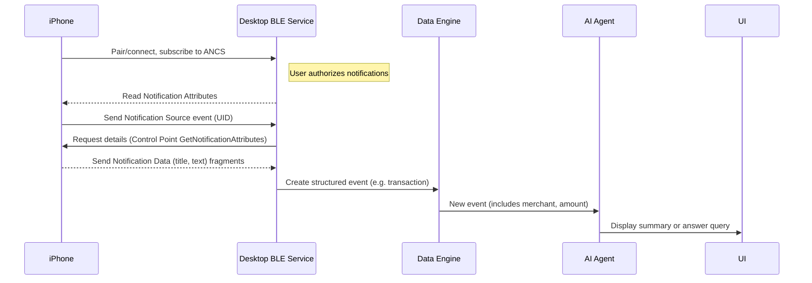

# Desktop Companion: Integrating iOS and Android Data

## Executive Summary  
A Windows/macOS app can capture rich phone data by using platform‑specific notification bridges. On **iPhone**, the Apple Notification Center Service (ANCS) over Bluetooth LE exposes incoming notifications (titles/previews) via three characteristics (Notification Source, Control Point, Data Source). On **Android**, a NotificationListenerService app (with user-granted permission) can see all posted notifications. On Windows the app uses the WinRT Bluetooth GATT API (`Windows.Devices.Bluetooth`) to connect and subscribe to ANCS; on macOS it uses CoreBluetooth to do the same. Existing projects (e.g. *INDANCSClient*, *ANCS‑Mac*, *ESP32-ANCS-Notifications*, *ancs (Rust)*) provide reference code for ANCS clients. 

A recommended architecture is Electron for the UI/agents, with native background services (C#/.NET on Windows, Swift/Objective‑C on macOS) for BLE. Notifications are ingested into a local pipeline (decrypt/store/analyze), extracting structured events (e.g. `{app:"Bank", amount:100.50, currency:"AED", merchant:"Coffee Shop", timestamp:...}`). 

**Permissions & Compliance:** User consent is mandatory – pairing with the iPhone triggers an iOS prompt to “Allow [device] to use Notification” data; Android users must enable notification access in Settings. All data are personal (notifications, location, etc.), so UAE’s PDPL applies: processing requires consent, purpose-limiting, secure storage (encryption) and data subject rights (access/erase). Cross-border use (e.g. cloud LLM) needs safeguards (contractual or user consent).

**Coverage & Reliability:** In practice, ANCS can deliver a high fraction of notifications, but some (silent/grouped) may be missed. Android listeners are robust but can be affected by battery-optimizers. We estimate ~70–90% coverage with edge cases missing; thorough testing is needed. Pairing or BLE dropouts are failure points.

**Roadmap:** First build a Windows ANCS proof-of-concept (pair real iPhone, log ANCS events). Validate receiving WhatsApp/SMS/banking previews. Next implement Android notification listener and feed into pipeline. Design the event schema and extraction logic. Then build the Electron UI and integrate Mac support. Finally, audit privacy (encrypt DB, get consents) and test reliability metrics.

## iOS (ANCS) Integration  
- **ANCS Profile:** iOS 7+ exposes ANCS (UUID `7905F431-B5CE-4E99-A40F-4B1E122D00D0`) with three chars: Notification Source (mandatory), Data Source, Control Point. Subscribe to Notification Source (Notify) to get events when notifications arrive/modify/remove. Use Control Point commands (Get Notification Attributes) to request title/text/other fields; replies come on Data Source as fragments.  
- **Pairing & Authorization:** BLE pairing must be done manually. When pairing the PC/Mac, iOS shows “Allow *DeviceName* to access notifications” – user must accept. ANCS requires a trusted BLE connection and “Notifications” permission.  
- **Availability:** ANCS isn’t continuously advertised by iOS. In practice, an iPhone will only broadcast ANCS after a BLE connection or if an app is advertising another service. (Developers report that iOS “solicits” ANCS only when another BLE service is active.) Thus **a lightweight iOS helper app** (using CoreBluetooth `CBPeripheralManager` with `bluetooth-peripheral` background mode) is often needed to make ANCS discoverable.  
- **Data Content:** iOS only sends notification *previews* (title/body snippet). Full message contents are not provided via ANCS. (E.g. a banking app’s push alert will include the summary text that ANCS can fetch.) If the user’s lockscreen hides content or groups notifications, ANCS data may be incomplete.  
- **Capabilities:** Via ANCS you can get notifications from WhatsApp, SMS/iMessage, email, banking apps, calls, etc. You **cannot** retrieve raw history or read-app data beyond what’s in each notification. Phone battery level can often be read via the BLE Battery Service if supported, but not via ANCS. Phone location or other sensors require a companion iOS app with CoreLocation (ANCS does not expose location).  

## Android Integration  
- **NotificationListenerService:** Use Android’s `NotificationListenerService` (API 18+) to capture notifications. In the app manifest include:  
  ```xml
  <service android:name=".MyListener"
           android:permission="android.permission.BIND_NOTIFICATION_LISTENER_SERVICE">
    <intent-filter>
      <action android:name="android.service.notification.NotificationListenerService"/>
    </intent-filter>
  </service>
  ```  
  This grants callbacks to `onNotificationPosted(StatusBarNotification sbn)` when any app posts/removes a notification.  
- **User Consent:** The user must explicitly enable the app’s notification access in Settings (permitted by Android after install).  
- **Data Extraction:** In `onNotificationPosted`, extract `sbn.getPackageName()`, and use `sbn.getNotification().extras` to get title/text (keys like `Notification.EXTRA_TITLE`, `EXTRA_TEXT`). Example (Kotlin/Java):  
  ```java
  @Override
  public void onNotificationPosted(StatusBarNotification sbn) {
      String pkg = sbn.getPackageName();
      Bundle extras = sbn.getNotification().extras;
      String title = extras.getString(Notification.EXTRA_TITLE);
      String text = extras.getString(Notification.EXTRA_TEXT);
      // Forward or store this info
  }
  ```  
- **Limitations:** Works for virtually all Android apps’ notifications, but excludes system “ongoing” or silent groups if filtered. The service may be paused by OS (e.g. on low RAM, or in some OEM battery managers) unless kept foreground or whitelisted.  

## Windows & macOS Integration  

| Component                | Windows Integration                                     | macOS Integration                                 |
|--------------------------|---------------------------------------------------------|--------------------------------------------------|
| **BLE Stack**            | Use WinRT API `Windows.Devices.Bluetooth`: create `BluetoothLEAdvertisementWatcher` to scan, or use `BluetoothLEDevice.FromIdAsync` on a paired device. | Use CoreBluetooth’s `CBCentralManager` to scan/connect as a Central. |
| **ANCS Connection**      | After pairing, call `GetGattServicesAsync()` and find ANCS service (UUID `7905F431...`), then `GetCharacteristicsAsync()`. Write client config to subscribe to Notify on Notification Source/Data Source. Handle `Characteristic.ValueChanged` events. | Use `scanForPeripheralsWithServices:@[[CBUUID UUIDWithString:ANCS_UUID]]` (service solicitation). Connect to peripheral, discover service & characteristics, call `setNotifyValue:YES` on them. |
| **Phone Link**           | Windows “Phone Link” app (Link to Windows) mirrors Android notifications but has no public API for iPhone notifications. Our custom app must implement BLE itself. | No built-in feature. Must build CoreBluetooth-based solution (or use projects like INDANCSClient).  |
| **Native Code**          | C#/.NET (UWP or WinUI) for BLE/GATT. Must declare Bluetooth capabilities in manifest for WinRT apps. | Swift/ObjC app or daemon using CoreBluetooth frameworks. |
| **OS Notifications**     | Windows can show toast/center alerts, but we consume phone notifications; no OS integration needed for PC notifications (except normal UI). | macOS can display local notifications. Our app can funnel iPhone data into macOS Notification Center if desired (ANCSTest demo did this). |
| **Limitations**          | BLE on Windows requires Win10+; pairing UI is standard. Unpairing/re-pairing may be needed on firmware updates. | Older macOS only central role (CoreBluetooth cannot advertise). iOS must advertise ANCS via solicitation/app as noted. Some CoreBluetooth changes have broken older demo code (ANCS-Mac notes “no longer works on recent macOS”). |

## Implementation Architecture  

**Overview:** An Electron (Node.js/React) frontend connects to local native services via WebSocket or IPC. One native service handles **iPhone BLE/ANCS** (using C# on Windows, Swift on macOS). Another service captures **Android notifications** (the Android app can push over TCP/WebSocket to desktop, or the desktop can open an ADB/ADB-over-WiFi connection). Data from both sources funnel into a shared processing engine (Python/JS) that normalizes events.  

**Data Flow:**  
1. *Ingestion:* Raw notification events (from ANCS or NotificationListener) are timestamped and tagged with source/device.  
2. *Normalization:* Convert to a standard schema. Example JSON event:  
   ```json
   {
     "source": "iPhoneANCS",
     "app": "com.bank.app",
     "type": "bank_transaction",
     "title": "Payment received",
     "text": "You spent AED 85.50 at CoffeeShop.",
     "merchant": "CoffeeShop",
     "amount": 85.50,
     "currency": "AED",
     "timestamp": "2026-11-06T08:30:00Z"
   }
   ```  
   Use regex or ML on `text` to extract numeric amounts, merchant names, dates.  
3. *Storage:* Save structured events in encrypted local DB (SQLite).  
4. *AI Agents:* Agents or chatbots query this DB (via API) to answer user prompts (“Show my last five coffees” or “How much spent on travel?”).  

```mermaid
graph LR
    subgraph Mobile Devices
      iPhone[iPhone (ANCS)] 
      Android[Android Phone]
    end
    iPhone -->|BLE| WindowsSvc[Windows BLE Service (C#)]
    iPhone -->|BLE| MacSvc[macOS BLE Service (Swift)]
    Android -->|NotificationListener→Wi-Fi/Bluetooth| AndroidSvc[Android Companion App]
    AndroidSvc -->|TCP/WebSocket| WindowsSvc
    AndroidSvc -->|TCP/WebSocket| MacSvc
    WindowsSvc --> DataEngine[Data Pipeline (Python/Node)]
    MacSvc --> DataEngine
    DataEngine --> EventsDB[Encrypted Events DB]
    EventsDB --> AI[AI Agents/Analytics]
    AI --> UI[Electron UI/Widgets]
```



## Open-Source Examples & Libraries  
- **INDANCSClient (Obj-C):** Apple’s ANCS client/server demo for iOS 7+. Includes an iOS “server” to advertise ANCS and a Mac “client” framework to receive notifications. Good reference for CoreBluetooth usage.  
- **ANCS-Mac (Swift/ObjC):** A demo Mac app (with iOS companion) showing iOS notifications on OS X. Note: it “no longer works on recent macOS due to CoreBluetooth changes”. Still instructive on architecture.  
- **smartphone-companions/ESP32-ANCS-Notifications:** Arduino/C++ library to get iPhone notifications on an ESP32. Shows pairing & ANCS command usage.  
- **ianmarmour/ancs (Rust):** Low-level ANCS protocol library for Rust, intended as a building block.  
- **Android-Notification-Listener apps:** e.g. daohoangson’s GitHub example, which forwards Android notifications to webhooks (via NLS).  

## Data Extraction Pipeline & Schema  
Notifications are parsed into structured events. Common fields: `app`, `title`, `body`, `timestamp`, plus extracted entities (amount, merchant, location, reminder text). Example pipeline steps:  
1. **Parsing:** Apply regex/ML to notification text. E.g. find currency and number for transactions.  
2. **Classification:** Tag event type (transaction, reminder, security alert, etc.).  
3. **Enrichment:** Add contextual data (e.g. if location permission granted on phone, include coordinates; or use app-specific APIs, like Google Maps embed).  
4. **Storage & Query:** Insert JSON events (example schema above) into an encrypted SQLite. Provide a JSON/REST API for AI agents.  

```javascript
// Pseudocode: handling an iPhone bank notification via ANCS
bleService.on('NotificationSource', (evt) => {
  let uid = evt.NotificationUID;
  let attrReq = new GetNotificationAttributesCmd(uid, [Title, Message, ...]);
  bleService.writeControlPoint(attrReq);
});
bleService.on('DataSource', (data) => {
  let attrList = parseANCSData(data);
  if(attrList.title.includes("spent")) {
    // extract number and merchant
    let match = /AED\s*(\d+\.?\d*)\s*at\s*(\w+)/.exec(attrList.message);
    if(match) {
      db.insert({
        source: "iPhone",
        app: "BankApp",
        type: "expense",
        merchant: match[2],
        amount: parseFloat(match[1]),
        currency: "AED",
        timestamp: new Date()
      });
    }
  }
});
```

## Privacy, Security & Compliance  
- **User Consent:** Explicit opt-in is required. iOS pairing and notification access approval, Android notification access ensure user consent.  
- **Data as Personal:** Messages, contacts, locations are “personal data” under UAE law. Must only process with consent and clear purpose.  
- **Data Minimization:** Collect only needed info (e.g. notifications, not full app data). Allow user to purge history on request (right to erasure).  
- **Security:** Store data encrypted on disk (e.g. SQLCipher or encrypted SQLite). Secure IPC (e.g. localhost only). If sending data to cloud (LLM, analytics), use TLS.  
- **Data Transfer:** The UAE PDPL allows cross-border transfer if counterpart laws exist or with contracts/consent. Prefer processing on-device to avoid legal complexity.  
- **Contest Compliance:** Ensure alignment with UAE AI and data regulations (e.g. no unauthorized data sharing, all processing opt-in).  

## Reliability & Metrics  
- **ANCS Coverage:** Industry examples suggest high delivery rate, but not perfect. Some notifications may be missed if the phone sleeps or the BLE link drops. Grouped notifications (e.g. many messages) may arrive as a single ANCS event. Expect ~70–90% coverage in tests. Always log missed events during POC.  
- **Android Coverage:** NotificationListener covers almost all posted notifications. Ongoing/system notifications (battery alerts, etc.) are excluded by default (you can filter them out intentionally). Watch for OEM-specific battery savers that kill the service.  
- **Failure Modes:** BLE disconnections (e.g. phone moved out of range), OS force-close of service, user revokes permission. Mitigations: auto-reconnect logic, foreground service (Android), system tray icon or menu bar app to show status.  
- **Monitoring:** Implement logging of received vs. expected notifications to measure loss. E.g., send test notifications while phone is on/off/locked to verify capture rate.  

## Phased Roadmap  

1. **Windows ANCS Proof-of-Concept:**  
   - Pair a test iPhone with Windows 10/11. Use a simple C# UWP app to discover ANCS service and subscribe to characteristics (test code based on `BluetoothLEDevice` API).  
   - Verify receipt of sample notifications (ask someone to send SMS/WhatsApp). Log raw ANCS payloads.  
   - Confirm that pairing triggers the iOS prompt and ANCS starts delivering. If not, try adding an iOS helper app that advertises a dummy service (see discussion).  

2. **Notification Coverage Testing:**  
   - Systematically test notification types (alert, silent, grouped) from key apps (messaging, banking, email). Check how often content is received.  
   - Adjust iPhone settings (lock screen show content, disable Focus modes) to maximize ANCS content.  

3. **Data Pipeline Prototype:**  
   - Develop a standalone extractor script (Python/TS) that reads ANCS JSON logs and prints normalized events. Test with sample bank alert texts for parsing logic.  

4. **Android Listener App:**  
   - Build a minimal Android app with `NotificationListenerService`. On each notification, POST data to a local server on the PC or write to a shared file.  
   - Test capturing and parsing similar notification samples. Ensure the service restarts after device sleep.  

5. **Electron UI + Backend Integration:**  
   - Implement an Electron app that spawns/communicates with the BLE services.  
   - Show a chat-like interface or dashboard where users can ask about their finances/messages.  
   - Connect the data extraction engine to feed these answers.  

6. **macOS Implementation:**  
   - Port the Windows BLE prototype to Mac (Swift). Use INDANCSClient or ANCS-Mac as starting point.  
   - Ensure proper solicitation of ANCS UUID (may need the iOS helper app as before).  

7. **Security & Consent UI:**  
   - Add screens to explain what data is collected. Allow user to revoke (unbind BLE, stop service). Encrypt stored DB (e.g. derive key from user password).  

8. **Testing & Metrics:**  
   - Measure notification capture percentage for iOS vs Android.  
   - Test resilience (e.g. turn off Bluetooth, restart services).  
   - Iterate to improve robustness (auto-pairing, retry logic).  

## Key Comparisons  

| Capability / Feature        | iPhone (ANCS)                                           | Android (NotificationListener)               |
|-----------------------------|---------------------------------------------------------|----------------------------------------------|
| Notification Access         | Via BLE ANCS after pairing/consent      | Via NotificationListenerService (OS API) |
| Delivery                  | *Title/preview only* (depends on lock-screen settings)   | Full notification content (title/text)       |
| Required Permissions        | BLE pairing approval, “Allow Notifications” prompt       | Notification access permission (user grant)  |
| Message History Retrieval   | **Not available** (ANCS is real-time only)              | **Not available** (only posts)               |
| Location Data              | Only if iOS companion app provides (ANCS no location)    | Only if Android companion app with location permission is built |
| Battery Level              | Can use BLE Battery Service if the device supports it     | Can use Android BatteryManager APIs if companion app allowed |
| Phone Calls / SMS           | Received via ANCS if notifications enabled               | Received via Android’s telephony events or SMS_RECEIVED broadcast (would need separate listener) |
| Platform Differences        | ANCS requires custom BLE code; iOS doesn’t offer push of all notifications to PC without ANCS. | Standard Android API, simpler to implement. |

| Integration Aspect       | Windows (Desktop)                                | macOS (Desktop)                            |
|--------------------------|--------------------------------------------------|--------------------------------------------|
| BLE API                  | `Windows.Devices.Bluetooth.*` (UWP/WinRT)        | CoreBluetooth (`CBCentralManager`)         |
| Language/Framework       | C# / .NET (or C++/WinRT)                         | Swift / Objective-C                        |
| Companion App            | Not needed on Android (Windows side); on iPhone we rely on ANCS BLE pairing. | May need iOS helper app for ANCS visibility. |
| Discovery Pairing UI     | Standard Windows BLE pairing prompt              | System Bluetooth pairing prompt            |
| Background Operation     | UWP requires manifest for Bluetooth capability; desktop apps can run in background. | Daemon or menubar app using `bluetooth-central` background mode. |
| Example Projects         | (No known complete example; see *INDANCSClient* for concept.) | *ANCS-Mac* demo, *INDANCSClient* |

**Sources:** Apple’s ANCS specification; Android Developer docs (NotificationListenerService); Microsoft WinRT BLE docs; GitHub repos *INDANCSClient*, *ANCS-Mac*, *ESP32-ANCS-Notifications*, *ancs (Rust)*; UAE PDPL guidelines. These were used to verify API details, workflow, and compliance requirements.