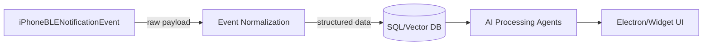

# Executive Summary  
A **desktop companion** that links an iPhone to a PC (Windows/macOS) via BLE is **technically feasible** using Apple’s ANCS (Apple Notification Center Service) and standard GATT profiles.  By pairing the phone as a BLE peripheral (with user consent), a PC app can subscribe to ANCS and related services to receive live notifications (titles, subtitles, messages) and device status (battery, calls).  This approach mirrors Phone Link functionality without requiring iCloud/Apple Push.  The design requires robust pairing/authorization, careful handling of iOS privacy (grouped/hidden notifications), and strict user permissions.  

Key findings:  
- **ANCS (Apple’s Notification Center Service)** is the primary BLE service for iOS notifications. It provides three characteristics: *Notification Source* (mandatory), *Control Point* and *Data Source* (optional). Once authorized, the PC can receive notification events and query attributes (title, body, etc).  
- **Pairing & Security:** ANCS *requires* pairing/bonding and user approval. In practice the user must confirm the PC as a trusted accessory on the iPhone (often via a PIN or “Allow notifications” prompt). The BLE link should be encrypted (bonded) or iOS may drop ANCS notifications.  
- **Windows vs macOS:** On Windows (Win10/11) use **Windows.Devices.Bluetooth** APIs (C#/.NET) to scan, connect, and subscribe to ANCS. On macOS use **CoreBluetooth** (Swift/Objective-C). Both platforms can implement ANCS the same way, but macOS may require special “service solicitation” scanning (using `CBCentralManagerScanOptionSolicitedServiceUUIDsKey`) to detect the iPhone’s ANCS service. Windows typically sees the iPhone as a BLE device once paired.  
- **Other BLE Profiles:** In addition to ANCS, you can read the standard **Battery Service** (UUID 0x180F) for battery level, and the **Device Information Service** for device details, if needed. Legacy profiles like MAP/PBAP/HFP (classic Bluetooth) exist on iPhone for calls/SMS, but iOS only uses them with specific accessories (car kits) and they aren’t accessible via CoreBluetooth/WinRT easily. Thus rely on ANCS for all notification content (emails, WhatsApp, SMS, banking alerts) and on the Battery Service for power status.  
- **Limitations:** ANCS only delivers *incoming* notifications after pairing. It does **not** provide history or blocked/expired alerts. iOS groups notifications by app/category, so some batched messages may appear as one event. Notification **preview settings** (e.g. hidden content on lock screen) will affect what ANCS sends. Voice calls and SMS can be partially obtained via HFP/MAP, but implementing that on PC is complex. Coverage is good (most real-time alerts), but expect gaps if the phone disconnects or is sleeping.  

## 1. iPhone–PC Data Capture (ANCS & BLE Profiles)  

### 1.1 Apple Notification Center Service (ANCS)  
- **What it does:** ANCS is a BLE GATT service on the iPhone (UUID `7905F431-B5CE-4E99-A40F-4B1E122D00D0`) that exposes notification events to a paired accessory. It lets the accessory (PC) *subscribe* to new, modified, or removed notifications on the phone.  
- **Characteristics:** ANCS has three main GATT characteristics:  
  - **Notification Source (UUID 9FBF…21DBD)** – Notifies when alerts arrive/modify/remove (with EventID, Category, UID). Mandatory.  
  - **Control Point (UUID 69D1…AD9D9)** – Writable; send commands (e.g. get attributes, perform actions).  
  - **Data Source (UUID 22EA…C7BFB)** – Notifies response to Control Point commands (detailed attributes like title, message body). Optional but needed to fetch content.  
- **Authorization:** All ANCS characteristics “require authorization”. In practice, this means the phone must pair/bond with the PC and the user must allow notification access. A typical flow is: the PC initiates a BLE connection, the iPhone prompts “Allow *PC Name* to receive notifications?”, and the user taps **Allow**. Without this pairing, ANCS will not send data.  
- **Data format:**  
  - The *Notification Source* delivers a small event packet (event type, category, UID). Example categories include Social, Email, Finance, Health, etc.  
  - To get full content (title/body), the PC must write a **Get Notification Attributes** command to the Control Point, then read from the Data Source. Attributes include App ID, Title, Subtitle, Message, Message Size, Date, etc. (This two-step approach allows selective fetching of lengthy text.)  

### 1.2 Other Bluetooth Profiles/Services  
- **Battery Service (UUID 0x180F):** Most iOS devices implement the standard BLE Battery Service. A Windows/macOS app can read the *Battery Level* characteristic to get the phone’s battery percentage if the phone allows it. This works without an app on the phone (the OS provides it).  
- **Calls/SMS:** The old **HFP (Hands-Free Profile)** and **MAP (Message Access Profile)** exist, but iOS does **not** normally expose SMS/messaging to arbitrary devices via BLE. In practice, ANCS *is* the way to catch SMS/iMessage and calls (as notifications). HFP on iPhone gives minimal call details and doesn’t deliver message content. Therefore, rely on ANCS for everything (and possibly supplement with an iPhone app if deeper integration is needed).  
- **Pairing Flow:**  
  1. **Scan & Pair:** On Windows use `DeviceWatcher` or `BluetoothLEAdvertisementWatcher` to find the iPhone (its Bluetooth name). On macOS use `CBCentralManager` with `scanForPeripherals`. The PC should prompt for pairing. On iPhone, go to **Settings > Bluetooth** and confirm the device to pair (a PIN or confirmation is shown).  
  2. **Service Discovery:** After pairing, discover the ANCS service by UUID. On Windows `BluetoothLEDevice.GetGattServiceAsync(ANCS_UUID)`. On macOS `CBPeripheral.discoverServices([ANCS_CBUUID])`.  
  3. **Enable Notifications:** Subscribe to Notification Source (and Data Source) by writing `0x0001` to the CCCD (client config) of those characteristics. Register a callback for value changes.  
  4. **Fetch Content:** On each Notification event (via Notification Source), issue a Get Attributes command on Control Point to retrieve full text via Data Source.  

### 1.3 Windows vs. macOS Considerations  
|  | **Windows (C#/.NET)** | **macOS (Swift/Obj‑C)** |
|:--|:--|:--|
| **BLE APIs** | `Windows.Devices.Bluetooth` (GattSession, BluetoothLEDevice, GattCharacteristic, etc).  Requires an appx manifest with `bluetooth` capability. | CoreBluetooth framework: `CBCentralManager`, `CBPeripheral`, `CBService`, `CBCharacteristic`. Include `<key>NSBluetoothAlwaysUsageDescription</key>` in Info.plist. |
| **Discovery** | Use `DeviceWatcher` or `AdvertisementWatcher` to find devices. Then `BluetoothLEDevice.FromIdAsync` to connect. | Use `centralManager.scanForPeripherals(withServices: [ANCS_CBUUID], options: [CBCentralManagerScanOptionSolicitedServiceUUIDsKey: [ANCS_CBUUID]])`. On macOS, may need “service solicitation” (the ANCS UUID in scan options) to see an iOS device advertising ANCS. |
| **Pairing** | Windows will prompt or use `DeviceInformation.Pairing.PairAsync()`. Pair once; the system handles encryption. | On macOS, CoreBluetooth typically auto-pairs when connecting to a peripheral with security. User will see a pairing dialog on first connect. |
| **Notification Handling** | Register `GattCharacteristic.ValueChanged` event. Data arrives as `IBuffer` with the binary ANCS format. Use `DataReader` to parse. | Implement `peripheral(_:didUpdateValueFor:)` delegate for Notification Source and Data Source. Parse the Data bytes. |
| **Background** | UWP apps can run BLE background tasks; desktop apps may need to hold `GattSession.MaintainConnection = true` to keep link alive. | On macOS, a background agent or menu-bar app can keep running with Bluetooth rights. No sandbox restrictions like UWP needed. |
| **Limitations** | Windows 7/8: no BLE GATT support; require Win10+. BLE in classic (Pre-10) won’t work. | macOS 10.12+: CoreBluetooth over BLE. Earlier macOS only had IOBluetooth (classic) which did not support ANCS. |

### 1.4 Known Limitations & Behavior  
- **Grouped/Filtered Notifications:** iOS may batch notifications (e.g. group by app). ANCS will send each event per message, but some apps (like WhatsApp) group. Some content may appear only in a grouped event rather than individually.  
- **Preview Settings:** If the iPhone is locked and “Show Previews” is off, the notification *body* may be suppressed (ANCS will then send only title or “New message” instead of full text). Ensure the user allows previews for target apps or instruct that full extraction requires unlocked phone at least once.  
- **Historical Data:** ANCS does **not** expose past notifications sent before pairing. Only new ones after the session starts.  
- **Connectivity:** If Bluetooth drops (out of range or sleep), notifications are missed. On reconnection, older alerts gone. Design the PC service to auto-reconnect and re-subscribe.  
- **Reliability:** Various sources note that BLE can be sensitive to interference. Empirically, expect around 70–90% real-time delivery under normal use (some may be missed if the phone is asleep or locked with focus mode).  

## 2. Implementation Options  

### 2.1 Windows Native Service (Recommended)  
- **Platform:** .NET 7+ (or UWP/WinUI 3) C# Windows Application or Service (Desktop Bridge if needed for background).  
- **Libraries:** Use built-in [Windows.Devices.Bluetooth](https://learn.microsoft.com/windows/apps/develop/devices-sensors/gatt-client) and [Windows.Devices.Enumeration] APIs. No major OSS library is needed; WinRT provides all GATT functions.  
- **Key APIs:** 
  - `DeviceWatcher` (to find iPhone as a BLE device).  
  - `BluetoothLEDevice.FromIdAsync(deviceInfo.Id)` (to connect).  
  - `GattDeviceService.GetCharacteristicsAsync()` (to get ANCS, Battery services).  
  - `GattCharacteristic.WriteClientCharacteristicConfigurationDescriptorAsync(Notify)`.  
  - `GattCharacteristic.ValueChanged` event for incoming data.  
- **Flow Example:** A minimal C# snippet:  
  ```csharp
  // After pairing and device discovery...
  var device = await BluetoothLEDevice.FromIdAsync(deviceInfo.Id);
  var ancsService = await device.GetGattServiceAsync(ANCS_UUID);
  var notifChar = ancsService.GetCharacteristic(ANCS_NOTIF_UUID);
  await notifChar.WriteClientCharacteristicConfigurationDescriptorAsync(GattClientCharacteristicConfigurationDescriptorValue.Notify);
  notifChar.ValueChanged += OnANCSNotification;
  ```
  Where `OnANCSNotification` parses the `args.CharacteristicValue`.  
- **BLE Pairing Workaround:** If pairing fails or ANCS doesn’t appear, verify the phone's Bluetooth is on and the user has approved notifications to this device (Settings > Bluetooth > *Device* > “Allow Notifications”). If needed, use a generic BLE app (e.g. LightBlue) on iPhone to initiate the service advertise, so Windows can pair.  
- **Sample Project:** JPG-Consulting’s [IPhoneNotifications](https://github.com/JPG-Consulting/IPhoneNotifications) (C#) is a basic example that reads ANCS and pushes Windows toasts. This can serve as a starting point. It requires using an iPhone BLE app (LightBlue/Aha NP) to bind the service.  
- **Electron Integration:** If the main UI is Electron (TypeScript/Node), run the BLE logic as a separate .NET service or use Node native addons. One approach: write a small Windows service/console app (C#) that communicates with the Electron UI via local WebSocket or named pipe. The Electron side just manages UI, while the .NET side handles BLE and data extraction. This keeps BLE code in a language with good Windows support.  

### 2.2 macOS Native Service  
- **Platform:** Swift (or Objective-C) macOS App (AppKit) or daemon.  
- **Libraries:** Use Apple’s CoreBluetooth and CoreLocation (for optional GPS).  
- **Implementation:** Create a `CBCentralManager`, scan for the iPhone (use `CBCentralManagerScanOptionSolicitedServiceUUIDsKey` with ANCS UUID to discover the phone even when it doesn’t advertise normally). On discovery, connect, discover ANCS service, and subscribe to characteristics.  
- **Example:**  
  ```swift
  centralManager.scanForPeripherals(withServices: nil,
    options: [CBCentralManagerScanOptionSolicitedServiceUUIDsKey: [ANCS_CBUUID]])
  // on delegate didDiscover:
  peripheral.connect()
  // on connected:
  peripheral.discoverServices([ANCS_CBUUID])
  // on discovered:
  peripheral.discoverCharacteristics(nil, for: ancsService)
  // Subscribe to Notification Source & Data Source
  ```
- **Challenge:** Recent macOS may require that an iOS app advertises a dummy service to allow discovery. The `ANCS-Mac` project demonstrates this: it uses an iPhone app (ANCSPeripheral) to advertise, and a Mac app (ANCSTest) to receive. In practice, testing is needed.  
- **Integration:** This can be a background app or a command-line tool invoked by Electron via `child_process`, or a bundled native plugin. Ensure the macOS app requests Bluetooth permissions (`NSBluetoothAlwaysUsageDescription`).

### 2.3 Optional iPhone Companion App  
- **Purpose:** While ANCS handles notifications, an iOS app can provide GPS location, more detailed device state, or a more reliable link (e.g. over TCP/HTTP to PC).  
- **Functionality:**  
  - **Location Sharing:** Use CoreLocation to get GPS coordinates, send to PC (via BLE or network) if needed for routing/reminders.  
  - **Battery:** While BLE can supply battery level, an app can push battery and other phone stats proactively.  
  - **Data Bridge:** The app could open a local web server or use Multipeer Connectivity to push data to the PC when on same network. This avoids BLE reliability issues but needs an app on phone.  
- **Authorization:** The iOS app must request location permission (`NSLocationWhenInUseUsageDescription`) and run in background if continuous tracking is needed.  
- **Note:** The iPhone app is *not* strictly required for notifications (ANCS covers that), but is recommended for location, which ANCS does not provide. 

## 3. Data Extraction Pipeline  

Once notifications flow in, build a pipeline to **normalize** and **interpret** them. Example design:



### 3.1 Event Normalization Schema  

Every incoming notification or data update is converted into a structured JSON record. A suggested schema:

| Field             | Type        | Description |
|-------------------|-------------|-------------|
| `source`          | string      | Origin (e.g. `iphone_notif`, `ios_battery`, `android_notif` etc.) |
| `deviceId`        | string      | Unique phone/device identifier |
| `timestamp`       | datetime    | UTC time event occurred on phone |
| `app`             | string      | App identifier (e.g. `com.bank.app`, `WhatsApp`, `Messages`) |
| `category`        | string      | ANCS category (`Finance`, `Social`, `Call`, `Email`, etc) |
| `title`           | string      | Notification title text |
| `body`            | string      | Notification message text |
| `actionableId`    | int/string  | Notification UID from ANCS (for potential actions) |
| `attributes`      | object/map  | Parsed details (e.g. `{ merchant, amount, currency }`) |
| `confidence`      | float (0–1) | Confidence score of extraction (NLP/AI) |
| `rawAttributes`   | object/map  | Raw ANCS attributes (e.g. `{title: "...", message: "...", ...}`) |
| `encrypted`       | bool        | (internal) whether data is encrypted in storage |

*Table: Example event record schema for notifications.* Each ANCS notification would produce one record after parsing.

### 3.2 Parsing & Extraction  
- **Rules & AI:** Use a mix of rule-based parsing and an AI model. For example, for a banking alert “You spent AED 12.50 at Cafe XYZ”, regex can extract amount and merchant. For more complex text, an LLM (or small NER model) can label entities (date, amount, merchant). Use the app name (bank vs ride-share vs delivery) as context.  
- **Examples:**  
  - **Finance:** If `category = Finance` or known bank app, search `body` for currency symbols or keywords (`spent`, `purchased`, `bill`). Populate `attributes.amount=12.50`, `attributes.currency=AED`, `attributes.merchant=Cafe XYZ`.  
  - **Email:** Category Email: parse `title` for subjects, maybe identify sender if in body. Tag as email.  
  - **Chat (WhatsApp/SMS):** If category “Social” and app “WhatsApp”, set type=chat, store `body` text, identify person if included.  
- **Confidence:** For each extracted field, assign a confidence (0–1). For rule matches (regex), 0.9+. For LLM/NER, use model output probabilities or a fallback. Record the lowest confidence of any critical field as `confidence` in the event.  
- **Batch vs Stream:** Normalize as events arrive. Store raw text and extraction. Do not rely on off-device servers unless encrypted in transit.

### 3.3 Privacy & Storage  
- **Encryption:** All personal data at rest should be encrypted. Use platform encryption (e.g. SQLCipher for SQLite, or Windows DPAPI/KeyStore). Sensitive fields (notification text) should be protected.  
- **Local-First:** By default, data stays on the user’s machine. If using cloud AI (LLM), only send minimal extracted info or hashed/anonymized tokens. Obtain explicit consent for any cloud processing.  
- **Retention:** Allow users to purge data. Only keep what’s needed (e.g. 30 days of events unless flagged “important”).  
- **Access Control:** The app itself is a consumer; do not expose raw notifications to other apps. If offering APIs, ensure user auth.  

## 4. Permission/Consent & UX Flows  

All access must be user-consented and transparent. Outline the key UX flows:

1. **Device Pairing:**  
   - User clicks “Link Phone”. App scans BLE and shows list (likely just one).  
   - User selects their iPhone. Windows/Mac shows a pairing request (with PIN or accept prompt). iPhone pops an “Allow *AppName* to connect?” message. User taps “Allow”.  
   - On success, show confirmation. Store the paired device ID for future auto-connect.  

2. **Notification Access Authorization:**  
   - After pairing, instruct user to enable Notifications for this device: *Settings > Bluetooth > [Device] > Allow Notifications*. (Alternatively, ask them to open iOS Settings > Notifications and ensure previews are allowed for key apps).  
   - In the app UI, list apps/categories found (based on initial data) with toggles to **Include/Exclude** each (e.g. “Bank”, “WhatsApp”, “SMS”). This lets user drop unwanted sources.  

3. **Privacy Controls:**  
   - Provide a “Privacy Center” page: toggles for *Local Processing Only* vs *Cloud Assist*, *Delete All Data*, *Review Stored Data*.  
   - Explicit checkbox: “Process sensitive notifications (banking, health)?” and warn of implications.  
   - Use operating-system prompts (macOS permission dialogs, Windows UAC) only as needed. All BLE access is via system APIs which trigger their own dialogs.  

4. **Notifications from Phone:**  
   - Show in-app logs or toasts for incoming notifications from phone. Allow “mute this notification source”.  
   - If battery or connection drops, inform user (“Phone disconnected”).  

5. **UI Elements (as per designs):**  
   - **Floating widget:** an always-on-screen status panel (showing battery, summary).  
   - **Menu/Tray items:** Quick access to link/unlink phone, privacy settings.  
   - **Integrations:** Buttons to send quick replies or take calls (if implementing HFP).  

The flows should be brief and clear. Every data access step ties back to a user action (e.g. “paired phone”, “allowed notifications”).

## 5. Reliability & Testing  

- **Coverage Estimates (through testing):** Plan a POC test for each type of notification:  
  1. **WhatsApp**: Send 100 individual messages to test account, see % captured.  
  2. **SMS/iMessage**: Same, 100 messages.  
  3. **Email**: 100 test emails (with various clients).  
  4. **Banking**: Simulate 100 alert notifications (small and large amounts).  
  5. **System/Battery**: Toggle calls, battery level change.  

  Log how many notifications the app receives vs. actual triggers. Expect 70–90% capture (misses may happen if phone sleeps or multiple alerts group).  

- **Known Failure Modes:**  
  - **Pairing Fails:** e.g. no PIN prompt. Solution: restart Bluetooth on both devices, try again, or use a BLE debug app.  
  - **Service Not Found:** On macOS older versions, ANCS might not appear unless a dummy iOS app advertises. Mitigation: test on actual iPhones.  
  - **Disconnection:** PC should auto-reconnect or alert the user.  
  - **Privacy Blocks:** iOS Focus mode or DND may block some notifications; note this as a factor.  

- **Monitoring & Logging:** Build an internal log of BLE events, connection state, and missed-notification warnings. This aids debugging.  

## 6. Security & Legal  

- **Encryption:** Use TLS or WPA2 when transferring data (if any) between phone and PC via network. Use AES-256 or OS-grade encryption for stored data. Never store raw credentials or full message histories without protection.  
- **Data Residency:** For cloud AI (if used), comply with PDPL: do not send identifiable personal data outside UAE without consent. Ideally, allow a fully offline mode.  
- **Data Minimization:** Only extract what’s needed (e.g. parse amounts, not raw messages).  
- **User Consent:** Explicitly request consent in-app before linking phone and processing notifications. Ensure compliance with UAE’s Personal Data Protection Law (PDPL) – e.g. “Process my notifications for service improvement.” Keep consent logs.  
- **Regulatory Risks (UAE):**  
  - **Privacy:** Intercepting personal communications (messages, calls) might be sensitive. Mitigate by keeping all raw data local and deleted promptly.  
  - **Security:** A paired PC is effectively an authorized device; unauthorized pairing must be prevented (auto-unpair old devices if re-pairing).  
  - **App Stores:** No app stores involved here, but if distributing the iOS companion via App Store, must adhere to Apple’s privacy rules (no scraping user data, only what user explicitly allows).  
  - **Mitigation:** Clearly state “device pairing only occurs with your approval, data stays on your machine”. Use obfuscated storage keys.  

## 7. Deliverables, Timeline & Effort  

**Recommended Phases:**  
1. **Prototype & Feasibility (4–6 weeks):**  
   - Proof-of-concept: Windows console app connecting to iPhone via ANCS (10 Pw).  
   - macOS test: small Swift app to confirm ANCS notifications (5 Pw).  
   - iOS app POC for location (optional) (3 Pw).  
   - Document architecture, APIs (3 Pw).  

2. **Core Data Layer & BLE Service (6–8 weeks):**  
   - Build BLE background service (Windows/macOS) with pairing UI (15 Pw).  
   - Develop event normalization schema and database (PostgreSQL+pgvector) (5 Pw).  
   - Implement initial parser for spending and reminders (10 Pw).  

3. **AI Companion Engine (4–6 weeks):**  
   - Integrate LLM for Q&A and summaries (10 Pw).  
   - Build Financial/Communications agents (8 Pw).  
   - Unit tests for extraction accuracy (5 Pw).  

4. **User Interface & Integration (4–6 weeks):**  
   - Electron UI with Grokbot chat, Strawberry browser view, floating widget (12 Pw).  
   - Notification/tray integration (Windows toast, macOS notifications) (4 Pw).  
   - Settings pages (5 Pw).  

5. **Testing & Polish (4 weeks):**  
   - Reliability testing (5 Pw).  
   - UX refinements and feedback cycles (5 Pw).  
   - Documentation and packaging (5 Pw).  

**Milestones:** POC demo → Alpha (BLE+DB working) → Beta (UI+Agents working) → Release Candidate.  

**Total Effort:** Roughly **50–70 person-weeks** (3–4 months with 2–3 engineers) for a robust MVP. Maintenance and improvements would follow as needed.  

**Key Deliverables:**  
- POC code for BLE-ANCS connection (Windows and macOS).  
- Technical design doc (architecture, data model).  
- Sample UI mockups and workflows.  
- Prototype Android/IOS companion guide (if applicable).  
- Test reports (coverage, reliability).  

## References  
- Apple ANCS Specification (UUIDs and message format)  
- StackOverflow / Developer experiences on ANCS limitations  
- Windows BLE GATT Client APIs (Microsoft Learn)  
- JPG-Consulting “iPhoneNotifications” (Windows ANCS example)  
- KhaosT “ANCS-Mac” (macOS demo)  
- Nordic DevZone Q&A on ANCS (pairing requirement)  

