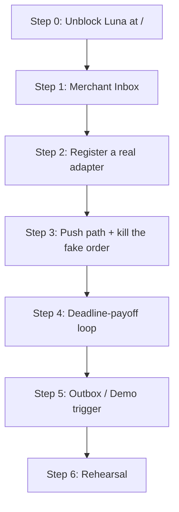

# Dubai-io — Engineering & Product Review: Next Steps
**Review of:** `docs/DUBAI-IO_Product_Enhancement_Review.md`  
**Reviewer:** Gemini (Autonomous Systems & Full-Stack Architecture Review)  
**Date:** 19 October 2026  
**Context:** Create AI Agents Championship — Contest MVP Build

> ## ⚠️ Repo status corrections — read before acting on this file
>
> **This review was written against the pre-refactor tree. Its product verdict still holds; its file paths, entry points and technical claims about the code are partly wrong and have been corrected inline. Sections already reconciled are marked `✅ reconciled`.**
>
> **What changed since this was written (commit `678c083`, "refactor: clean monorepo structure"):** the legacy `demo/` folder was **deleted entirely**. There is no `demo/lab/`, no `demo/index.html`, no `demo/_ref/`. Everything moved to `apps/web/` (frontend) and `apps/api/` (backend), with `design/references/` and `design/screens/` replacing the old `screens/` assets. `PLAN.md §7.1` confirms: "HTML web app first (`apps/web/`…); Vite + React second."
>
> **Also newly verified since this review (do not skip — these change the plan below):**
> 1. **There is no merchant inbox anywhere** — not in `apps/web`, not in `apps/api`. This review's Step 4 assumed one existed.
> 2. **No adapter is registered.** All eight capabilities in `apps/api/app/actions.py:63-70` have `adapter=None`, so `prepare` always returns `BLOCKED`.
> 3. **There is no push path.** `rg 'EventSource|WebSocket|BroadcastChannel|poll' apps/web` → **0 hits**. No SSE, no polling.
> 4. **Luna is gated off at the main entry point.** `apps/web/chat.js:18` reads `enabled: location.pathname.startsWith('/lab/')`, so at `http://localhost:8000/` every turn silently falls back to the keyword router. Fix this first — see §5 Step 0 below.
> 5. **The demo's primary approval card is simulated.** `apps/web/offers.js:201-225` approves with **zero network calls** and then fabricates `ACCEPTED` / `SLOT_CONFIRMED` via `setTimeout`.
>
> Tests today: `pytest -q tests` → **40 passed, 11 skipped** (the 11 are live Luna golden cases gated on `RUN_LIVE=1`). Node: **107 checks across 3 files** (`profile` 92, `recovery` 8, `luna-client` 7).
>
> Full reconciliation: [`docs/space-bunny_review.md`](space-bunny_review.md) §4. Current status of record: [`docs/handoff.md`](handoff.md).

---

## 1. Executive Summary & Verdict

The product enhancement document (`DUBAI-IO_Product_Enhancement_Review.md`) is an **exceptional, high-rigor strategic analysis**. It succeeds at the most difficult task in hackathons and AI competitions: **protecting the project from catastrophic scope bloat, ungrounded technical claims, and legal exposure**, while preserving the emotional hook of the presentation.

### Primary Verdict:
* **Adopt:** The *Truth in Status* doctrine, the *Single Verifiable Agent Proof* (§10.4), the *4-minute staged narrative* (§2.2), and the *Telemarketing/Compliance Hold* (§8).
* **Trim / Defer:** The complex multi-tier enterprise support desk (§7), generic PDF/Docling ingestion pipelines (§5.2), and multi-partner e-commerce protocols (Noon/Amazon L4). These are post-contest enterprise features that will dilute engineering momentum.
* **Immediate Technical Unification:** Consolidate around the active Wi-Fi arrival app (**`apps/web/`** — was `demo/lab/`) and the FastAPI backend (`apps/api/`), retiring the obsolete v1 prototype (was `demo/index.html`, now deleted). ✅ **Done** — commit `678c083`.

---

## 2. Critical Analysis of Key Sections

### 2.1 Stage Narrative vs. Demonstrable Proof (§2 & §10.4) — **Rating: 10/10**
* **The Insight:** The document brilliantly delineates between the **Cinematic Story** (7-day visitor arc: DXB arrival, lost ID, haircut, laundry, parking fine twist) and the **Verifiable Agent Proof** (a live, bounded interaction on stage).
* **Why this matters for Judges:** Championship judges immediately penalize teams claiming to have live integrations with government portals (Dubai Police, RTA) or closed platforms (Uber, Noon) when they clearly do not.
* **The Anchor Proof:** Demonstrating a single real flow—*Voice/Text Request → Luna Structured Extraction → Single User Approval Card → Pilot Merchant Inbox → Live Chat Status Update*—proves genuine agency without external dependencies.

> **Correction (19 Oct):** "Webhook/Socket" was wrong for a self-hosted sandbox merchant. There is no external service to push from. The correct shape is **server-mediated and polled or SSE'd within our own process** — the merchant taps Accept in a second surface, the API writes an `action_events` row, and the user's chat receives it over an in-process stream. Do not add Redis or any external broker for this.

### 2.2 Google Cloud & $300 Credit Evaluation (§3) — **Rating: 9/10**
* **Accurate Boundaries:** Correctly identifies that Google Cloud welcome credits cannot fund Google AI Studio Gemini API keys, that Places API (New) has SKU billing nuances (Text Search Pro vs. Essentials), and that Google Terms forbid creating a permanent cached replica of local merchant databases.
* **Recommendation:** Keep Google API usage strictly bounded to **Places API (New)** for local venue discovery and **Routes API** for travel duration calculations. Keep all LLM orchestration on server-side endpoints (`apps/api/app/config.py`).

### 2.3 Legal & Compliance Boundaries (§8 & §11) — **Rating: 10/10**
* **The Telemarketing Hold:** The document's strongest defensive contribution is killing the proposal for autonomous AI agents making 1,000 cold calls/day to Dubai merchants. Citing UAE Cabinet Resolutions 56 and 57 of 2024 (telemarketing restrictions, licensing, time windows) prevents severe regulatory penalties and brand damage.
* **Data Privacy:** Explicitly restrains collecting or claiming to process Emirates IDs, passport scans, or banking tokens without lawful integrations.

### 2.4 Human Case Desk & Escalation (§7) — **Rating: 5/10 (Scope Risk)**
* **The Critique:** While logically sound for a commercial concierge service, designing a formal human-in-the-loop coordinator ticketing system with risk tiers, SLAs, and case schemas is **over-engineering for a contest MVP**.
* **Recommendation:** On stage, simulate any human escalation or keep it as a simple status pill (`"Merchant reviewing your request"`), rather than coding an entire CRM back-office.

---

## 3. Position on the 18 Founder Decisions (§13)

| Decision | Recommended Choice | Rationale |
|---|---|---|
| **D01 — Core Agentic Proof** | **Choice A: Pilot Merchant Request + Live Ack** | Real tool selection + real merchant dispatch + real status update. Reliable and verifiable. |
| **D02 — Voice Interface** | **Choice C: Push-to-Talk / Wake State** | Never rely on always-on acoustic wake words in a crowded contest hall. A prominent mic button with instant transcription is 100% resilient. |
| **D03 — Missing Merchant API** | **Choice C: Dubai-io Pilot Inbox** | Direct fixed-price dispatch to a merchant dashboard (built in `apps/api` / lab backstage). |
| **D04 — Proactive Moment** | **Choice B: Staged Geo Trigger → State Update** | An operator-triggered geofence event during the demo demonstrating how the companion pushes cards into chat. |
| **D05 — Fine Appeal Climax** | **Choice A: Climax Only (Simulated)** | Keep the emotional drama of the parking fine being resolved, but explicitly label it as a demonstration narrative. |
| **D06 — Web Sessions** | **Choice A: Copyable Draft / Link Handoff** | Never automate third-party authenticated logins. Deep-link or copyable prefilled data only. |
| **D07 — Google Budget** | **Choice A: Places & Routes First** | Concrete spatial grounding delivers the highest visual and functional value for local services. |
| **D08 — Mini-Apps vs Web** | **Choice A: Native Typed Cards (Default)** | Native cards inside chat provide superior speed and mobile UX over iframe-heavy widgets. |
| **D09 — Launch Promise** | **Choice B: Discovery + 1 Tested Merchant** | Under-promise and over-deliver with one flawless vertical (e.g. laundry or airport transfer). |
| **D10 — Memory Retention** | **Choice A: Typed Trip/Task Facts (Visible)** | Implement user-stated facts with "You told me" badges and "Forget" controls (`apps/api/data/memory.json`). |
| **D11 — Human Recovery** | **Choice B: Lightweight Merchant Status** | Defer full operator desk to post-competition roadmap. |
| **D12 — Community Events** | **Choice A: Curated Verified Sources** | Curated directory entries prevent content moderation failures during testing. |
| **D13 — Discounts/Offers** | **Choice A: Published Fixed-Price Specials** | Strictly maintain the "No bidding / No negotiation" rule from `CLAUDE.md`. |
| **D14 — Merchant Growth** | **Choice B: Inbound Opt-in Portal** | Full legal compliance under UAE regulations. |
| **D15 — Autonomous Execution** | **Choice B: Explicit Approval Card for Side Effects** | User must always tap "Approve" before data or orders leave the device. |
| **D16 — Target Persona** | **Choice A: Arriving Visitor (Contest Arc)** | Perfectly matches the Wi-Fi arrival onboarding flow. |
| **D17 — Stage Format** | **Choice A: 90s Cinematic Intro + 2m Live App Walkthrough + 30s Epilogue** | Optimal 4-minute contest timing. |
| **D18 — Commercial Model** | **Choice A: Merchant Commission on Fixed Services** | Simplest, cleanest unit economics. |

---

## 4. Architectural Realignment: `apps/` ✅ reconciled

### The Current Reality *(corrected against `678c083`)*
1. ~~`demo/index.html` (Legacy v1) is obsolete.~~ **Deleted.** Preserved in `main` history.
2. **`apps/web/index.html` is the active, production-target frontend** (byte-identical to the former `home-v2-cyan.html`):
   - Wi-Fi arrival flow (`arrival.js`), shader coverflow home, cyan stage cards, DXB guide, services catalog, companion chat.
   - Served at `/` by `apps/api`. The `/lab/` mount still exists but is a duplicate — **and Luna is currently only enabled under `/lab/`**, see Step 0.
3. **`apps/api/` is the active backend** (FastAPI + LangGraph, `app/main.py`):
   - Serves `apps/web` at both `/` and `/lab`.
   - `/api/luna/turn` (understanding only), `/api/session/memory`, `/api/actions/*` (durable local action engine, SQLite), `/api/places/search`, `/api/route`, `/api/auth/*`.
4. **New since this review:** an action engine with real approval-binding, idempotency and an evidence gate (`apps/api/app/actions.py`), plus a prepared-but-unconfigured Google OAuth connector (`apps/api/app/oauth.py`).

### The Gap This Review Missed
> The gap is **not** repo hygiene — that is finished. The gap is that **the proof chain is incomplete at three points**, and each is small:
>
> | Link | State | Evidence |
> |---|---|---|
> | Chat → Luna | ✅ works, but **disabled at `/`** | `apps/web/chat.js:18` |
> | Luna → Approval Card | ✅ works (two divergent implementations — see below) | `apps/web/service-workflow.js:46` |
> | Approve → dispatch | ❌ **no adapter registered** → always `BLOCKED` | `apps/api/app/actions.py:63-70` |
> | **Merchant inbox** | ❌ **does not exist** | `rg -i 'merchant\|inbox' apps/web apps/api` → 0 views |
> | Merchant → user chat | ❌ **no SSE, no polling** | 0 hits |
>
> **Two divergent order paths is the real hazard.** `apps/web/service-workflow.js` is the honest one (real API, returns `BLOCKED`). `apps/web/offers.js:201-225` is the one a judge will actually tap — and it performs **no network I/O at all**, then fabricates `ACCEPTED` / `SLOT_CONFIRMED` after `setTimeout`. `SLOT_CONFIRMED` also violates `ARCHITECTURE.md:146`. **Ship one path, not two.**

### Action Plan
* **Run the stack** via `apps/api`: `uvicorn app.main:app`, then `http://localhost:8000/` (add `#wifi` to replay the arrival flow).
* **Keep:** `apps/web` as the single UI entry, `design/references/` + `design/screens/` as the immutable design truth (these replaced the old `screens/`).
* **Then build the three missing links** — merchant inbox, registered adapter, push path — in that order.

---

## 5. Next Steps Roadmap ✅ reconciled

> **Reordering note.** The original 5-step plan put "Live Luna Agent Hookup" third and treated the merchant inbox as an existing surface to connect. Both assumptions were wrong: Luna needs only a one-line fix, and the inbox must be **built from scratch**. Luna is no longer the long pole — the merchant loop is.

1. **Step 0 — Unblock Luna (30 min, do this first).**
   `apps/web/chat.js:18` gates the model behind `location.pathname.startsWith('/lab/')`, so at `http://localhost:8000/` every turn falls back to the keyword router and **zero model calls are made**. Gate on API reachability (`/api/health`) instead of pathname. Also fix the intent drift: `chat.js:127` handles `'thanks'`, which is absent from `Intent` in `apps/api/app/luna/schema.py:8` and from `INTENTS` in `apps/web/luna-client.js:2` — an unrecognised intent throws and silently drops the turn to the router.
   *Then measure real p50/p95 latency for `gpt-6-luna` at `effort=high`. If **p95 > 8 s**, run stage on `LUNA_EFFORT=medium` — a 15-second silent gap reads as a crash.*

2. **Step 1 — Build the merchant inbox (new surface).**
   `apps/web/merchant.html` + `apps/web/merchant.js`, backed by `apps/api/app/merchant.py` on the existing SQLite store. Queue, Accept / Mark ready / Decline, fixed total read-only, labelled `Merchant role · test operator (sandbox)`. Add merchant role isolation — `ARCHITECTURE.md:213` flags roles as unimplemented, and today `ActionStore.session()` hands every caller a fresh anonymous owner. **Rehearsal logistics:** run it on a second device on the same LAN; you cannot drive two browsers on stage.

3. **Step 2 — Register a real adapter (the crux).**
   Give the laundry capability a named demo recipient, a `fixed_total_aed`, and an adapter that POSTs to the local merchant endpoint and returns `{"provenance":"provider_confirmed","reference":"DIO-<id>"}`. `apps/api/app/actions.py:205-208` already refuses to set `SUBMITTED` without exactly that evidence — registering it is the intended architecture, not a workaround. Label the strand `live_internal`: the engine, approval binding and evidence gate are production code; the merchant is a sandbox operator. **This is the answer to "is it an agent or a script?"**

4. **Step 3 — Add the push path, and kill the simulated order.**
   `GET /api/stream?action_id=…` as a FastAPI `StreamingResponse` over an **in-process** queue (no Redis), with a 1.5 s poll on `GET /api/actions/{id}` as the fallback. Then delete the `setTimeout` merchant simulation at `apps/web/offers.js:215-224` and the `SLOT_CONFIRMED` code (`ARCHITECTURE.md:146`). Either the mini-app order reaches the engine or it leaves the demo.

5. **Step 4 — The deadline payoff (`PLAN.md §3`, 1:55–2:45).**
   Accepted at fixed price → ready-time 10:00 → companion flags it misses the user's 09:00 deadline → asks for earlier → 08:30 → merchant confirms. Add `ready_at` and a `request-earlier` action that **cannot** move the price: `actions.py:196-197` already 409s if recipient/effect/total drift, so `CLAUDE.md` rule 6 holds by construction. This is the strongest 50 seconds in the demo and the real answer to *"where's the agency beyond buttons?"* — do not cut it.

6. **Step 5 — Make proactivity real (new).**
   There is currently **no** outbox, scheduler, `dedupe_key` or trigger endpoint anywhere — so the `Demo trigger` flow in `ARCHITECTURE.md §7` cannot be built on top of what exists. Add the outbox + `POST /api/demo/triggers` (operator-only, cards tagged `trigger_source: "demo"` with the `Demo trigger` pill per `CLAUDE.md` rule 8). Gate it as a test, not a claim: fire twice → exactly one message; reload → persists. On stage this is 15 seconds and it is the cheapest differentiating moment in the demo.

7. **Step 6 — Rehearse (1 day, not compressible).**
   10 timed 4:00 runs on the real device and network. Record the fallback video **before** you need it. Pre-warm one throwaway Luna turn 60 s before you start. Re-run the live golden set before each rehearsal (`$env:RUN_LIVE=1; pytest -q tests`) — those 11 skipped tests are the only ones that prove Luna works.

---

## 6. Corrections to this review's own recommendation table ✅ reconciled

Two rows in §3 need amendment before anyone acts on them:

| Decision | Original call | Corrected |
|---|---|---|
| **D08 — Mini-apps vs. web** | **A: Native Typed Cards (Default)** | **Conflicts with a founder lock.** `PLAN.md §2` item 6 and `ARCHITECTURE.md §6` require every service row to open **its own modal HTML mini-app**; the card-then-widget order is not optional. Native cards remain the *fallback* when a manifest is missing. A new sandboxed `iframe`+`postMessage` bridge is required regardless — the `live_internal` merchant loop does not replace it. |
| **D02 — Voice** | C: push-to-talk / wake state | **B: push-to-talk only, no wake word.** A wake phrase loses to contest PA noise and room echo, and it re-opens the failure the source review itself flagged in §16.5 ("presenter's narrative must not accidentally be ingested as a command"). PTT eliminates it structurally. Render the live transcript on screen — it is the proof that the speech was really understood. Note there is **no audio code in the repo today**, so PTT is also the cheaper build. |

The rest of §3 holds. In particular **D01 (pilot merchant + live ack), D05 (fine appeal as simulated climax only), D11 (defer the human desk), D13 (fixed published prices, no bidding)** all survive — with the note in `docs/space-bunny_review.md` §3.3 that the fine appeal is not in `PLAN.md` at all and is best dropped entirely.

