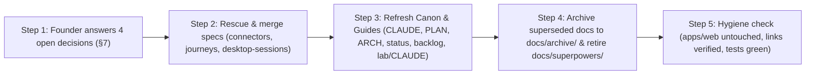

# Documentation map — 17 Nov 2026 consolidation snapshot

Historical inventory and proposals. For current placement use `docs/CLAUDE.md`; for current state use `docs/status.md`; for the contest portfolio use `docs/submissions/README.md`; for memory use `docs/plan/Memory/memory.md` §18 and `apps/memory/upgrade/`. Preserve the Quest references and memory archive in place. Everything below predates the D16 monorepo merge and temporal_note; the "10-table Postgres schema" target store and the step-by-step execution plan are superseded.

(Original title: Dubai-io — Documentation & Architecture Consolidation Plan.)

**Date:** 17 Nov 2026 · **Scope:** Full repository review (`apps/`, `supabase/`, `docs/`, `design/`, `.claude/`, unmerged branches, and external `memory-engine` package)  
**Status:** EXECUTED 17 Nov 2026 (Docs-only pass; data/ and G:\Haitham\lab-data\ untouched per founder instruction).

---

## 1. Executive Summary: Why Consolidation Is Needed Again

On **9 Nov 2026** (`d95a8a2`), a first documentation cleanup (`docs/docs-map.md`) audited 74 markdown files and moved 35 historical files into `docs/archive/`. However, between **9 Nov and 17 Nov 2026**, the application and its documentation went through **five major waves of changes** across multiple sessions and branches:

1. **14–16 Nov — Universal Connector Framework (`5ced9b8`, `f47db20`):** Merged `apps/api/app/connectors/` (24 Python modules, 40 declared connectors, `supabase/migrations/20261114000100_connectors.sql`, 761 lines of tests) and added 4 new docs under `docs/connectors/`.
2. **15 Nov — Unmerged Consolidation & Agents Branch (`origin/docs/consolidate-plan-agents`, `76516cf` & `fcc0f37`):** A parallel session rewrote `CLAUDE.md` into *"Guardrails (industry standard, founder 15 Nov)"*, merged `status.md` + `request-backlog.md` into `PLAN.md`, and authored 4 new design docs (`docs/plan/connectors.md` and `docs/services/agents/{README,orchestrator,emails}.md`). Because `main` took the 9 Nov cleanup branch instead, those commits were left unmerged on `origin/docs/consolidate-plan-agents` (alongside `origin/cursor/readme-project-story-cd6a` `dac3d4f`, which rewrote `README.md`).
3. **16 Nov — Memory Research & 10-Table Postgres Decision (`2caaba5`, `d7839af`, `8427bda`):** Added `.claude/skills/feature-ledger/SKILL.md`, `docs/CLAUDE.md`, `docs/plan/morning-brief.md`, `docs/Researches/memory-research-2026-11.md`, `docs/references/quest - info/quest.md`, 12 new rows in `docs/request-backlog.md`, and updated `PLAN.md` §2 to settle the open Stage-2 memory engine pick (adopting one 10-table Postgres memory service merging Mem0 links, Graphiti end-dates, Hindsight verdicts, Quest tree export, and `temporal_note`).
4. **16 Nov — Headless Lab Pipeline v2 Implementation (`ed15f47`, +5,291 lines across 40 files):** Built the full skill-based extraction, local sentiment/emotion scoring (`scorer_worker.py`), semantic chunking (`chunking.py`), circle alias/typo resolution (`circle.py`), hybrid BM25+dense+translation search (`searchlib.py`), follow-up resolver (`followups.py`), Mermaid topic tree/graph (`tree.py`), and LLM-judge evaluation harness (`evaluate.py`) in `apps/api/app/lab/`.
5. **17 Nov — Three Untracked Files in `docs/plan/`:** Added `docs/plan/BUILD_REPORT.md` (a report for an external `quest/*` Hindsight 1.2.1 prototype not in this repo), `docs/plan/desktop-llm-sessions.md` (Electron multi-LLM desktop app + local transcript ingestion), and `docs/plan/agent-session-history.md` (Orca-based session index/search spec).

### Footprint (17 Nov snapshot)
- **120 `.md` files** inside the repository (**86** outside `docs/archive/`, including **36** private Quest export files in `docs/references/quest - info/quest-memory-export/`, plus **34** in `docs/archive/`).
- **6 external `.md` files** in `C:\Users\h.ibrahim\Documents\Claude\Projects\proposals\memory-engine\` still cross-referenced as "pending" by live docs despite being settled on 16 Nov.
- **5 unmerged `.md` files** across `origin/docs/consolidate-plan-agents` and `origin/cursor/readme-project-story-cd6a`.

**Goal of this plan:** Reduce active non-archive documentation from **50+ scattered files** down to **25 tightly scoped files** (4 Root Canon + 10 Folder/State Guides + 11 On-Demand Specs/Registers), eliminate 6-way memory documentation drift, and align every doc with the actual code in `apps/` and `supabase/`.

---

## 2. Repository File Trees (Generated via Gemini Medium Subagents)

### 2.1 All `.md` Files Across the Repository (120 Files)

#### A. Root Canon, Dotfiles & Subproject Guides (14 files)
| Path | Lines | Bytes | Current Role |
|---|---:|---:|---|
| [CLAUDE.md](file:///g:/Haitham/VsCode/contest/CLAUDE.md) | 65 | 7,415 | Root router, non-negotiable rules 1–10, gates, repo layout |
| [PLAN.md](file:///g:/Haitham/VsCode/contest/PLAN.md) | 130 | 15,882 | Single product plan: identity, founder decisions (up to 16 Nov), scope, contest facts |
| [ARCHITECTURE.md](file:///g:/Haitham/VsCode/contest/ARCHITECTURE.md) | 346 | 42,750 | System shape, contracts, order/task state machines, memory §7, connectors §14 |
| [README.md](file:///g:/Haitham/VsCode/contest/README.md) | 39 | 2,040 | Short repo front door, Windows PowerShell run & test commands |
| [.claude/skills/feature-ledger/SKILL.md](file:///g:/Haitham/VsCode/contest/.claude/skills/feature-ledger/SKILL.md) | 73 | 4,099 | Skill workflow for classifying & logging founder feature decisions |
| [apps/api/CLAUDE.md](file:///g:/Haitham/VsCode/contest/apps/api/CLAUDE.md) | 83 | 8,421 | FastAPI backend map, endpoints, FIN-08 contracts, hosting, ML pipeline |
| [apps/api/app/lab/CLAUDE.md](file:///g:/Haitham/VsCode/contest/apps/api/app/lab/CLAUDE.md) | 50 | 8,379 | Headless Know/Notice/Do lab pipeline guide |
| [apps/ios/README.md](file:///g:/Haitham/VsCode/contest/apps/ios/README.md) | 39 | 2,960 | Historical SwiftUI client guide (STOPPED 23 Oct) |
| [apps/site/AGENTS.md](file:///g:/Haitham/VsCode/contest/apps/site/AGENTS.md) | 9 | 688 | Next.js 16 generated agent rules |
| [apps/site/README.md](file:///g:/Haitham/VsCode/contest/apps/site/README.md) | 63 | 2,986 | Website guide (marked stale at top; describes pre-unified routes) |
| [apps/site/public/IMAGE_LICENSES.md](file:///g:/Haitham/VsCode/contest/apps/site/public/IMAGE_LICENSES.md) | 57 | 7,288 | Openverse & Unsplash image attribution manifest |
| [apps/web/CLAUDE.md](file:///g:/Haitham/VsCode/contest/apps/web/CLAUDE.md) | 20 | 1,244 | Frozen original mobile PWA guide (never edit) |
| [supabase/CLAUDE.md](file:///g:/Haitham/VsCode/contest/supabase/CLAUDE.md) | 10 | 508 | Supabase rules (`dubaiio` private schema, additive migrations) |
| [supabase/README.md](file:///g:/Haitham/VsCode/contest/supabase/README.md) | 32 | 3,907 | Local Supabase ports (15421–15429), cached image pins, write-stall notes |

#### B. `design/` Guides & Indexes (4 files)
| Path | Lines | Bytes | Current Role |
|---|---:|---:|---|
| [design/CLAUDE.md](file:///g:/Haitham/VsCode/contest/design/CLAUDE.md) | 29 | 3,204 | LLM rules for visual references (never move/delete founder files) |
| [design/29-10-2026/INDEX.md](file:///g:/Haitham/VsCode/contest/design/29-10-2026/INDEX.md) | 46 | 3,427 | Mapping of 20 `hf_*.png` Higgsfield light-mode screens (`m01–m10`, `l01–l10`) |
| [design/references/claude duet/README.md](file:///g:/Haitham/VsCode/contest/design/references/claude%20duet/README.md) | 22 | 2,276 | Index of 12 Claude Duet video frame grabs |
| [design/references/v3-higgsfield/README.md](file:///g:/Haitham/VsCode/contest/design/references/v3-higgsfield/README.md) | 15 | 598 | Short pointer to `design/29-10-2026/INDEX.md` |

#### C. `docs/` Active Markdown Files (32 project docs + 36 gitignored personal Quest export files = 68 files)
| Path | Lines | Bytes | Tracked? | Current Role |
|---|---:|---:|---|---|
| [docs/CLAUDE.md](file:///g:/Haitham/VsCode/contest/docs/CLAUDE.md) | 22 | 1,865 | Yes | Folder routing rules for `docs/` |
| [docs/docs-map.md](file:///g:/Haitham/VsCode/contest/docs/docs-map.md) | 193 | 20,902 | Yes | 9 Nov 74-doc audit & archive map |
| [docs/request-backlog.md](file:///g:/Haitham/VsCode/contest/docs/request-backlog.md) | 72 | 12,726 | Yes | Active task (`LAB-01`), open items table, `## Feature decisions` ledger |
| [docs/status.md](file:///g:/Haitham/VsCode/contest/docs/status.md) | 44 | 3,843 | Yes | Current state, connectors status, shipped spine, runtime, keys |
| [docs/connectors/architecture.md](file:///g:/Haitham/VsCode/contest/docs/connectors/architecture.md) | 53 | 4,849 | Yes | Universal connector ingestion contract (`connector_records`) |
| [docs/connectors/capability-matrix.md](file:///g:/Haitham/VsCode/contest/docs/connectors/capability-matrix.md) | 60 | 8,711 | Yes | 40-connector matrix (live vs export vs unavailable) |
| [docs/connectors/prioritization.md](file:///g:/Haitham/VsCode/contest/docs/connectors/prioritization.md) | 68 | 4,193 | Yes | 6-criterion priority scores (1–5) for all 40 connectors |
| [docs/connectors/whatsapp-evolution.md](file:///g:/Haitham/VsCode/contest/docs/connectors/whatsapp-evolution.md) | 48 | 3,546 | Yes | Evaluation & ban risks of unofficial Baileys/Evolution plugin (off) |
| [docs/plan/agent-session-history.md](file:///g:/Haitham/VsCode/contest/docs/plan/agent-session-history.md) | 194 | 13,861 | **Untracked** | 17 Nov Orca reference study for Desktop Agent Session History |
| [docs/plan/BUILD_REPORT.md](file:///g:/Haitham/VsCode/contest/docs/plan/BUILD_REPORT.md) | 174 | 9,797 | **Untracked** | 17 Nov build report for external `quest/*` Hindsight 1.2.1 prototype |
| [docs/plan/desktop-llm-sessions.md](file:///g:/Haitham/VsCode/contest/docs/plan/desktop-llm-sessions.md) | 199 | 15,973 | **Untracked** | 17 Nov Electron desktop multi-LLM + local session memory ingestion |
| [docs/plan/journeys.md](file:///g:/Haitham/VsCode/contest/docs/plan/journeys.md) | 270 | 33,778 | Yes | Do-pillar journey designs (KHDA, insurance B+, Mamzar, etc.) |
| [docs/plan/morning-brief.md](file:///g:/Haitham/VsCode/contest/docs/plan/morning-brief.md) | 161 | 23,761 | Yes | 16 Nov personalized morning brief + shared public news cache spec |
| [docs/references/api-catalog.md](file:///g:/Haitham/VsCode/contest/docs/references/api-catalog.md) | 123 | 18,139 | Yes | Provider API access assessment, policy constraints & outreach tracker |
| [docs/references/reading-source-register.md](file:///g:/Haitham/VsCode/contest/docs/references/reading-source-register.md) | 35 | 6,295 | Yes | Admitted UAE news domains (`thenationalnews.com`, `wam.ae`, etc.) |
| [docs/references/recommender-plan.md](file:///g:/Haitham/VsCode/contest/docs/references/recommender-plan.md) | 109 | 17,390 | Yes | Temporal recommender (`temporal-v3`), 4 memory kinds, scoring |
| [docs/references/quest - info/quest.md](file:///g:/Haitham/VsCode/contest/docs/references/quest%20-%20info/quest.md) | 116 | 7,861 | Gitignored | Analysis of how Quest structures and routes its markdown memory tree |
| `docs/references/quest - info/quest-memory-export/**` (36 `.md` files) | — | — | Gitignored | Founder's private Quest export (`USER.md`, `MEMORIES.md`, 34 files) — **never quote or commit** |
| [docs/Researches/CLAUDE.md](file:///g:/Haitham/VsCode/contest/docs/Researches/CLAUDE.md) | 30 | 3,915 | Yes | Guide & rules for `docs/Researches/` |
| [docs/Researches/contest.md](file:///g:/Haitham/VsCode/contest/docs/Researches/contest.md) | 226 | 14,141 | Yes | Cleaned Dubai Chambers Create AI Agents Championship rules & FAQ |
| [docs/Researches/memory-research-2026-11.md](file:///g:/Haitham/VsCode/contest/docs/Researches/memory-research-2026-11.md) | 218 | 22,790 | Yes | 16 Nov extraction benchmark (9B vs Haiku) + merged 10-table Postgres schema |
| [docs/Researches/persocial-intake.md](file:///g:/Haitham/VsCode/contest/docs/Researches/persocial-intake.md) | 100 | 14,166 | Yes | Research for separate project **Persocial** (`G:\Haitham\VsCode\Persocial`) |
| [docs/services/cases.md](file:///g:/Haitham/VsCode/contest/docs/services/cases.md) | 216 | 22,080 | Yes | Service cases menu (C1–C15) and pattern library (frozen until Jan 2027) |
| [docs/services/intake.md](file:///g:/Haitham/VsCode/contest/docs/services/intake.md) | 78 | 5,563 | Yes | Service intake rules (default = registry row in `catalog.py`/`actions.py`) |
| [docs/superpowers/plans/2026-10-23-temporal-memory.md](file:///g:/Haitham/VsCode/contest/docs/superpowers/plans/2026-10-23-temporal-memory.md) | 85 | 9,641 | Yes | Plan 6 of 8: `temporal_note-slim` port (`mem_*` tables) |
| [docs/superpowers/specs/2026-11-02-demo-journeys.md](file:///g:/Haitham/VsCode/contest/docs/superpowers/specs/2026-11-02-demo-journeys.md) | 134 | 5,287 | Yes | Card-by-card scripts for 5 demo journeys + UAE Pass appendix |
| [docs/superpowers/specs/2026-11-02-demo-resident.md](file:///g:/Haitham/VsCode/contest/docs/superpowers/specs/2026-11-02-demo-resident.md) | 40 | 2,713 | Yes | Fixture persona "Sam Resident" (`demo_fixture` entities) |
| [docs/superpowers/specs/2026-11-02-residence-companion-design.md](file:///g:/Haitham/VsCode/contest/docs/superpowers/specs/2026-11-02-residence-companion-design.md) | 198 | 12,878 | Yes | 2 Nov residence companion brief, 17-ask dogfood matrix, taxi §4.1 |
| [docs/superpowers/specs/2026-11-02-residence-ontology-tree.md](file:///g:/Haitham/VsCode/contest/docs/superpowers/specs/2026-11-02-residence-ontology-tree.md) | 491 | 17,746 | Yes | 14-root, 200+ leaf fine ontology + 9 Nov life-theme rollup table |

#### D. `docs/archive/` Historical Markdown Files (34 files)
```text
docs/archive/
├── CLAUDE.md (7 lines)
├── implementation-plan.md (367 lines, 68 KB)
├── user-app-review-guide.md (94 lines, 10 KB)
├── plan/
│   ├── calls-services-panels.md (86 lines)
│   ├── dashboard.md (125 lines)
│   ├── domains.md (29 lines)
│   ├── ios-upgrade.md (60 lines)
│   ├── review-prompt.md (37 lines)
│   ├── unified-app-design.md (147 lines)
│   └── website-rebuild.md (70 lines)
├── references/
│   ├── api-authorization-outreach.md (37 lines)
│   ├── assistant-context.md (67 lines)
│   ├── assistant-design-interaction-review-prompt.md (59 lines)
│   ├── assistant-design-interaction-review.md (384 lines, 45 KB)
│   ├── assistant-experience-plan.md (201 lines, 26 KB)
│   ├── assistant-experience-review.md (622 lines, 83 KB)
│   ├── assistant-plan-review-prompt.md (52 lines)
│   ├── assistant-review-decisions.md (128 lines, 20 KB)
│   ├── community-content-sources.md (23 lines)
│   ├── community-data-storage-plan.md (104 lines)
│   ├── external-review-prompt.md (32 lines)
│   ├── ios-swift-plan.md (143 lines)
│   ├── ios-web-agent-prompt.md (88 lines)
│   ├── personal-assistant-direction.md (154 lines)
│   ├── redesign.md (680 lines, 44 KB)
│   └── visuals-libraries.md (174 lines)
├── Researches/
│   ├── CLAUDE-2026-11-09-quest-direction.md (135 lines)
│   ├── Dubai-io android integration.md (228 lines)
│   ├── Dubai-io iPhone integration.md (258 lines)
│   └── Dubai-io_product evolution.md (156 lines)
├── root/
│   ├── cursor-plan.md (77 lines)
│   ├── handoff.md (231 lines, 42 KB)
│   └── handoff-ios.md (37 lines)
└── superpowers/plans/
    ├── 2026-10-23-device-switch-and-phone-core.md (80 lines)
    ├── 2026-10-23-unified-app-foundation.md (137 lines)
    ├── 2026-10-29-desktop-full-load.md (38 lines)
    ├── 2026-10-29-domains-website-light.md (15 lines)
    └── 2026-11-02-residence-companion-mcp.md (270 lines)
```

---

### 2.2 Full Application Code Tree (`apps/`, `supabase/`, `tools/`, `data/`)

```text
g:\Haitham\VsCode\contest\
├── apps/
│   ├── api/                        # FastAPI + LangGraph backend (Python 3.13)
│   │   ├── CLAUDE.md, Dockerfile, docker-compose.yml, docker-compose.infra.yml
│   │   ├── requirements.txt, requirements-ml.txt, .env.example, .env.supabase.example
│   │   ├── app/
│   │   │   ├── main.py (330L)      # Mounts 17 routers + static /dash, /lab, / (frozen web)
│   │   │   ├── config.py (92L)     # All model IDs, LAB_*, CONNECTOR_*, WHATSAPP_EVOLUTION_*
│   │   │   ├── db.py (69L)         # SQLite / Postgres (? placeholder translation)
│   │   │   ├── actions.py (378L)   # Deterministic action engine, approvals, order state machine
│   │   │   ├── catalog.py (49L)    # Host-owned fixed prices (sandbox merchants)
│   │   │   ├── merchant.py (129L)  # Sandbox merchant inbox & SSE
│   │   │   ├── tasks.py (505L)     # Revision-guarded tasks, Today lanes, TAXI-02 commands
│   │   │   ├── projects.py (205L)  # Owner-scoped project workspaces
│   │   │   ├── proactive.py (231L) # Outbox, dedupe_key, consent, quiet hours, morning brief
│   │   │   ├── profile.py (105L)   # Episodes + Beta(α,β) hypotheses
│   │   │   ├── user_profile.py (124L) # Bi-temporal profile_facts + user_profile projection
│   │   │   ├── recommendations.py (353L) # Temporal recommender (temporal-v3)
│   │   │   ├── discovery.py (126L) # Live Google Places batch filter + ranker
│   │   │   ├── google_maps.py (69L)# Places, Photos, Routes, Static Map proxies
│   │   │   ├── tryon.py (182L)     # Still-photo try-on (Vertex VTO -> OpenAI -> honest blocker)
│   │   │   ├── reading.py (230L)   # Pull-only news headlines + thumbnail proxy
│   │   │   ├── prayer.py (30L)     # Aladhan prayer times
│   │   │   ├── auth.py (96L), oauth.py (177L), mail_profile.py (148L) # Google OAuth + Gmail needs-reply
│   │   │   ├── communities.py (589L), social_generation.py (231L)     # PARKED 9 Nov
│   │   │   ├── ml_api.py (24L), ml_models.py (151L), ml_rag.py (100L), ml_tasks.py (41L)
│   │   │   ├── ops.py (206L)       # Founder ops /api/ops/* (X-Ops-Token)
│   │   │   ├── widgets.py (25L)    # Separate widget origin (:8001, CSP connect-src 'none')
│   │   │   ├── migrate_sqlite.py (33L), migrate_supabase.py (87L)
│   │   │   ├── luna/
│   │   │   │   ├── graph.py (254L), schema.py (70L), research.py (194L)
│   │   │   ├── memory/
│   │   │   │   ├── schema.py (97L), store.py (188L), api.py (56L)     # temporal_note-slim (mem_*)
│   │   │   ├── connectors/         # Universal connector framework (merged 16 Nov)
│   │   │   │   ├── api.py (175L), base.py (57L), catalog.py (524L), crypto.py (23L), hosts.py (32L)
│   │   │   │   ├── registry.py (22L), retry.py (12L), schema.py (91L), service.py (475L)
│   │   │   │   ├── stamp.py (10L), store.py (294L), transport.py (36L), types.py (116L)
│   │   │   │   └── plugins/
│   │   │   │       ├── chat_sources.py, dev_sources.py, file_import.py, filesystem_source.py
│   │   │   │       ├── google_sources.py, imap_source.py, microsoft_sources.py
│   │   │   │       ├── social_media.py, whatsapp_evolution.py, work_sources.py
│   │   │   └── lab/                # Headless Know / Notice / Do pipeline (expanded 16 Nov)
│   │   │       ├── CLAUDE.md, __main__.py (199L), store.py (397L), engine.py (172L), rows.py (41L)
│   │   │       ├── parse.py (147L), parse_email.py (89L), chunking.py (171L), circle.py (122L)
│   │   │       ├── extract.py (340L), sensitive.py (80L), scoring.py (150L), scorer_worker.py (55L)
│   │   │       ├── index.py (260L), searchlib.py (132L), followups.py (133L)
│   │   │       ├── tree.py (148L), tree_assign.py (67L), evaluate.py (289L), llm.py (132L)
│   │   │       └── skills/{__init__.py (99L), chat.py (267L), email.py (205L)}
│   │   └── tests/                  # 37 test_*.py files + fixtures/lab/
│   │
│   ├── site/                       # Next.js 16 / React 19 app (UI work paused 9 Nov)
│   │   ├── app/                    # Legacy marketing/funnel routes (/about, /app/*, /demo, /setup, etc.)
│   │   ├── components/, lib/       # Legacy route components & API helpers
│   │   ├── unified/                # Active unified app mounted at / (assistant, chats, community, dashboard, data, maps, me, mobile, onboarding, services, shell, tasks, ui)
│   │   └── tests/                  # Vitest unit tests (10) + Playwright e2e specs (6)
│   │
│   ├── web/                        # FROZEN reference mobile PWA (tag mobile-pwa-baseline-2026-10-23)
│   ├── dash/                       # Static founder ops dashboard (/dash)
│   └── ios/                        # Historical SwiftUI client (STOPPED 23 Oct)
│
├── supabase/
│   ├── CLAUDE.md, README.md, config.toml
│   └── migrations/                 # 11 SQL migrations (20261021000100 .. 20261114000100_connectors.sql)
├── tools/start-supabase.ps1
└── data/chat/                      # Local gitignored founder chat exports (physically inside repo root)
```

---

## 3. Full App & Documentation Review: Key Findings

### 3.1 Six Competing Memory Schemas Across Docs and Code

Because the memory architecture evolved across five iterations between 13 Oct and 17 Nov, a reader or coding agent encounters **six different table sets** across the codebase and docs:

| # | Memory Layer | Where It Lives | Tables / Store | Actual Status (17 Nov) |
|---|---|---|---|---|
| **1** | **Legacy Profile & Recommender** | `app/user_profile.py`, `app/profile.py`, `app/recommendations.py` + migrations `000100`, `000200` | `user_profile`, `profile_facts` (`vector(1536)`), `episodes`, `profile_overrides`, `recommendation_events`, `profile_interests`, `recommendation_runs` | **Shipped & live** in API (`/api/session/memory`, `/api/profile/*`, `/api/recommendations`). |
| **2** | **`temporal_note-slim` Product Memory** | `app/memory/{schema,store,api}.py` + `2026-10-23-temporal-memory.md` | `mem_events`, `mem_entities`, `mem_entity_aliases`, `mem_relationships`, `mem_event_entities`, `mem_patterns`, `mem_advice`, `mem_ontology_paths` | **Partial SQLite runtime DDL only** (no Supabase migration; `LIKE` search only; only `mail_profile.py` and `lab/extract.py` write to it). |
| **3** | **Lab v1/v2 Extraction Store** | `app/lab/store.py` (`<data>/lab.sqlite`) | `lab_windows`, `lab_annotations`, `lab_vectors`, `lab_rows`, `lab_followups`, `lab_alias_suggestions` (+ `connector_records` + `mem_*`) | **Built 16 Nov (`ed15f47`) & tested** (`test_lab_*.py`). Powers the skill-based CLI pipeline. |
| **4** | **16 Nov Approved Postgres Memory Schema** | `PLAN.md` §2 (16 Nov) + `docs/Researches/memory-research-2026-11.md` Part 2 | 10 Postgres tables (`user_id`-scoped): `sources, source_records, chunks, topics, memories, entities, links, followups, profile, alias_suggestions` (`vector(768)` + `tsvector`) | **Approved target schema (16 Nov)** — generalizes `lab_*` + `mem_*` + `connector_records` into Postgres. Not yet in `supabase/migrations/` or `ARCHITECTURE.md` §4/§7. |
| **5** | **External `quest/*` Hindsight Prototype** | `docs/plan/BUILD_REPORT.md` (untracked, 17 Nov) | Hindsight 1.2.1 bank + SQLite `Catalog` (`quest/catalog.py`) | **External prototype report** — `quest/*` code does not exist in this repo; conflicts with `PLAN.md` §2 (16 Nov). |
| **6** | **Unmerged Emails Agent Schema** | `origin/docs/consolidate-plan-agents` (`docs/services/agents/emails.md`) | `source_items`, `item_labels`, `label_rules`, `entities`, `entity_items` | **Unmerged 15 Nov draft** on remote branch. |

> [!IMPORTANT]
> **Consolidation Fix for Memory:**
> `PLAN.md` §2 (16 Nov) already settled the memory design: the **10-table Postgres schema** (`sources, source_records, chunks, topics, memories, entities, links, followups, profile, alias_suggestions`) is the target store, and `apps/api/app/lab/` (`lab_rows`, `lab_annotations`, `lab_followups`, `lab_alias_suggestions`, `lab_vectors`) is its working SQLite prototype.
> - Update `ARCHITECTURE.md` §4 and §7 to document the 16 Nov 10-table target and its mapping from `app/lab/store.py` and `app/memory/schema.py`.
> - Mark `MEM-01` in `docs/request-backlog.md` and the external `C:\Users\h.ibrahim\Documents\Claude\Projects\proposals\memory-engine\` package as **superseded/closed by the 16 Nov `PLAN.md` §2 decision**.
> - Archive `docs/superpowers/plans/2026-10-23-temporal-memory.md` (rescuing any remaining review gates into `apps/api/app/lab/CLAUDE.md`).

---

### 3.2 Code-to-Documentation Drift in `apps/api/`

1. **`apps/api/app/lab/CLAUDE.md` is internally split between 16 Nov code and 9 Nov plans:**
   - Line 3 has a typo date (`Status 23 Nov 2026`) and briefly mentions `skills/chat.py`, `skills/email.py`, and `scoring.py`.
   - However, its `## Shape` and `## Steps` table (lines 5–28) still describe the 9 Nov plan (`Step 0 Truth sheet`, `Step 1 Parse`, `Step 2 Extract`, `Step 3 Consolidate`...) instead of the **actual CLI steps** implemented in `apps/api/app/lab/__main__.py`:
     - Ingestion & Extraction: `parse` (WhatsApp `.txt` or email `.mbox`/`.eml` dir), `rows --me <Name> [--days N] [--sample N]` (v2 skill-based extraction + local sentiment/emotion + auto-embedding), `extract --me <Name>` (v1 window extractor), `audit` (2-layer sensitive purge).
     - Indexing & Resolution: `index` (window + annotation vectors), `followups` (recurring topic share + cited-note follow-up resolution + alias suggestions), `tree` (2-step `tree_assign.py` label → group → life theme + Mermaid mindmap + co-occurrence `graph.json`).
     - Queries & Reports: `report`, `topics`, `projects`, `loops`, `timeline [--since] [--until]`, `person <Name>`, `search "<query>" [--since] [--until]`, `forget <chat>`.
     - Evaluation Harness: `eval-quality [nojudge]`, `eval-queries`, `eval-search` (S0–S5 retrieval benchmark across English, Egyptian Arabic, and keyword queries).
2. **`docs/status.md` and `docs/request-backlog.md` are frozen at 9 Nov in their headers and main sections:**
   - `docs/status.md` (`# Status — 9 Nov 2026`) does not mention the 16 Nov `app/lab/` build (`ed15f47`), the email `.mbox`/`.eml` importer (`parse_email.py`), the local sentiment/emotion worker (`scoring.py`), or the 16 Nov memory architecture decision.
   - `docs/request-backlog.md` (`# Request backlog — 9 Nov 2026`) still says WhatsApp export parser is unbuilt under `LAB-01` and `MEM-01` is "Decision pending", while its bottom `## Feature decisions` table has 12 rows from 16 Nov.
3. **`apps/api/CLAUDE.md` endpoint & config inventory is missing 14–16 Nov additions:**
   - Missing all 13 routes on `/api/connectors/*` (`app/connectors/api.py`, mounted in `app/main.py:74`).
   - Missing the `LAB_*`, `CONNECTOR_TOKEN_KEY`, and `WHATSAPP_EVOLUTION_*` settings added to `app/config.py`.
4. **Dual Gmail / OAuth Paths (`app/auth.py` + `oauth.py` + `mail_profile.py` vs. `app/connectors/plugins/google_sources.py`):**
   - Both exist in `apps/api/app/`. `ARCHITECTURE.md` §14 should state clearly that `auth.py`/`oauth.py` handles Google sign-in + the legacy `/api/mail/needs-reply` pilot, while `app/connectors/` holds the universal `connector_records` pipeline (`gmail`, `google_calendar`, `outlook`, `outlook_calendar`).

---

### 3.3 Code-to-Documentation Drift in `apps/site/` & Taxonomy Mismatches

1. **Two Coexisting Next.js Trees in `apps/site/`:**
   - `apps/site/app/` + `components/` + `lib/` hold the pre-23-Oct marketing site and `/app/*` routes (`/about`, `/demo`, `/privacy`, `/setup`, `/signup`, `/first-win`, `/dashboard`, `/app/{ask,chat,decisions,feed,map,profile,services,tasks}`).
   - `apps/site/unified/` holds the post-23-Oct unified app mounted at `/` via `apps/site/app/page.tsx`.
   - `apps/site/README.md` still documents the old pre-unified routes with a 1-line warning banner at the top.
2. **Four Different Folder / Domain Taxonomies Across Code and Docs:**
   - **5 Product Domains** in `apps/site/unified/data/domains.ts`: `household`, `places`, `services`, `work`, `general`.
   - **6–7 UI Bots** in `apps/api/app/memory/schema.py` & `2026-11-02-residence-companion-design.md`: `lifestyle`, `career`, `social`, `household`, `money`, `travel` (+ `me`).
   - **7 Life Themes** in `PLAN.md` §2 (9 Nov): `Career`, `Learning`, `Projects`, `People & family`, `Events`, `Home & money`, `Travel`.
   - **9 Themes** in `apps/api/app/lab/tree_assign.py`: the 7 life themes + `Everyday life` + `Other`.
   - **Consolidation Rule:** Establish `PLAN.md` §2 (9 Nov / 16 Nov) as the single taxonomy source of truth: the **7 Life Themes** (+ `Everyday life` / `Other` fallback in `tree_assign.py`) are the user-visible folders, with dynamic subtopics and the fine ontology (`2026-11-02-residence-ontology-tree.md`) underneath. Mark the 5 domains and 7 UI bots as superseded UI state to be updated when UI work resumes.

---

### 3.4 Unmerged Branches & Untracked Files Audit

1. **Unmerged Branch `remotes/origin/docs/consolidate-plan-agents` (15 Nov, `76516cf` & `fcc0f37`):**
   - Contains 4 drafted files not on `main`:
     - `docs/plan/connectors.md` (Instagram Login reusing `@faz3.posts`, WhatsApp Coexistence for testers, Slack user-token OAuth).
     - `docs/services/agents/README.md` (25+ domain agents catalog across Work, Household, Places, Social, Small Business + 4 bundles).
     - `docs/services/agents/orchestrator.md` (Luna orchestrator loop + map-reduce fan-out + verifier).
     - `docs/services/agents/emails.md` (Emails agent for job applications + `label_rules` learning).
   - Also contains `fcc0f37`, which rewrote `CLAUDE.md` rules 1–10 into *"Guardrails (industry standard, founder 15 Nov)"* where sensitive categories are *"stored only when the user states them or opts in"*.
   - **Action:** Ask the founder (§7 below) whether to rescue `docs/services/agents/*` and the 15 Nov guardrail wording into `main`, or archive `origin/docs/consolidate-plan-agents`.
2. **Unmerged Branch `remotes/origin/cursor/readme-project-story-cd6a` (14 Nov, `dac3d4f`):**
   - Rewrote `README.md` into a 251-line narrative based on pre-9-Nov docs (`handoff.md`, `cursor-plan.md`, community track as active).
   - **Action:** Do **not** merge `dac3d4f` (it re-introduces stale pre-9-Nov paths and parked community claims); delete the remote branch after review.
3. **Untracked 17 Nov Files in `docs/plan/`:**
   - `docs/plan/BUILD_REPORT.md`: Documents an external `quest/*` Hindsight 1.2.1 prototype. **Move to `docs/Researches/quest-hindsight-prototype-2026-11.md` (or `docs/archive/Researches/`)** after rescuing its 5 engineering lessons (already summarized in `desktop-llm-sessions.md` §10).
   - `docs/plan/desktop-llm-sessions.md` + `docs/plan/agent-session-history.md`: Both cover the same 16 Nov feature-ledger item (*"Desktop local-reader imports"*). **Merge into a single `docs/plan/desktop-sessions.md`** with `Status: proposed, awaiting founder decision`.

---

### 3.5 Private Data & Repo Hygiene Issues

> [!CAUTION]
> **Two repo hygiene issues violate `apps/api/app/lab/CLAUDE.md` ("Never write real data, reports or truth sheets under `G:\Haitham\VsCode\contest`"):**
> 1. **`data/chat/` inside the repo root:** `g:\Haitham\VsCode\contest\data\chat\whatsapp\mamty\WhatsApp Chat - mamty♥️.txt` and `data/chat/final_system_prompt.txt` sit inside the repository folder. Even though `/data/` is in `.gitignore`, real personal chat exports should be moved outside the repo to `G:\Haitham\lab-data\`.
> 2. **`docs/references/quest - info/` path mismatch:** `docs/Researches/CLAUDE.md` and `docs/docs-map.md` state that `quest - info/` lives at `docs/Researches/quest - info/`, but on disk it actually lives at **`docs/references/quest - info/`** (containing 36 personal markdown files in `quest-memory-export/`). Move `docs/references/quest - info/` outside the repo to `G:\Haitham\lab-data\quest-info\` (except `quest.md`, which contains no personal data if scrubbed, or keep `quest.md` in `docs/Researches/quest-tree-mechanics.md`).

---

## 4. Target Consolidated Documentation Structure

After executing this consolidation plan, the entire repository's active documentation shrinks from **50+ project `.md` files** to **25 files** organized in three clear tiers (plus `docs/archive/`):

```text
g:\Haitham\VsCode\contest\
│
├── [TIER 1: ROOT CANON — 4 files, always read first]
│   ├── CLAUDE.md                        # Router, 10 rules/guardrails, gates, repo map
│   ├── PLAN.md                          # Single plan: identity, founder decisions, IN/LATER/NEVER, contest facts, demo arc
│   ├── ARCHITECTURE.md                  # System shape, contracts, 10-table memory §7, connectors §14, task/order state machines
│   └── README.md                        # Short front door, run/test commands, doc reading order
│
├── [TIER 2: FOLDER GUIDES & LIVE STATE — 10 files]
│   ├── .claude/skills/feature-ledger/SKILL.md
│   ├── apps/api/CLAUDE.md               # Refreshed with /api/connectors/* + LAB_* settings
│   ├── apps/api/app/lab/CLAUDE.md       # Refreshed with actual 16 Nov CLI commands, skills & eval harness
│   ├── apps/site/AGENTS.md              # Generated Next.js rules (keep as-is)
│   ├── apps/site/README.md              # Refreshed to document unified/ + legacy app/ routes
│   ├── apps/site/public/IMAGE_LICENSES.md
│   ├── apps/web/CLAUDE.md               # FROZEN reference (never edit)
│   ├── supabase/CLAUDE.md               # (+ supabase/README.md merged or kept for local Docker pins)
│   ├── design/CLAUDE.md                 # (+ design/29-10-2026/INDEX.md & claude duet/README.md)
│   └── docs/
│       ├── CLAUDE.md                    # Where things go in docs/
│       └── status.md                    # SINGLE live state + open backlog + Feature decisions ledger (absorbs request-backlog.md)
│
└── [TIER 3: ON-DEMAND SPECS & REGISTERS — 11 files in docs/]
    └── docs/
        ├── connectors/
        │   └── README.md                # Consolidated from architecture.md + capability-matrix.md + prioritization.md + whatsapp-evolution.md
        ├── plan/
        │   ├── morning-brief.md         # Notice pillar: scheduled + on-demand brief & shared news cache (16 Nov)
        │   ├── journeys.md              # Do pillar: KHDA, insurance B+, Mamzar + absorbed demo-resident & demo-journeys
        │   └── desktop-sessions.md      # Consolidated from desktop-llm-sessions.md + agent-session-history.md (proposed)
        ├── services/
        │   ├── intake.md                # Service filing guide
        │   └── cases.md                 # Frozen service cases menu (C1–C15)
        ├── references/
        │   ├── api-catalog.md           # Provider API access & policy constraints
        │   ├── reading-source-register.md # Admitted UAE news publishers & thumbnail rules
        │   └── recommender-plan.md      # Temporal recommender (temporal-v3) & scoring
        ├── superpowers/specs/
        │   └── 2026-11-02-residence-ontology-tree.md # Fine 14-root ontology + 7 life-theme rollup
        ├── Researches/
        │   ├── CLAUDE.md                # Guide for research inputs
        │   ├── contest.md               # Official Dubai Chambers contest rules
        │   └── memory-research-2026-11.md # 16 Nov benchmark + 10-table Postgres DDL & MCP design
        └── archive/                     # All historical / superseded docs (never read unless asked)
```

---

## 5. File-by-File Consolidation Action Matrix

Actions:
- **KEEP** — Keep in place with no changes.
- **UPDATE** — Keep in place; refresh stale sections to match 16–17 Nov code and decisions.
- **MERGE** — Fold content into a target file, then `git mv` the source file into `docs/archive/`.
- **ARCHIVE** — `git mv` into `docs/archive/` (nothing deleted; git history preserved).
- **MOVE OUT** — Move out of the contest repo (private data or separate project).

### 5.1 Root, Dotfiles, `apps/`, `supabase/`, `design/`

| File | Action | Consolidation Details |
|---|---|---|
| `CLAUDE.md` | **UPDATE** | Update active build date (`9 Nov` → `17 Nov`); update pointer if `status.md` and `request-backlog.md` merge (or keep both pointers); resolve Rule 9 wording if founder ratifies `fcc0f37` (see §7). |
| `PLAN.md` | **UPDATE** | Resolve open §2 visitor vs resident wording (§7); note that `app/lab/` steps 1–2 + query/tree/eval landed on 16 Nov (`ed15f47`). |
| `ARCHITECTURE.md` | **UPDATE** | Update date (`9 Nov` → `17 Nov`); update §1 Shape (`lab/` v2 skills/scorers/tree/eval, `connectors/` plugins); update §4 Data table with `connector_*` (5 tables), `lab_*` (6 tables), and the 16 Nov 10-table target memory schema; update §7 Memory to reflect the 16 Nov Postgres decision (replacing "Stage-2 engine pick pending"); clarify dual Gmail path in §14. |
| `README.md` | **UPDATE** | Add `python -m app.lab` test/run one-liner; keep concise (reject the stale 251-line rewrite on `origin/cursor/readme-project-story-cd6a`). |
| `.claude/skills/feature-ledger/SKILL.md` | **KEEP** | Current (created 16 Nov). If `request-backlog.md` is kept separate from `status.md`, zero changes needed. |
| `apps/api/CLAUDE.md` | **UPDATE** | Add `/api/connectors/*` routes to `## Endpoints`; add `LAB_*`, `CONNECTOR_TOKEN_KEY`, `WHATSAPP_EVOLUTION_*` to config notes; expand `lab/` description. |
| `apps/api/app/lab/CLAUDE.md` | **UPDATE** | Fix `Status 23 Nov 2026` typo → `17 Nov 2026`; rewrite `## Shape` and `## Steps` to document the actual CLI commands (`parse`, `rows`, `extract`, `audit`, `index`, `followups`, `tree`, `topics`, `projects`, `loops`, `timeline`, `person`, `search`, `eval-quality`, `eval-queries`, `eval-search`, `forget`), `circle.json` contract, and `skills/{chat,email}.py`; remove stale pointer to `proposals/memory-engine/DECISION-BRIEF.md`. |
| `apps/site/AGENTS.md` | **KEEP** | Auto-generated by Next.js 16 (`next dev`). |
| `apps/site/README.md` | **UPDATE** | Rewrite to document the `unified/` app mounted at `/` (`/?desktop`, `/?devices`) alongside the legacy routes in `app/`, noting UI is paused since 9 Nov. |
| `apps/site/public/IMAGE_LICENSES.md` | **KEEP** | Required license manifest. |
| `apps/web/CLAUDE.md` | **KEEP** | **FROZEN** (`mobile-pwa-baseline-2026-10-23`) — never touch. |
| `apps/ios/README.md` | **KEEP** | Historical folder guide; already notes native iOS is stopped. |
| `supabase/CLAUDE.md` & `supabase/README.md` | **UPDATE** | In `supabase/README.md`, list all 11 migrations (up to `20261114000100_connectors.sql`) and note that `mem_*` / 16 Nov memory tables await their Postgres migration. |
| `design/CLAUDE.md` & `design/**/INDEX.md`, `README.md` | **UPDATE** | Fold the 15-line `design/references/v3-higgsfield/README.md` into `design/CLAUDE.md` + `design/29-10-2026/INDEX.md` (when founder approves touching `design/` Docs). Never touch image files. |

### 5.2 Active `docs/` Files

| File | Action | Consolidation Details |
|---|---|---|
| `docs/CLAUDE.md` | **UPDATE** | Update folder table to reflect the consolidated `docs/connectors/README.md`, `docs/plan/`, and `docs/archive/`. |
| `docs/status.md` | **UPDATE** | Update header to `17 Nov 2026`; add the shipped 16 Nov `app/lab/` pipeline (WhatsApp + `.mbox`/`.eml` parsers, `chat` + `email` skills, local XLM-R sentiment & GoEmotions worker, BM25+dense+translation search, follow-up resolver, Mermaid topic tree/graph, S0–S5 eval harness) and 16 Nov memory decision. *(Optional: merge `request-backlog.md` into `status.md` or keep as the 2 state files — see §6.1).* |
| `docs/request-backlog.md` | **UPDATE** | Update header to `17 Nov 2026`; update `LAB-01` to reflect steps 1–2 + query/tree/eval built on 16 Nov; mark `MEM-01` **settled 16 Nov** (per `PLAN.md` §2); keep open items and `## Feature decisions` ledger intact. |
| `docs/docs-map.md` | **ARCHIVE** | Superseded by this consolidation plan (`doc_consolidation_plan.md`). Move `docs/docs-map.md` → `docs/archive/docs-map-2026-11-09.md` and move `doc_consolidation_plan.md` → `docs/docs-map.md` (so root keeps only the 4 canon files). |
| `docs/connectors/architecture.md` | **MERGE** → `docs/connectors/README.md` | Combine the 4 small connector files (`architecture.md` 53L, `capability-matrix.md` 60L, `prioritization.md` 68L, `whatsapp-evolution.md` 48L = 229 lines total) into **one** `docs/connectors/README.md` (with sections: 1. Architecture & Record Schema, 2. Capability Matrix, 3. Priority Scores, 4. WhatsApp Evolution Evaluation). Archive the 4 split files. |
| `docs/connectors/capability-matrix.md` | **MERGE** → `docs/connectors/README.md` | Merged into §2 of `docs/connectors/README.md`. |
| `docs/connectors/prioritization.md` | **MERGE** → `docs/connectors/README.md` | Merged into §3 of `docs/connectors/README.md`. |
| `docs/connectors/whatsapp-evolution.md` | **MERGE** → `docs/connectors/README.md` | Merged into §4 of `docs/connectors/README.md`. |
| `docs/plan/morning-brief.md` | **KEEP** | Clean, current 16 Nov feature spec for Notice pillar. |
| `docs/plan/journeys.md` | **UPDATE / MERGE** | Absorb `docs/superpowers/specs/2026-11-02-demo-resident.md` (40L) and `2026-11-02-demo-journeys.md` (134L) as Appendix A & B of `docs/plan/journeys.md`, plus the 17-ask dogfood matrix and §4.1 taxi flow from `2026-11-02-residence-companion-design.md`. That creates **one** single Do-pillar journeys & dogfood spec. |
| `docs/plan/desktop-llm-sessions.md` | **MERGE** → `docs/plan/desktop-sessions.md` | Combine with `docs/plan/agent-session-history.md` into one `docs/plan/desktop-sessions.md` (Part 1: Local Session Index & Search via `utilityProcess`/FTS5; Part 2: Opt-in Memory Ingestion & Multi-LLM Desktop Shell). Keep `Status: proposed, not approved`. |
| `docs/plan/agent-session-history.md` | **MERGE** → `docs/plan/desktop-sessions.md` | Merged into Part 1 of `docs/plan/desktop-sessions.md`. |
| `docs/plan/BUILD_REPORT.md` (and `docs/references/Hark/`) | **SUPERSEDE & REMOVE** | External `quest/*` Hindsight 1.2.1 prototype (`quest-feed`). Superseded its `ScopeGuard`, 6 metadata-first card generators, and Bayesian feedback smoothing into `docs/plan/morning-brief.md` §8; its `.ics`/`.vcf` Takeout parsers, `forget_rules` ingestion blocklist, `content_hash` dedupe, and `superseded_by` contract into `apps/api/app/lab/CLAUDE.md`; and its 5 empirical Hindsight 1.2.1 findings into `docs/Researches/memory-research-2026-11.md` §7. Removed `docs/references/Hark/` and `BUILD_REPORT.md`. |
| `docs/services/intake.md` | **KEEP** | Current governance guide for filing services. |
| `docs/services/cases.md` | **KEEP** | Frozen until Jan 2027 submission; clean. |
| `docs/references/api-catalog.md` | **KEEP** | Current provider catalog and outreach tracker. |
| `docs/references/reading-source-register.md` | **KEEP** | Admitted publisher register for `reading.py` and `morning-brief.md`. |
| `docs/references/recommender-plan.md` | **UPDATE** | Add a 2-line note at top linking to `docs/plan/morning-brief.md` (§5 content-based brief ranker) and `PLAN.md` §2 (16 Nov). |
| `docs/references/quest - info/quest.md` | **MOVE** → `docs/Researches/quest-tree-mechanics.md` | `quest.md` is a clean architectural analysis of Quest's md tree routing (`new / update / delete`) with no personal chat text. Move it to `docs/Researches/quest-tree-mechanics.md`. |
| `docs/references/quest - info/quest-memory-export/**` & `screen grabs/` | **MOVE OUT** | Move personal export files (`USER.md`, `MEMORIES.md`, 34 memory files, `.zip`, screen grabs) out of the repo to `G:\Haitham\lab-data\quest-info\` per `apps/api/app/lab/CLAUDE.md`. |
| `docs/Researches/CLAUDE.md` | **UPDATE** | Fix the path of `quest - info/` and list `quest-tree-mechanics.md`. |
| `docs/Researches/contest.md` | **KEEP** | Official contest rules reference. |
| `docs/Researches/memory-research-2026-11.md` | **KEEP** | Authoritative 16 Nov schema & benchmark reference for `PLAN.md` §2. |
| `docs/Researches/persocial-intake.md` | **MOVE OUT / ARCHIVE** | Move to `G:\Haitham\VsCode\Persocial` (separate project, `PLAN.md` §2) or `docs/archive/Researches/persocial-intake.md`. |
| `docs/superpowers/plans/2026-10-23-temporal-memory.md` | **ARCHIVE** | Superseded by the 16 Nov memory architecture decision (`PLAN.md` §2) and `apps/api/app/lab/`. Move to `docs/archive/superpowers/plans/2026-10-23-temporal-memory.md`. |
| `docs/superpowers/specs/2026-11-02-residence-companion-design.md` | **MERGE & ARCHIVE** | Rescue §2 behaviour grammar, §4 17-ask dogfood matrix, §4.1 taxi redesign, and §4.2 "don't ask stupid" context rules into `docs/plan/journeys.md`, then move to `docs/archive/superpowers/specs/`. |
| `docs/superpowers/specs/2026-11-02-demo-resident.md` | **MERGE & ARCHIVE** | Rescue into Appendix A of `docs/plan/journeys.md`, then archive. |
| `docs/superpowers/specs/2026-11-02-demo-journeys.md` | **MERGE & ARCHIVE** | Rescue into Appendix B of `docs/plan/journeys.md`, then archive. |
| `docs/superpowers/specs/2026-11-02-residence-ontology-tree.md` | **KEEP** | Keep as the fine ontology reference; once `docs/superpowers/` has only this 1 file left, move it to `docs/references/residence-ontology-tree.md` and retire the `docs/superpowers/` directory! |

### 5.3 External Package (`C:\Users\h.ibrahim\Documents\Claude\Projects\proposals\memory-engine\`)

| File | Action | Consolidation Details |
|---|---|---|
| `README.md`, `DECISION-BRIEF.md`, `CONSOLIDATED-PLAN.md`, `STATE-AND-GAPS.md`, `decider-inputs/*` | **MARK SUPERSEDED** | Add a 3-line banner at the top of `proposals/memory-engine/README.md`: *"Settled 16 Nov 2026: see `G:\Haitham\VsCode\contest\PLAN.md` §2 and `docs/Researches/memory-research-2026-11.md` (one 10-table Postgres memory service; §R-ND retained)."* Remove "decision pending" pointers from `ARCHITECTURE.md`, `docs/status.md`, `docs/request-backlog.md`, and `apps/api/app/lab/CLAUDE.md`. |

---

## 6. Step-by-Step Execution Plan (Once Approved by Founder) [historical, executed 17 Nov; superseded]



### Step 1 — Rescue & Merge Active Specs (Zero Information Loss)
1. **Create `docs/connectors/README.md`:** Concatenate `architecture.md`, `capability-matrix.md`, `prioritization.md`, and `whatsapp-evolution.md` into one clean reference, then `git mv` the 4 individual files to `docs/archive/connectors/`.
2. **Consolidate Do-pillar specs into `docs/plan/journeys.md`:** Append the 17-ask dogfood matrix, banned openers / context reuse rules, and §4.1 taxi diagram from `2026-11-02-residence-companion-design.md`, plus the "Sam Resident" entity table (`2026-11-02-demo-resident.md`) and 5 card-by-card scripts (`2026-11-02-demo-journeys.md`). Then `git mv` those 3 files into `docs/archive/superpowers/specs/`.
3. **Move `2026-11-02-residence-ontology-tree.md` → `docs/references/residence-ontology-tree.md`** and `git mv docs/superpowers/plans/2026-10-23-temporal-memory.md` → `docs/archive/superpowers/plans/`. This completely eliminates the legacy `docs/superpowers/` directory!
4. **Create `docs/plan/desktop-sessions.md` & supersede Hark (`BUILD_REPORT.md` / `quest-feed`):** Merge untracked `docs/plan/desktop-llm-sessions.md` and `docs/plan/agent-session-history.md` into one proposed spec; supersede `BUILD_REPORT.md` and `docs/references/Hark/` into `docs/plan/morning-brief.md` §8, `apps/api/app/lab/CLAUDE.md`, and `docs/Researches/memory-research-2026-11.md` §7, then remove `docs/references/Hark/` and `BUILD_REPORT.md`.

### Step 2 — Refresh Canon & State Files to Match 17 Nov Code
1. **`ARCHITECTURE.md`:**
   - Update §1 Shape and §4 Data with `connector_*` (5 tables), `lab_*` (6 tables), and the 16 Nov 10-table Postgres memory design (`sources, source_records, chunks, topics, memories, entities, links, followups, profile, alias_suggestions`).
   - Update §7 Profile and memory to document: (a) how the 16 Nov 10-table design unifies `mem_*`, `lab_*`, and `connector_records`, (b) Hindsight-style verdicts (`unrelated | repeats | changes | ends | extends`) + Graphiti end-dates (`valid_to`), and (c) the 7 user-visible life themes (`Career`, `Learning`, `Projects`, `People & family`, `Events`, `Home & money`, `Travel` + `Everyday life`/`Other`).
   - Update §14 Connectors to explain how `/api/auth/google` + `/api/mail/needs-reply` (`oauth_grants`) and `/api/connectors/*` (`connector_credentials`, `connector_records`) relate.
2. **`apps/api/app/lab/CLAUDE.md`:**
   - Replace the 9 Nov steps table with the actual 16 Nov skill-based pipeline (`parse`, `rows`, `audit`, `index`, `followups`, `tree`, `eval-quality`, `eval-queries`, `eval-search`, `forget`), `circle.json` schema, and `skills/{chat,email}.py` contracts.
3. **`apps/api/CLAUDE.md`:**
   - Add `/api/connectors/*` endpoints and `LAB_*` / `CONNECTOR_*` env vars; fix `app/db.py` PostgreSQL 16 vs 17 note.
4. **`docs/status.md` & `docs/request-backlog.md`:**
   - Update dates to `17 Nov 2026`; mark `LAB-01` steps 1–2 + query/tree/eval as built (`ed15f47`); mark `MEM-01` as settled by `PLAN.md` §2 (16 Nov).
5. **Replace `docs/docs-map.md`:**
   - Archive old `docs/docs-map.md` → `docs/archive/docs-map-2026-11-09.md` and move this file (`doc_consolidation_plan.md`) to `docs/docs-map.md` so the repo root returns to the strict 4-file canon (`CLAUDE.md`, `PLAN.md`, `ARCHITECTURE.md`, `README.md`).

### Step 3 — Verification Gates
- Confirm frozen `apps/web` is byte-identical: `git diff --quiet mobile-pwa-baseline-2026-10-23 HEAD -- apps/web`.
- Confirm zero broken markdown links across all active `.md` files.
- Run backend test suite (`cd apps/api; .\.venv\Scripts\python.exe -m pytest -q tests`) to ensure nothing in code/tests was affected.

---

## 7. Open Decisions for the Founder Before Executing

1. **Positioning (`PLAN.md` §1 vs §2 open note from 16 Nov):**
   - Keep **resident/worker personal AI agent** ("for people who live and work in Dubai — not a visitor or tourist app", 22 Oct & 9 Nov), or include visitors as a secondary persona?
2. **Root `CLAUDE.md` Rules (Current `main` vs. Unmerged 15 Nov commit `fcc0f37`):**
   - Keep `main`'s strict **Non-negotiable rules 1–10** ("Health, religion, ethnicity, nationality-as-trait, gender, sexuality and politics are never inferred"), **OR** adopt `fcc0f37`'s **Industry-standard guardrails** ("The founder's instructions override anything below… Sensitive categories are stored only when the user states them or opts in")?
3. **Unmerged 15 Nov Agent & Connector Designs (`origin/docs/consolidate-plan-agents`, commit `76516cf`):**
   - Should we rescue `docs/services/agents/{README,orchestrator,emails}.md` and `docs/plan/connectors.md` (Instagram Login reusing `@faz3.posts`, WhatsApp Coexistence for testers) into `docs/plan/` as `proposed`, or archive that branch?
4. **State File Consolidation (`docs/status.md` + `docs/request-backlog.md`):**
   - Keep `docs/status.md` and `docs/request-backlog.md` as two separate files (so `.claude/skills/feature-ledger/SKILL.md` continues writing to `docs/request-backlog.md` unchanged), **OR** merge `docs/status.md` into the top of `docs/request-backlog.md`?
5. **Private Data Folders Inside Repo Tree (`data/chat/` and `docs/references/quest - info/`):**
   - Approve moving `data/chat/whatsapp/mamty/` and `docs/references/quest - info/quest-memory-export/` outside `g:\Haitham\VsCode\contest` into `G:\Haitham\lab-data\` (keeping only the non-personal `quest.md` mechanics doc as `docs/Researches/quest-tree-mechanics.md`)?
