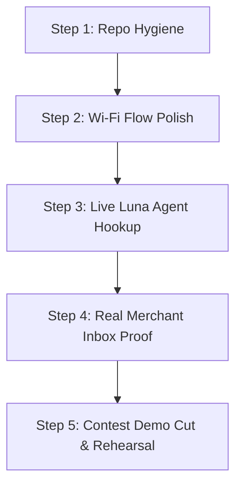

# Dubai-io — Engineering & Product Review: Next Steps
**Review of:** `docs/DUBAI-IO_Product_Enhancement_Review.md`  
**Reviewer:** Gemini (Autonomous Systems & Full-Stack Architecture Review)  
**Date:** 19 October 2026  
**Context:** Create AI Agents Championship — Contest MVP Build

---

## 1. Executive Summary & Verdict

The product enhancement document (`DUBAI-IO_Product_Enhancement_Review.md`) is an **exceptional, high-rigor strategic analysis**. It succeeds at the most difficult task in hackathons and AI competitions: **protecting the project from catastrophic scope bloat, ungrounded technical claims, and legal exposure**, while preserving the emotional hook of the presentation.

### Primary Verdict:
* **Adopt:** The *Truth in Status* doctrine, the *Single Verifiable Agent Proof* (§10.4), the *4-minute staged narrative* (§2.2), and the *Telemarketing/Compliance Hold* (§8).
* **Trim / Defer:** The complex multi-tier enterprise support desk (§7), generic PDF/Docling ingestion pipelines (§5.2), and multi-partner e-commerce protocols (Noon/Amazon L4). These are post-contest enterprise features that will dilute engineering momentum.
* **Immediate Technical Unification:** Consolidate around the active Wi-Fi arrival app (`demo/lab/`) and the FastAPI backend (`apps/api/`), retiring the obsolete v1 prototype (`demo/index.html`).

---

## 2. Critical Analysis of Key Sections

### 2.1 Stage Narrative vs. Demonstrable Proof (§2 & §10.4) — **Rating: 10/10**
* **The Insight:** The document brilliantly delineates between the **Cinematic Story** (7-day visitor arc: DXB arrival, lost ID, haircut, laundry, parking fine twist) and the **Verifiable Agent Proof** (a live, bounded interaction on stage).
* **Why this matters for Judges:** Championship judges immediately penalize teams claiming to have live integrations with government portals (Dubai Police, RTA) or closed platforms (Uber, Noon) when they clearly do not.
* **The Anchor Proof:** Demonstrating a single real flow—*Voice/Text Request → Luna Structured Extraction → Single User Approval Card → Pilot Merchant Inbox Webhook/Socket → Live Chat Status Update*—proves genuine agency without external dependencies.

### 2.2 Google Cloud & $300 Credit Evaluation (§3) — **Rating: 9/10**
* **Accurate Boundaries:** Correctly identifies that Google Cloud welcome credits cannot fund Google AI Studio Gemini API keys, that Places API (New) has SKU billing nuances (Text Search Pro vs. Essentials), and that Google Terms forbid creating a permanent cached replica of local merchant databases.
* **Recommendation:** Keep Google API usage strictly bounded to **Places API (New)** for local venue discovery and **Routes API** for travel duration calculations. Keep all LLM orchestration on server-side endpoints (`apps/api/app/config.py`).

### 2.3 Legal & Compliance Boundaries (§8 & §11) — **Rating: 10/10**
* **The Telemarketing Hold:** The document's strongest defensive contribution is killing the proposal for autonomous AI agents making 1,000 cold calls/day to Dubai merchants. Citing UAE Cabinet Resolutions 56 and 57 of 2024 (telemarketing restrictions, licensing, time windows) prevents severe regulatory penalties and brand damage.
* **Data Privacy:** Explicitly restrains collecting or claiming to process Emirates IDs, passport scans, or banking tokens without lawful integrations.

### 2.4 Human Case Desk & Escalation (§7) — **Rating: 5/10 (Scope Risk)**
* **The Critique:** While logically sound for a commercial concierge service, designing a formal human-in-the-loop coordinator ticketing system with risk tiers, SLAs, and case schemas is **over-engineering for a contest MVP**.
* **Recommendation:** On stage, simulate any human escalation or keep it as a simple status pill (`"Merchant reviewing your request"`), rather than coding an entire CRM back-office.

---

## 3. Position on the 18 Founder Decisions (§13)

| Decision | Recommended Choice | Rationale |
|---|---|---|
| **D01 — Core Agentic Proof** | **Choice A: Pilot Merchant Request + Live Ack** | Real tool selection + real merchant dispatch + real status update. Reliable and verifiable. |
| **D02 — Voice Interface** | **Choice C: Push-to-Talk / Wake State** | Never rely on always-on acoustic wake words in a crowded contest hall. A prominent mic button with instant transcription is 100% resilient. |
| **D03 — Missing Merchant API** | **Choice C: Dubai-io Pilot Inbox** | Direct fixed-price dispatch to a merchant dashboard (built in `apps/api` / lab backstage). |
| **D04 — Proactive Moment** | **Choice B: Staged Geo Trigger → State Update** | An operator-triggered geofence event during the demo demonstrating how the companion pushes cards into chat. |
| **D05 — Fine Appeal Climax** | **Choice A: Climax Only (Simulated)** | Keep the emotional drama of the parking fine being resolved, but explicitly label it as a demonstration narrative. |
| **D06 — Web Sessions** | **Choice A: Copyable Draft / Link Handoff** | Never automate third-party authenticated logins. Deep-link or copyable prefilled data only. |
| **D07 — Google Budget** | **Choice A: Places & Routes First** | Concrete spatial grounding delivers the highest visual and functional value for local services. |
| **D08 — Mini-Apps vs Web** | **Choice A: Native Typed Cards (Default)** | Native cards inside chat provide superior speed and mobile UX over iframe-heavy widgets. |
| **D09 — Launch Promise** | **Choice B: Discovery + 1 Tested Merchant** | Under-promise and over-deliver with one flawless vertical (e.g. laundry or airport transfer). |
| **D10 — Memory Retention** | **Choice A: Typed Trip/Task Facts (Visible)** | Implement user-stated facts with "You told me" badges and "Forget" controls (`apps/api/data/memory.json`). |
| **D11 — Human Recovery** | **Choice B: Lightweight Merchant Status** | Defer full operator desk to post-competition roadmap. |
| **D12 — Community Events** | **Choice A: Curated Verified Sources** | Curated directory entries prevent content moderation failures during testing. |
| **D13 — Discounts/Offers** | **Choice A: Published Fixed-Price Specials** | Strictly maintain the "No bidding / No negotiation" rule from `CLAUDE.md`. |
| **D14 — Merchant Growth** | **Choice B: Inbound Opt-in Portal** | Full legal compliance under UAE regulations. |
| **D15 — Autonomous Execution** | **Choice B: Explicit Approval Card for Side Effects** | User must always tap "Approve" before data or orders leave the device. |
| **D16 — Target Persona** | **Choice A: Arriving Visitor (Contest Arc)** | Perfectly matches the Wi-Fi arrival onboarding flow. |
| **D17 — Stage Format** | **Choice A: 90s Cinematic Intro + 2m Live App Walkthrough + 30s Epilogue** | Optimal 4-minute contest timing. |
| **D18 — Commercial Model** | **Choice A: Merchant Commission on Fixed Services** | Simplest, cleanest unit economics. |

---

## 4. Architectural Realignment: `demo/` & `apps/`

### The Current Reality
1. `demo/index.html` (Legacy v1) is obsolete.
2. `demo/lab/home-v2-cyan.html` is the **active, production-target frontend**:
   - Contains the Wi-Fi onboarding (`demo/lab/arrival.js`), coverflow intro, cyan home cards, and companion chat.
3. `apps/api/` is the **active backend**:
   - Built on FastAPI + LangGraph (`app/main.py`).
   - Serves `demo/lab/` directly at `/lab` and root `/`.
   - Exposes `/api/luna/turn` for AI interactions and `/api/session/memory` for stated user facts.

### Action Plan:
* **Immediate:** Run the stack via `apps/api/` (`uvicorn app.main:app`), pointing the browser to `http://localhost:8000/#wifi`.
* **Cleanup:** Safely archive the old v1 files (`demo/index.html`, `demo/app.js`, `demo/styles.css`) into an archive directory so developers only work on `demo/lab/` and `apps/api/`.
* **Preserve Design Files:** Maintain `demo/_ref/` (especially `01 - visitor wifi.jpg` and the screen flow PNGs) and `screens/` as the immutable design truth.

---

## 5. Next Steps Roadmap

1. **Step 1: Clean Architecture Boundary**
   - Confirm `demo/lab` as the single UI entry point.
   - Serve exclusively through `apps/api`.
2. **Step 2: Polish the Wi-Fi Arrival Flow**
   - Test `demo/lab/arrival.js` on desktop and mobile Safari viewports.
   - Ensure the captive portal transition into the install sheet feels native and frictionless.
3. **Step 3: Connect Luna Agent Loop**
   - Ensure `/api/luna/turn` produces structured card payloads (Service Name, Provider, Price, Delivery Time, "Approve" button).
4. **Step 4: Connect the Backstage Merchant Inbox**
   - When the user taps "Approve", dispatch the event to the merchant inbox (`demo/lab/` backstage or a dedicated view).
   - Simulating the merchant tapping "Accept" sends a real event back to update the user's chat thread.
5. **Step 5: 4-Minute Presentation Rehearsal**
   - Time the live walkthrough according to Cut B (§2.3) in the enhancement review.
