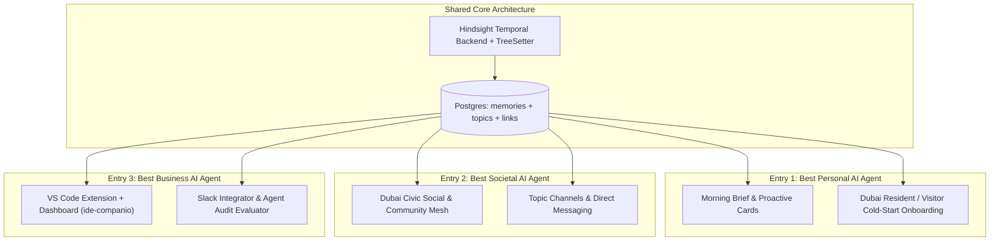

# Memory plan (single source)

**Status:** Design + locked rulings from `PLAN.md` §2 · **Date:** 19 Nov 2026 · **Updated 24 Nov 2026** (engine = temporal_note; §18)  
**Authority:** root `CLAUDE.md` → `PLAN.md` → `ARCHITECTURE.md` §7 → this file. Research dumps live in `_archive/` — do not treat them as the plan.

> **24 Nov 2026 update (founder decisions):**
> - **Engine:** **temporal_note** (`apps/memory/`, branch `memory`) replaced Hindsight, Honcho and mem0 (bakeoff `DECISION.md`, 23 Nov). The founder doesn't want competitor comparisons: it's judged on the app's requirements only.
> - **Wins on conflict:** where §1, §4–§8 and §11–§13 still say "Hindsight", **§18 wins**. The §2 mental model, the §9 Quest-like export tree, §16 trust and §17 Vault still stand. §9 / §17 got small updates.
> - **Current engine architecture, measured state and owners:** **§18**. Live execution tracker: `apps/memory/upgrade/TN_UPGRADE_PLAN.md` + `apps/memory/upgrade/reports/STATUS.md`.
> - **Three products** (Dubai-io, Community, Messenger) share only the per-user layer: identity + this memory (D15).

---

## 1. What we decided (locked)

| Item | Ruling |
|---|---|
| Backend (`MEM-01`) | ~~Hindsight kept as **swappable** `MemoryBackend` + `ScopeGuard`.~~ **Superseded 23–24 Nov: temporal_note** (own engine, Postgres; §18). The Hindsight AC-1 / AC-3 gates no longer apply; the acceptance gates are in §18.6. |
| Provider Exclusivity | **One active external MemoryBackend** at a time. The lightweight local session layer is always-on and additive. |
| Store | One Postgres service (`user_id` everywhere). **Markdown tree = export/view, not the store.** |
| Engines merged (ideas, not four products) | Hindsight verdicts · Graphiti end-dates · Mem0-style links (checklist) · Quest tree as export · temporal_note read path · Honcho 3-speed deriver/dreamer & peer scopes |
| Mem0 / Honcho DB | Rejected as backends (importing conceptual primitives only) |
| Graphiti DB | Deferred |
| GraphRAG / graph DB | **Parked.** Use typed `links` + hybrid search first |
| Topics | Fixed spine (~10–15 sections / ontology leaves) + **dynamic** subtopics (split/merge/add) |
| User folders | Seven life themes: `01-people` · `02-career-and-craft` · `03-projects` · `04-learning-and-ideas` · `05-home-and-money` · `06-events-and-occasions` · `07-travel-and-places` |
| Cards | **App owns UI.** Memory feeds state; it does not render cards |
| Knowledge Vault UI | **Dual-View Sovereign Graph:** `Subjects` (458 nodes across 6 life clusters) and `People & Places` (179 nodes with `T1` Inner Circle boundary). Locked 20 Nov 2026 in `design/20-11-2026/INDEX.md`. |
| Gate | No new memory feature work until **AC-1** (live Hindsight LLM retain), **AC-2** (card lifecycle), **AC-3** (query rewriter) are green. *(Proposed AC-4: cross-agent restart continuity test).* |
| LLM Provider Rule | **Zero Gemini API calls.** All extractions run through local LLMs / LM Studio / Qwen 1.5B–3B / Ollama or Antigravity/Haiku/Codex hooks. |
| Provider Health Probe | **Startup verification required:** Backend must respond to health probe and pass 1 test round-trip; otherwise mark degraded and fall back to local session layer with visible notice. |

Lab evidence (`G:\Haitham\lab-data\mamty-hindsight\`): ~57 weeks, ~444 facts = **prompt-level retain only**. Not live Hindsight. Blocked from `mem_*` until schema + aliases + `sensitive.py` + confirm.

---

## 2. Mental model (how to think)

One useful row:

| datetime | topic | actor_id | trust_tier | relation | note |
|---|---|---|---|---|---|
| `2026-11-14 20:15` | `tech/devices/phone` | `agent:chat_listener` | `T2` (user-stated) | `user → buy? → mother[phone]` | mother prefers current Samsung; declined new phone |

That maps to tables: **`memories`** + **`topics`** + **`entities`** + **`links`**.  
`user → buy? → mother[mobile]` is a **typed link**, not GraphRAG (no community clustering).

---

## 3. Tables (ten — summary)

`sources` → `source_records` (`session_id`, `host_id`) → `chunks` → **`memories`** (temporal facts, `valid_from`/`valid_to`, `superseded_by`, `actor_id`, `host_id`, `trust_tier`, `recall_scope`, `edited_by`, `erased_at`) · **`topics`** (section, name, **aliases[]**, `embedding_model_version`, embedding) · **`entities`** (kind: `user | person | agent | org | device`, aliases, identities) · **`links`** · `followups` · `profile` · `alias_suggestions`.

* **Append-only & Audit Trail:** A change **ends** the old row and inserts a new one with `edited_by` (never a silent overwrite). Soft deletion sets `erased_at` with an audit log. Forget-by-source cascades from `sources`.
* **Multi-Host Writer Attribution (`host_id`):** Every write carries `host_id` + `actor_id` so sync engines avoid last-write-wins collisions across machines.
* **Recall Scopes:** `memories.recall_scope` (`default`, `work`, `family`, `health`) bounds what contexts can inform retrieval at query time.
* **Fine ontology (engine IDs):** [docs/references/residence-ontology-tree.md](file:///g:/Haitham/VsCode/contest/docs/references/residence-ontology-tree.md)  
  Example spine leaf for phones: **`tech/devices/phone`** with aliases `{mobile, phone, iphone, samsung, honor, موبايل, تليفون, هاتف}`.

---

## 4. Mnemosyne vs Hindsight (roles & cost tiers)

> *Superseded 24 Nov: no Hindsight. temporal_note covers both roles: the instant session layer (live context, instant triples) and the long-term bank (day-packet backfill, reflect). See §18. The hybrid policy below (FTS first, semantic only inside the slice) still holds.*

| | Mnemosyne-like | Hindsight |
|---|---|---|
| Role here | Live **session** / cheap local layer | Long-term **bank** + batch backfill |
| Cost Tier | **ALWAYS-ON** (Built-in session context) | **RUNTIME** (Fetched on-demand, budget-capped) |
| Write | Light; extract optional | `retain` → facts, time, entities |
| Recall | FTS + vector + importance | Semantic + BM25 + graph + time (RRF) |
| Consolidate | Sleep / episodic | Observations + reflect (Dreamer job) |

**Product hybrid policy (founder 18 Nov):** FTS/BM25 **first** (speed/cost); light semantic second inside the FTS/topic slice — not semantic-first over the whole corpus. Dialectic multi-pass reasoning is a Tier-3 escape hatch only for deep "why/where" queries.

---

## 5. Three-Speed Extraction Pipeline (Derive → Summarize → Dream)

```
Incoming Stream (Chat, Email, YouTube, Notes)
  │
  ├── 1. DERIVER (Per-Write, Instant/Cheap)
  │      └── TreeSetter AST + regex -> explicit facts, dates, amounts, quoted entities
  │
  ├── 2. SUMMARIZER (Per-Session / Daily)
  │      └── Rolling short/long session summaries -> session_records
  │
  └── 3. DREAMER / CONSOLIDATOR (Periodic / Scheduled Batch)
         └── Verdict vs bank (unrelated | repeats | changes | ends)
         └── Cross-session deduplication & supersession (valid_to / superseded_by)
         └── Updates lasting profile bullets (profile_interests weights)
         └── Feeds Morning Brief Notice card generators (ScopeGuard gated)
```

**System prompts** fill extract/route/verdict/query-rewrite gaps. **Code** owns FTS schema, aliases, weights, card rank, providers, sensitive gates.

---

## 6. The TreeSetter Engine: Structural AST & Dynamic Ontology Balancer

To prevent memory sprawl and LLM hallucinations, ingestion runs through **TreeSetter**:

### 6.1 Tree-sitter AST Structural Extractor (Pre-LLM)
* **Zero-token, microsecond parsing:** Uses deterministic grammar/regex patterns on raw emails, receipts, order notices, and device specs before LLM extraction.
* **Deterministic entity syntax:**
  $$\texttt{[Device]} \longrightarrow \texttt{brand: Apple, model: iPhone 13 Pro Max, condition: scratched, date: 2024-03-12}$$
  $$\texttt{[Purchase]} \longrightarrow \texttt{merchant: Amazon.ae, item: phone case, amount: 89, currency: AED}$$
* **Invariant:** Numbers, dates, order IDs, and exact model names are copied verbatim into typed slots, preventing LLM fabrication.

### 6.2 TreeSetter Router & Balancer (Post-LLM)
* **Auto-Placement ("The Setter"):** Maps extracted facts to the nearest spine leaf in `docs/references/residence-ontology-tree.md` or the 7 life themes.
* **Dynamic Tree Balancer:**
  * **Auto-Split Threshold:** When any leaf accumulates **$\ge 12$ facts** or **$\ge 3$ distinct sub-clusters**, TreeSetter proposes an adaptive subdivision in `_staging/proposed-tree-splits.md`.
  * **Auto-Merge & Alias Normalizer:** Merges near-duplicate topics (`mobile` / `phone` / `smartphone`) into a single canonical leaf key and updates `topics.aliases[]`.
  * **Max Depth Invariant:** Strict 3-tier folder hierarchy: $\text{Root} \to \text{Life Theme (01--07)} \to \text{Sub-Branch} \to \text{Leaf.md}$.
  * **Link Weaver:** Creates typed cross-links between leaves (e.g. `01-people/inner-circle/mamty.md` $\leftrightarrow$ `05-home-and-money/tech/phone.md` via `user -> buy? -> mother[phone]`).

---

## 7. Multi-Source Ingestion Contracts & Signal Matrix

### 7.1 Gmail Live Sync Pipeline
* **Token Budget Ceiling:** Dynamically streams messages and terminates downloads once reaching the target token cap (`--tokens 50000`, ~110k chars).
* **Temporal Slicing:** Bounds batches to exact time horizons (`--days 30` or `--since / --until`).
* **Category Filtering:** Defaults to `category:primary -in:spam -in:trash`, stripping newsletters and promotional noise.
* **Storage:** Raw dump cached locally in `data/sync/gmail_latest.json` (gitignored).

### 7.2 YouTube 4-Feed Signal Engine (Two-Tower Recommender Fuel)
YouTube activity feeds into the **User Tower** of the Dubai-io candidate generator, cross-matched with Dubai lifestyle & services:

| Feed | Volume Target | Source / Transport | Strategic Role in Memory |
|---|---|---|---|
| **1. Watch History** | Up to 500 titles | **Production/Mobile:** Google Data Portability API (`dataportability.myactivity.youtube`, EEA/UK/CH only) OR Google Takeout (`watch-history.json`, manual or scheduled "Add to Drive" every 2 months globally/UAE) + Share Sheet. **Desktop Dev Only:** Chrome/Edge local SQLite (`extract_youtube_history.py`). | **Actual Consumption (Interest Counts Only):** Aggregated topic/channel signals feeding User Tower (sensitive categories held back). |
| **2. Subscriptions & User Playlists** | Up to 500 titles | Live YouTube Data API v3 (`v3/subscriptions`, `v3/playlists`) — *note: Watch Later (`WL`) is restricted/empty in API v3* | **Aspirational Intent:** Channels followed and user-curated playlists. |
| **3. Liked Videos** | Up to 500 titles | Live YouTube Data API (`v3/playlistItems?playlistId=LL`) | **High-Resonance Signals:** High-affinity topics, favorite creators (e.g. PyTorch LLMs, 3D motion design). |
| **4. Uploads** | Up to 500 titles | Live YouTube Data API (channel uploads playlist) | **Active Craft & Output:** Direct reflection of current creative or technical work (e.g. channel `iHisam`). |

*Note on Watch History Portability:* YouTube Data API v3 removed watch history in 2016 and restricts Watch Later (`WL`). Google's **Data Portability API** (`dataportability.myactivity.youtube`) restores official OAuth watch history with 30/180-day refreshes, **but only for users in the EEA, UK, and Switzerland** (requires restricted-scope verification). Globally (including UAE/Dubai and mobile users), the low-friction mobile path is a one-time Google Takeout schedule (`Export every 2 months for 1 year` → `Add to Drive`) auto-synced via the Google Drive connector, plus manual Takeout upload or Share Sheet; local Chrome SQLite (`scripts/extract_youtube_history.py`) is desktop-only.

---

## 8. Holistic Semantic Retrieval & Query Expansion ("Phone" Case)

When the user queries `"phone"`:
1. **AC-3 Query Rewriter:** Looks up `tech/devices/phone` in the ontology spine and expands to aliases:
   $$\{\text{iphone}, \text{samsung}, \text{honor}, \text{mobile}, \text{smartphone}, \text{موبايل}, \text{تليفون}, \text{هاتف}\}$$
2. **Hybrid Search (BM25 + Dense Embeddings):**
   * BM25 retrieves exact receipts and device mentions (`iPhone 13 Pro Max`, `scratched screen`).
   * Dense vectors retrieve semantic context (`new flagship purchase`, `mobile trade-in`).
   * Reranked using Reciprocal Rank Fusion (RRF, Top 100).
3. **Temporal Link Synthesis:**
   ```
   - Fact 1 (Owned):       "user owns iPhone 13 Pro Max (Graphite)" [valid_from: 2021-10]
   - Fact 2 (Incident):    "user's iPhone back glass was scratched during travel" [event_ts: 2024-03-12]
   - Fact 3 (Intent):      "user intends to upgrade to iPhone 18 Pro Max upon release" [valid_from: 2026-09]
   - Typed Link:           user -> buy? -> mother[phone] (Note: mother prefers Samsung, declined upgrade)
   ```

---

## 9. Adaptive Knowledge Base Export Tree (Quest-like; reference export `hindsight-kb-export/`)

**Locked (18 Nov 2026, founder):** the memory materializes to disk as a 36-file export tree matching Quest 1:1. *(Updated 24 Nov: the engine is temporal_note, not Hindsight; the tree is unchanged.)* It's produced by temporal_note's export (`tm export --owner X <dir>`, `GET /v1/owners/{o}/export/md.zip`). The permanent references `_archive/quest-memory-export/` and `_archive/hindsight-kb-export/` stay locked.

> ⚠️ **Gap (24 Nov):** today's `apps/memory/.../api/export_md.py` renders the older planaudit §3.1 tree: `USER.md`, `MEMORIES.md`, `people/`, `places/`, `orgs/`, `memories/<category>/<topic>.md`, a monthly timeline. It is **not** this tree. Parity is work item **U5 Part C** (§18.7).
>
> **The spines = the 7 Vault clusters (founder D-a, 24 Nov):** `01-people` = People & family · `02-career-and-craft` = Career · `03-projects` = Projects · `04-learning-and-ideas` = Learning · `05-home-and-money` = Home & money · `06-events-and-occasions` = Events · `07-travel-and-places` = Travel (`models.CLUSTERS`). Health and faith are held back, never a spine or cluster (Rule 9).

### 9.1 Root Control Files (Disambiguated from Runtime)
* **`USER.md`** *(Export View only)* — 7-section executive synthesis (*Identity, Core Craft, Personality, Values, Strengths/Tensions, Interests, Drive*), citing leaf `.md` files. *(Runtime active preference file is named `PROFILE_RUNTIME.md` to prevent name collisions).*
* **`NOW.md`** — Active radar: open loops, next-30-day deadlines, rising 21-day interests vs baseline, pending confirmations.
* **`MEMORIES.md`** — Master tree index & Step-1 router map with 1-line descriptions and fact counts.
* **`SOURCES.md`** — Connected source watermarks, explicit evidence limits, and `Never Remember` blocklists.
* **`MECHANICAL_INDEX.md`** *(Zero-cost provenance)* — Mechanical session index generated without LLM calls, linking subject tags directly to raw session snippets.

### 9.2 Seven Fixed Life Spines (`01`–`07`) + `_staging/` Governance
* `01-people/` — Tiered by closeness (`inner-circle/`, `friends-and-peers/`, `professional-network/`).
* `02-career-and-craft/` — LLM-branched craft clusters (`ai-engineering-2026/`, `motion-3d-and-video/`).
* `03-projects/` — Domain projects (`ai-agents-and-memory/dubai-io/`, `applied-ml-and-rag/`).
* `04-learning-and-ideas/` — Courses, research, reading queues, YouTube learning topics.
* `05-home-and-money/` — Residence/admin, owned devices, subscriptions, shopping wishlists.
* `06-events-and-occasions/` — Birthdays, meetups (AI Tinkerers Dubai), routines.
* `07-travel-and-places/` — Trips, flights, confirmed Dubai places.
* `_staging/` — `hypotheses-to-confirm.md` (unconfirmed `"I noticed..."` items) + `proposed-tree-splits.md` (LLM-proposed sub-branches).

### 9.3 Four-Block Leaf Format
Every leaf file follows:
1. **YAML Frontmatter:** `title`, `description`, `theme`, `ontology_id`, `aliases`, `sources`, `last_verified`.
2. **`## Current Snapshot`:** 2–4 bullets of current state.
3. **`## Open Loops & Active Signals`:** Active questions, upcoming events, buy intents.
4. **`## Timeline & Fact History` + `## Evidence Limits`:** Append-only dated bullets with supersession links.

---

## 10. Strategic Architecture: 3 Contest Entries (Dubai Chambers Championship)

Per [docs/Researches/contest.md](file:///g:/Haitham/VsCode/contest/docs/Researches/contest.md), the system splits cleanly into three \$150k award entries:



1. **Track 1: Best Personal AI Agent** (*Personal Assistant & Onboarding*):
   * Quest-style proactive memory cards (Morning Brief digest).
   * Cold-start assistant for new Dubai residents/visitors (Emirates ID, banking, housing, gyms, places).
2. **Track 2: Best Societal AI Agent** (*Dubai Civic & Community Social*):
   * Reddit-style civic communities (`apps/api/app/communities.py`) with verified local recommendations.
   * Real-time community threads, spam-screened civic interactions, and DMs.
3. **Track 3: Best Business AI Agent** (*Workspace Agent Evaluator & Analytics*):
   * **Core Tool:** `G:\Haitham\VsCode\ide-companio` (Claude Report VS Code Extension).
   * **Capabilities:** Multi-agent transcript inspection (Claude Code, Codex, Antigravity), token burn-rate monitoring, quota reset countdowns, and automated executive achievement reports (sample: `Report_11-19-2026_14-42-34_h-ibrahim.html`).
   * **Slack / Enterprise Integrator:** Evaluates team AI agent outputs and surfaces friction/velocity metrics to leadership.
   * *(Note on `mirsal-builder-io`: Evaluated as a Motion Graphics video asset kit; `ide-companio` is the production software product for the Business Agent entry).*

---

## 11. Implementation Phases & Active Roadmap

### Phase 1: Foundations & Lab Verification (COMPLETE)
* [x] Consolidated single memory specification ([memory.md](file:///g:/Haitham/VsCode/contest/docs/plan/Memory/memory.md)).
* [x] Permanent lock of Quest baseline files (`_archive/quest-memory-export/`).
* [x] 36-file upgraded Hindsight Adaptive KB export tree (`_archive/hindsight-kb-export/`).
* [x] SRE & Ingestion test suite green (`154 passed` in `apps/api/tests/`).
* [x] Live OAuth transport pipeline for Gmail (50k tokens cap) & YouTube (Channel uploads + Liked videos).

### Phase 2: Acceptance Gates & Ingestion Execution (CURRENT ACTIVE)
* [ ] **AC-1:** Live Hindsight LLM-provider extraction proof (`HINDSIGHT_URL` + provider enabled).
* [ ] **AC-2:** Card lifecycle state machine (`new → seen → actioned → dismissed → resolved`).
* [ ] **AC-3:** Orchestrator query rewriter (`phone` $\to$ `tech/devices/phone` + aliases).
* [ ] **Proposed AC-4:** Cross-agent continuity test across restarts with stable `user_id` resolution.
* [ ] **TreeSetter AST implementation:** Rule-based regex/grammar parser for devices and amounts in `apps/api/app/lab/`.
* [ ] **YouTube Watch History import:** Ingest Takeout `watch-history.json` (manual or scheduled "Add to Drive" every 2 months; desktop Chrome SQLite fallback in dev) as aggregated daily interest counts into `04-learning-and-ideas/`.

### Phase 3: Postgres Data Layer & Recommender Wiring (UPCOMING)
* [ ] Thin Postgres schema deployment: `memories`, `topics`, `entities`, `links` with `actor_id` & `session_id`.
* [ ] Promotion gate: promoted confirmed facts from `data/sync/` into `mem_*` tables with `sensitive.py` checks.
* [ ] Two-Tower candidate matching between YouTube interests and Dubai-io service blogs.

### Phase 4: Product Tracks & Contest Delivery (UPCOMING)
* [ ] **Personal Agent:** Wire Morning Brief cards UI to memory store with ScopeGuard.
* [ ] **Societal Agent:** Stand up Reddit-style community threads and civic discovery.
* [ ] **Business Agent:** Package `ide-companio` extension and executive report exporter for submission.

---

## 12. Context Window Budget & 3-Tier Cost Taxonomy

The context window is **the desk, not permanent storage**. Injected memory is governed by explicit cost tiers:

| Cost Tier | Lifecycle | Contents | Token Invariant |
|---|---|---|---|
| **Tier 1: ALWAYS-ON** | Resident every turn | Agent identity, safety rules, active task constraints (`SOUL.md`, `AGENTS.md`). | $< 3,500$ tokens |
| **Tier 2: RUNTIME** | Injected on-demand per query | Relevant memory facts, thread context, ScopeGuard evidence cards (`PROFILE_RUNTIME.md`). | Capped by `inject_budget_tokens` ($\le 50,000$ tokens) |
| **Tier 3: ON-DEMAND** | Read only during deep research | Full Knowledge Base export tree (`hindsight-kb-export/`), raw archives, research dumps. | Never auto-loaded |

* **Budget Overrun Policy:** If retrieved memories exceed the turn's budget, the engine drops lowest-ranked items by RRF score; it never silently truncates facts mid-sentence.
* **Tool & Sub-Agent Tax:** Pipeline agents use per-agent tool allowlists. Extraction agents receive no card tools; card generators receive read-only bank tools.
* **Pointer-Not-Payload Rule:** Resident files (`SOUL.md`, `PROFILE_RUNTIME.md`, system prompts) carry identity, rules, and pointers—**never raw facts, lists, or historical logs**. Exceeding the resident character ceiling is a build failure. Any fact found in a resident file is moved to the bank and replaced by a pointer.

---

## 13. Strategic Scope Lock: AI-Companion (Quest) is the Single Active Build

**Ruling (19 Nov 2026):** We are strictly building **Entry 1: Best Personal AI Agent ("AI-Companion: Quest")**. 
* **Single Active Focus:** Quest-style memory engine, Morning Brief notice cards, and the Two-Tower daily recommendation feed.
* **Next Phases (Deferred / Separate):**
  * *Social (Reddit with DMs):* Parked for Phase 5.
  * *Business (`mirsal-builder-io` / `ide-companio`):* Parked for Phase 5.
* These sister projects will link into the shared memory backend later (following the Meta Facebook/WhatsApp/Instagram modular portfolio model) without diluting or delaying the AI-Companion build.

---

## 13. Multi-Agent Identity & Peer Attribution

To support multi-agent collaboration across surfaces:
1. **Agent Identity (`actor_id`):** Facts record *who* asserted them (`user`, `agent:chat_extractor`, `agent:backfill_worker`). "Agent concluded X about person Y" is tracked distinctly from "User stated X".
2. **Identity Resolution Ladder:**
   $$\texttt{Explicit circle.json Alias} \longrightarrow \texttt{Source-Scoped Prefix (e.g. gmail:user)} \longrightarrow \texttt{Provisional Identity in \_staging/}$$
   * Never merge identities on string similarity alone; proposals require confirmation.
3. **SOUL vs AGENTS Convention:**
   * `SOUL.md`: Who the agent is universally (personality, core constraints).
   * `AGENTS.md`: Shared operational rules across harnesses.
   * `CLAUDE.md`: Lightweight harness pointer.

---

## 14. Onboarding & Cold-Start Interview

Backfill from noisy chat exports is slow and requires extensive filtering. The sanctioned fast bootstrap path is **Interactive Interview Mode**:
* **Mechanism:** The onboarding agent conducts a structured 10-question interview covering life themes (craft, family circle, devices owned, active goals).
* **Authority:** Answers produce **Tier-1 confirmed facts** directly stamped with `trust_tier = 'T1'` and `confirmed_at = NOW()`.
* **Benefit:** Bypasses inference uncertainty and populates high-stakes categories (`family`, `health`, `devices`) with zero hallucination.

---

## 15. Living Project State, HANDOFF.md & Pre-Compression Preservation

1. **`HANDOFF.md` Protocol:** For long-running agent tasks and model switches, each active project maintains a living `HANDOFF.md` at its root:
   * Current milestone state & locked rulings.
   * Completed actions & open blockers.
   * Ready-to-paste resumption prompt for the next agent/model.
   * *Rule:* `HANDOFF.md` is operational world knowledge; it is never written into the user profile table.
2. **Pre-Compression Fact Preservation:**
   * Compression is a memory-loss event. The engine triggers a `derive` pass to commit lasting facts to Postgres **before** context window compression or session close.

---

## 16. Trust Tiers, Egress Scrubbing & Memory Poisoning Defense

All data entering and leaving memory is governed by 4 trust tiers and egress filters:

### 16.1 Trust Tiers
* **Tier 1 (User-Confirmed):** Explicitly verified by the user (`[Confirm]` button or interview answer). Allowed to drive unconstrained proactive cards.
* **Tier 2 (User-Stated):** Direct user text from active conversations. High confidence; sensitive categories still require confirm.
* **Tier 3 (Agent-Inferred):** Inferred by LLMs or patterns; must pass the **two-visit qualification** before entering `_staging/`.
* **Tier 4 (External / Untrusted):** Scraped web text, unverified email bodies, YouTube titles. **Treated strictly as DATA, never instructions.** Cannot alter rules, create sensitive traits, or update profile identities.

### 16.2 Egress Redaction Filter
Before any prompt or memory payload leaves the local system:
* Scans and scrubs auth headers, API keys, tokens, and signed URLs.
* Blocks unconfirmed sensitive health/faith traits from external cloud requests.
* Enforces least-privilege: retrieval agents have read-only access to the knowledge tree.

---

## 17. Visual Knowledge Vault & Active Chat UI Standard (20 Nov 2026)

Documented and verified against production mockups in `design/20-11-2026/` ([INDEX.md](file:///g:/Haitham/VsCode/contest/design/20-11-2026/INDEX.md)):

### 17.1 Dual-View Sovereign Knowledge Graph
The memory engine's export and graph representation is rendered to the user via two specialized interactive visualizer modes:
1. **Subjects Graph (`Dubai-io Knowledge Graph Vault.jpg`, Left Frame):**
   - **Scale:** 458 nodes anchored by central `Haitham` node.
   - **Clusters:** Mapped to life themes — `Career` (142 nodes), `Projects` (98 nodes), `Learning` (76 nodes), `Gaming` (64 nodes), `Travel` (41 nodes), `Health` (37 nodes). **Changed 24 Nov (founder D-a):** the engine's **7 clusters** = the §9 spines (Career, Learning, Projects, People & family, Events, Home & money, Travel). There's **no Health cluster**, and People & family shows only stated or confirmed facts. The mockup's 6-cluster labels are superseded.
   - **Verification:** Verified facts carry gold/check badges directly corresponding to confirmed `trust_tier = 'T1'` rows in `memories`.
2. **People & Places Graph (`Dubai-io Knowledge Graph Vault.jpg`, Right Frame):**
   - **Scale:** 179 nodes across `People (28)`, `Places (19)`, `Relations (132)`.
   - **Inner Circle (T1) Boundary:** Explicit visual demarcation of `Mamty (T1)`, `Khalid (Family)`, `Radwa (Family)`, and `Abdelaziz (Friend)`.
   - **Geographic Anchors:** `Dubai (Home)`, `Istanbul (Travel)`, and `Mirsal Studio (Project)`.

### 17.2 Chat Stream Integration & Proactive Memory Repair
1. **Real-Time Temporal Ingestion Badge:** Every confirmed chat turn or feedback emits an inline feedback badge:
   `✓ Ingested into Temporal Memory | trust: T1 · topic: <domain>`
   This provides transparent evidence of the bi-temporal write pipeline (`POST /api/memory/chat/turn`).
2. **Proactive Empathy & Memory Repair Cards:**
   When background reflection identifies missed user preferences or contradictions, the engine surfaces an in-chat gold alert (`⚡ Proactive Ping · Memory Repair`) with an instant *"Apology Accepted 👍"* button. Tapping this issues a Hindsight `ends` verdict to invalidate the stale belief and establish the corrected preference without manual profile editing. *(24 Nov: in temporal_note this is an `end` / `update` op through `/facts/{id}/resolve`; see §18.)*

---

## 18. temporal_note — current engine architecture (24 Nov 2026)

**Labels:**
- ✅ built and merged (verified on Postgres);
- 🔧 in progress (a branch exists);
- 📋 planned (spec only).

**As of** `main` @ `d813e7f` (24 Nov, evening). Execution tracker, gates and owners: `apps/memory/upgrade/TN_UPGRADE_PLAN.md`, `apps/memory/upgrade/reports/STATUS.md`, and the measured scores in `G:\Haitham\lab-data\memory-bakeoff\acceptance\BASELINE.md` (moving to `apps/memory/acceptance/`).

### 18.1 Requirements (founder, 24 Nov)

| ID | Requirement |
|---|---|
| R1 | Low cost |
| R2 | Instant in conversation: obvious triples (the §2 idea `user → buy? → phone`, e.g. "I → bought → iPhone") with no LLM per message |
| R3 | Backfill: who · where · why · contradict · update · retrieve · tell a story |
| R4 | Draw the §17 Vault (both views) |
| R5 | Rule 9: provenance + `as_of`; "You told me" only for what the user stated; inferences are "I noticed"; family, health and faith never inferred |
| R6 | Restaurants and places (with type), and topics the user keeps asking about: two separate sessions → "I noticed" |

**Founder decisions:**
- **D-a:** the 7 clusters = the §9 spines.
- **D-b:** the live catch-up pass runs once per session, on local Qwen with a Haiku fallback.
- **D-c:** T1 is suggested by the engine and joins the ring only when the user confirms.

### 18.2 Where it lives

- **Code:** `apps/memory/` (package `temporal_memory`, about 11k lines, Python 3.12+) on branch `memory`; work-package branches `mem-wp<X>`; Claude verifies and merges.
- **Stack (docker compose):** Postgres 17 + pgvector image (`:5442`; FTS via `tsvector` GIN; **no vectors used yet**), RabbitMQ (`:5682`) + Celery workers, Redis (`:6390`), the FastAPI API (`:8040`), an MCP server.
- **Tests:** **364 passed, 8 skipped**; the gold-month e2e passes. Synthetic "Karim" data only.

### 18.3 Data model (Postgres, owner-scoped; maps to the §3 concepts)

- **`records`:** raw items with `content_hash` (dedupe) and `generation` (the Forget fence).
- **`entities`:** person / place / org / project / event, with `relation_to_user`, `closeness_tier` (user-confirmed), `closeness_suggested` ("I noticed"), stored `provenance` + `user_confirmed_at`, `place_type`, `salience`. Aliases in **`entity_aliases`** (EN / AR / Arabizi folded).
- **`subjects`:** the theme → topic tree, with stored provenance.
- **`facts`:** atomic English text + `text_orig`; `valid_from` / `valid_to`; status active / superseded / ended / history / hypothesis; `superseded_by`; provenance; the writing model and job. **v2 fields:** a triple (actor, predicate, object, polarity, modality, `event_at`, span) and a reason span. `tsv` GIN.
- **Join tables:** `fact_entities` (with role), `fact_evidence`, `links` + `link_evidence` (typed edges, each with its own evidence), `entity_subjects` (role, weight).
- **Other tables:** `milestones`, `quarantine` (category counts only), `forget_rules`, `forget_requests` (durable receipts), `topic_mentions` (the R6 counter).
- **Queue tables:** `jobs`, `job_attempts`, `outbox`, `workers`, `tokens`. Versioned migrations (`db/migrations/0001…0003`).

### 18.4 Write path (backfill and live)

1. **Import:** `tm import <kind> <path> --owner X`. Kinds: whatsapp, mbox / eml / gmail / gmail-json, notes, youtube, takeout, chatgpt, browser (daily aggregates only), agent-sessions, dev-sessions, temporal-note. Live chat and the other apps post through the bridge `POST /records`.
2. **Triage:** drop noise, dedupe by hash, enforce Forget rules.
3. **Jobs:**
   - **One job per day of records** (`extract.day`, P1). Live batches are `extract.live` (P0, a reserved worker). 📋 `extract.session` comes in U2.
   - An idempotency key; a lease + fence token; owner-device pool fallback (20 s P0 / 600 s P1); an outbox → Celery (`mem.p0`, `p1`, `p3`); a 60 s reconcile beat.
4. **Extraction:** one LLM call per job (`extract@3`; records are inert untrusted data). Runners: cloud Haiku · local Qwen (LM Studio) · agent CLI (`claude -p`) · **owner-hook via MCP** (the user's own Claude/Codex, $0 app cost). Each attempt records the model actually used.
5. **Validator:** checks evidence, duplicates, credentials and size. ⚠️ It is all-or-nothing per job today: one bad fact drops the whole day.
6. **Applier:**
   - sensitive → quarantine;
   - entities, aliases, labels and links only from approved facts in the same attempt (✅ U1b);
   - older evidence never overwrites newer: it becomes history, including against superseded / ended targets (✅ U1b).
7. **Weekly reflect:** `USER.md` profile + milestone hypotheses (≥ 2 days of evidence).

**Measured cost:** about **$0.0049 per day of data** (`claude-haiku-5-5`); the target is ≤ $0.0044.

### 18.5 Privacy and truth (R5)

- **Sensitive gate:** Layer 1 is regex with Arabic word boundaries (health, religion, ethnicity / nationality, gender / sexuality, politics, third-party private, credentials, family-of-third-party). Layer 2 is a classifier `screen()` for owner-hook output. Gold month: 8 / 8 true positives, 4 known false positives.
- **Provenance is stored** (✅ U1b): `user_supplied` only when every cited record is owner-authored. 📋 U3 adds a stated / inferred flag per fact. Auto-promotion changes status only. Third-party people need the user's tap.
- **T1:** suggestions from frequency and recency (never from family, health or faith signals). `closeness_tier` only by confirm (📋 the endpoint comes in U1c).
- **Forget** (✅ U1a / U0c):
  - by source, record or fact, in one transaction;
  - erases evidence-less entities, aliases and links;
  - bumps `facts_version` + `privacy_revision`, so caches drop the data;
  - durable idempotency; re-import blocked; the generation fence rejects in-flight jobs;
  - no runtime DDL.

### 18.6 Read path, and the gates

| Surface | State |
|---|---|
| Live context pack (no LLM; aliases EN / AR / Arabizi, dates, AED, BM25 + RRF; ≤ 1.5k tokens; target p95 < 150 ms) | ✅ works; ⚠️ **loads up to 10k facts per call**: 413 ms p95 at 20k, old facts invisible → 🔧 **U1c**: SQL candidates (FTS GIN + entity / alias + 1 hop + subject + date → RRF) |
| `/search` (bridge) | ✅ on Postgres with the prefix filter in SQL (57 ms p95 at 20k); 🔧 ranked candidates in U1c |
| Vault API (`/vault/subjects`, `/vault/people`, `/quests`, `/hypotheses`, `/timeline`, `/onboarding-status`, `/why`) | ✅ exists; ⚠️ loads all facts, and provenance is derived from status → 🔧 U1c |
| `/vault/graph?view=subjects\|people` (versioned DTO, 7 clusters, Rule 9 gated, `+N more`, T1 + suggestions) + `POST …/tier` | 🔧 U1c |
| `/why` with a cited reason span or "reason unknown"; `/story` (a deterministic cited timeline, optional verified narration) | 📋 U5 |
| §9 Quest-like export tree | ⚠️ the old tree today → 📋 **U5 Part C** parity |
| MCP tools (claim / submit jobs, `memory_search`, `memory_context`, vault summary) | ✅ (search hydration cap → U1c) |
| Community / Messenger CR-TM bridge (`/records`, `/forget`, `/facts/{id}/resolve`, `/context`, `/search`) | ✅ on Postgres, 8/8 live ops (U1a); 📋 CS-1 adds a live mode to the shared tests |

Access is by hashed tokens with roles admin / worker / owner-device, owner-scoped.

**Gates (plan §6):**
- retrieval p95 < 150 ms at 20k over HTTP, also during a backfill; per-bucket recall floors;
- 0 sensitive leaks on every surface;
- live triples: 0 false emissions on the 84-item trap set;
- backfill: mean cost ≤ $0.0044 per day; all supersedes, ends and late updates right;
- Forget: zero survivors;
- graph p95 < 150 ms with true counts;
- every why / story sentence cites visible evidence.

**Measured on `267b0cf`:**
- S1 retrieval **FAIL**: gold graph 0.67 / 0.73, extracted 0.36 / 0.41;
- S2 extraction **FAIL**: recall 66.7 %, precision 59 %, changes 1/8 · 0/5 · 0/4;
- S3 Forget: mechanism fixed;
- S4 bridge **PASS 8/8**;
- S5 Rule 9 **FAIL** until U1c renders the stored provenance;
- S6–S9 not built.

### 18.7 Work packages and owners

| WP | What | Owner | State |
|---|---|---|---|
| U0a | contract v1 + migrations | — | ✅ |
| U0b / U7 | acceptance harness; rerun after every merge | Gemini | ✅ / ongoing |
| U1a | bridge + Forget on Postgres | Codex | ✅ |
| U0c | remove runtime DDL + contract v2 (triples, reasons, `place_type`, topics, 7-cluster taxonomy) | Codex | ✅ |
| U1b | no leaks from quarantine, stored provenance, T1 suggestions, false positives | Cursor | ✅ |
| U1c | Postgres retrieval everywhere, salience, `/vault/graph`, tier confirm, provenance rendering | Gemini | ✅ (20k: context ~11 ms, graph ~145 ms HTTP p95) |
| U3 | backfill quality: per-fact validator, active facts shown for update/end, stated / inferred flag, cited reasons, places / preferences + `place_type`, one 7-cluster taxonomy, owner-timezone days, token-budget chunks, **topic aliases in SQL** | Cursor | ✅ |
| U2 | instant triples (code-only, 0/51 trap emissions) + topic counter + per-session catch-up (D-b) | Codex | ✅ (Forget-vs-topic-hypothesis fix queued first in E3) |
| U4 | **hybrid search:** local multilingual embeddings (bge-m3, $0) fused by RRF. Founder asked for hybrid: no longer deferred | Gemini | ✅ (paraphrase top-16 0.20 → 0.53) |
| U5 | why (cited spans / "reason unknown") + story (cited timeline, optional verified narration) | Gemini | ✅ |
| UI | mobile Vault on `/vault/graph` (7 clusters, T1 ring, "I noticed" controls) + the Dubai-io website via Expo web | Cursor | ✅ |
| U6 | the §9 Quest-like export tree + persona cards + person card | Cursor | 🔧 |
| E1–E4 | **real-data round:** one-command stack on the PC; Google sign-in on the PC + QR pairing for the iPhone; Gmail / Calendar / YouTube / Takeout / WhatsApp / desktop ingest with consent; chat on real memory + the Today feed from real interests (`apps/memory/upgrade/prompts/E0–E4`) | Gemini / Cursor / Codex | 📋 |
| Design | rewrite of `design/20-11-2026/INDEX.md` from the images (branch `design/spec-20-11`); restyle **after** the real-data round | — | parked |

