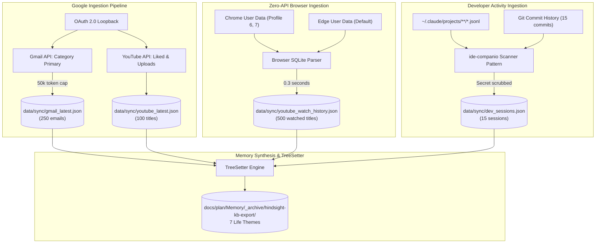

# Multi-Source Local Data Ingestion Runbook

**Date:** 19 Nov 2026 · **Status:** Active Operational Playbook · **Security:** Local-only, Gitignored (`/data/sync/`)

This runbook documents the multi-modal ingestion pipeline that pulls personal context into local memory without burning frontier tokens or leaking credentials to remote APIs.

---

## 1. Pipeline Overview



---

## 2. Ingestion Channels & Execution Methods

### Channel 1: Gmail Constrained Sync (`scripts/sync_google.py`)
* **Transport:** Google OAuth 2.0 (Desktop app loopback on `http://localhost:8088/`).
* **Constraints:**
  * **Token Budget Ceiling:** Caps downloads when cumulative tokens reach `--tokens 50000` (measured via $\text{characters}/2.2$).
  * **Temporal Slicing:** `--days 30` or `--since / --until` (preventing multi-year drift).
  * **Category Filter:** `category:primary -in:spam -in:trash` (strips promotional marketing and newsletters).
* **Output:** `data/sync/gmail_latest.json` (250 emails, ~34,615 tokens).
* **Run Command:**
  ```powershell
  .\apps\api\.venv\Scripts\python.exe scripts\sync_google.py --tokens 50000 --days 30
  ```

### Channel 2: YouTube Channel & Liked Videos (`scripts/sync_google.py`)
* **Transport:** YouTube Data API v3 using the same authorized OAuth token.
* **Feeds Pulled:**
  * Channel uploads for active creator output (connected to channel `iHisam`).
  * Liked videos playlist (`playlistId=LL`, 50 items).
* **Output:** `data/sync/youtube_latest.json` (100 items).

### Channel 3: YouTube Watch History — Zero-API Local Extraction (`scripts/extract_youtube_history.py`)
* **Why not API?** Google disabled the `watchHistory` playlist in YouTube Data API v3 in 2016 for third-party privacy.
* **The Local SQLite Solution:**
  * Scans Windows local browser history at `AppData\Local\Google\Chrome\User Data\Profile *\History` and `AppData\Local\Microsoft\Edge\User Data\Default\History`.
  * Copies SQLite file to a temp path to bypass browser read-locks.
  * Queries `url LIKE '%youtube.com/watch%'` and orders by `last_visit_time DESC`.
  * Converts WebKit microsecond timestamps to ISO 8601 UTC.
* **Takeout Fallback:** If `data/sync/watch-history.json` is present from Google Takeout, it automatically ingests that instead.
* **Speed:** **0.3 seconds**, zero API calls, zero manual downloads.
* **Output:** `data/sync/youtube_watch_history.json` (500 watched video titles with timestamps).
* **Run Command:**
  ```powershell
  .\apps\api\.venv\Scripts\python.exe scripts\extract_youtube_history.py
  ```

### Channel 4: Developer Sessions & Git History (`scripts/extract_dev_sessions.py`)
* **Transport:** Borrowed directly from `ide-companio` (Claude Report) scanner architecture.
* **Data Sources:**
  * Scans `~/.claude/projects/**/*.jsonl` for `aiTitle`, working directory (`cwd`), git branch, and user prompts.
  * Scans local repository Git commits (`git log -n 15`).
* **Security & Secret Scrubbing:**
  * Automatically strips `.env` line leaks, private keys, GitHub PATs, and bearer tokens before writing.
* **Output:** `data/sync/dev_sessions.json` (15 sessions, 15 git commits).
* **Run Command:**
  ```powershell
  .\apps\api\.venv\Scripts\python.exe scripts\extract_dev_sessions.py
  ```

---

## 3. Security & Governance Invariants

1. **Git Isolation:** All credentials (`client_secret*.json`, `.env.gcloud`, `google_token.json`) and raw payloads (`data/sync/*.json`) are strictly locked in `.gitignore`.
2. **Provider Sanctions:** Zero external Gemini API calls. All extraction and analysis are performed locally via LM Studio / Qwen / Ollama or declared Antigravity hooks.
3. **Data Protection:** Real user records never touch version control or shared public artifacts.
