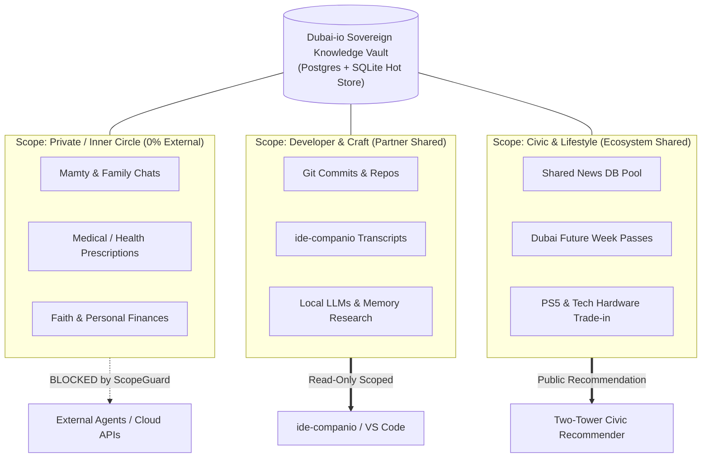

# Dubai-io Knowledge Vault Connector: Ecosystem Scoping & Visibility Specification

**Date:** 19 Nov 2026  
**Status:** Architectural Plan of Record  
**Target:** Contest Track 1 (Personal AI Agent) & Shared Ecosystem Memory Layer

---

## 1. Executive Summary & Vision

Like the **Google Docs / Google Drive MCP Connector**, **Dubai-io acts as the user's sovereign Personal Knowledge Base Connector**. 

Instead of external apps, third-party agents, or sister tools having unconstrained, raw access to the user's private data, **Dubai-io sits as the authoritative, permission-gated Knowledge Vault**. It organizes the user's life into verified, structured life themes and exposes standard MCP/REST read/write interfaces with strict **Trust Boundaries and Visibility Scopes**.

The resident maintains 100% sovereignty: they can inspect, toggle, or revoke what slices of their life knowledge are visible to external harnesses, developer IDE tools (`ide-companio`), creative video studios (`Mirsal Studio`), or civic recommendation engines.

---

## 2. 3-Tier Visibility & Scoping Matrix

| Scope Level | Category / Life Theme | Visibility Policy | Permitted Consumer Apps | Enforcement Mechanism |
|---|---|---|---|---|
| **Tier 1: Private (Vault-Only)** | `01-people/inner-circle`, health, faith, personal financials | **0% Shared (Strict Lockdown)** | None (Resident-only UI) | Hardware encryption + `sensitive.py` fail-closed gate. |
| **Tier 2: Partner / Craft** | `02-career-and-craft`, `03-projects`, dev sessions, git commits | **Selective Sharing (85% visibility)** | `ide-companio`, VS Code, Claude Code | Scoped token, token burn audits, masked credentials. |
| **Tier 3: Civic & Lifestyle** | `05-home-and-money`, `06-events`, `07-travel`, public interests | **100% Shared (Ecosystem Pool)** | Dubai-io Two-Tower, Community Mesh | Aggregated, anonymized candidate matching. |

---

## 3. Connector Interface Protocol (MCP / REST)

Dubai-io exposes the following standardized tool/resource endpoints:

1. `connector://dubai-io/scopes`: Lists available knowledge scopes and active grant statuses.
2. `connector://dubai-io/me/profile`: Returns the resident's confirmed profile traits (filtered by caller scope).
3. `connector://dubai-io/memory/query`: Scoped semantic and FTS search over allowed domains.
4. `connector://dubai-io/vault/export`: Generates an encrypted portable export of the user's verified facts.
5. `connector://dubai-io/vault/revoke`: Instant one-click revocation of any app's access token, cascading across active sessions.

---

## 4. Visual UI Reference (Higgsfield Flare Artifact)

The sovereign vault control UI has been generated and validated with Higgsfield Flare at:
- **Screenshot Asset:** [page4_knowledge_connector.png](file:///g:/Haitham/VsCode/contest/design/references/quest/generated/page4_knowledge_connector.png)
- **Visual Features:**
  - Golden Burj Khalifa horizon insignia.
  - Interactive iOS toggle switches for **Inner Circle & Family** (Private), **Developer Craft** (Shared 85%), and **Dubai Civic & Services** (Shared 100%).
  - Trust verification pill: `✓ Verified Trust Boundary · Zero API Leak`.
