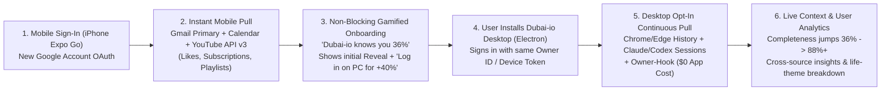

# End-Goal Plan: Non-Blocking Gamified Onboarding ("Knows You 36%") & Cross-Device Mobile → Desktop Analytics

**Date:** 23 Nov 2026 · **Status:** Founder-Approved End Goal (Executes right after initial `ios` + `desktop` builds merge) · **Related:** `docs/plan/ios-expo.md`, `docs/plan/desktop-electron.md`, `docs/plan/onboarding-youtube-sources.md`

---

## 1. Product Philosophy: Progressive Gamification, Never a Hard Gate

**Anti-pattern avoided:** The reference Quest app refused to open until the user manually uploaded WhatsApp and YouTube archives — an aggressive hard wall that blocks day-1 value.

**Dubai-io rule:** **Never block app entry.** The instant a new user signs in on mobile with a Google account, Dubai-io pulls initial fast signals, opens the full 4-pillar experience immediately, and uses a **gamified "Context Completeness" meter (`"Dubai-io knows you 36%"`)** plus an immediate **"Here is what I know about you for now…"** reveal card to motivate adding desktop & export sources at the user's own pace.

---

## 2. End-to-End User Journey (Mobile Login → `36%` Reveal → Desktop Continuous Pull)

---

## 3. Gamified Context Completeness Weights (`0% → 100%`)

Completeness is computed deterministically from connected source watermarks and verified fact/day-packet coverage across the 7 life themes (never a fake random percentage):

| Stage | Source / Action | Weight | Where it happens | What it unlocks immediately |
|---|---|---|---|---|
| **1. Mobile Instant Login** | Google OAuth: Gmail Primary (`30d`), Google Calendar, YouTube Data API v3 (`uploads`, `liked`, `subscriptions`, `playlists`) | **`+36%`** *(Base: 14% Gmail + 10% Calendar + 12% YouTube API v3)* | **iPhone (`apps/mobile`)** on first login | App opens immediately at **36%** with *"Here is what I know about you for now…"* cards + next-step prompt: *"Log in on your PC to add browser & AI workspace context (+37%)."* |
| **2. Mobile Deepening (Optional, Non-Blocking)** | WhatsApp manual `.txt` chat export (`+15%`) + YouTube Watch History via EEA Data Portability API or UAE/Global scheduled Takeout → Drive (`+12%`) | **`+27%`** | **iPhone (`apps/mobile`)** or Web | Inner-circle people (`T1`/`T2`), recurring social plans, and daily YouTube learning/topic counts (`youtube:interests`). |
| **3. Desktop Companion Login & Continuous Pull** | Install **Dubai-io Desktop** on PC → consent to **Chrome/Edge history** (`+18%`) + **local AI/coding sessions** (`Claude Code`, `Codex`, `ChatGPT/Takeout`, `+19%`) | **`+37%`** | **Windows PC (`apps/desktop`)** | Continuous background/on-demand pull via `owner-device` token + optional `$0 app cost` processing on the user's own Claude/Codex hook. Completeness reaches **73%–100%**. |

---

## 4. "Here Is What the App Knows About You for Now" & User Analytics Surface

Both mobile (`Memory` / `Connect` tabs) and desktop (`Analytics & Sources` drawer) render an honest, evidence-backed **User Context & Analytics** summary from `/v1/owners/{owner}/vault/*`, `/v1/ops/memory`, and source watermarks:

1. **Completeness Ring & Next Best Action Banner:**
   - Example at mobile day 1: **`"Dubai-io knows you 36% · Log in on Dubai-io Desktop on your PC to add Chrome & AI session context (+37%)"`**, with a one-tap *"Pair Desktop / Copy Setup Link"* action and a *"Skip — explore app now"* button that is always enabled.
2. **"What I Know About You So Far" Snapshot Cards (with `Confirm` / `Edit` / `Not true` / `Forget`):**
   - Immediate bullets grouped by detected life themes (e.g., *Active Interests from YouTube Likes/Subscriptions*, *Upcoming Commitments from Calendar/Gmail*, *Key Contacts*), each carrying `src:` evidence and `as_of`.
3. **User Analytics Breakdown (What the Data Says About You):**
   - **Life-Theme Radar (7 Spines):** Fact & activity distribution across `Career & Craft`, `Projects`, `Learning & Ideas`, `People & Inner Circle`, `Home & Money`, `Events`, and `Travel & Places` — highlighting **Rising 21-Day Interests vs. Baseline** (e.g., *"AI agent architecture & motion design up +42% this week"*).
   - **Cross-Source Signal Mix:** Exact counts of day-packets and verified facts contributed by each source (`gmail`, `youtube:interests`, `whatsapp`, `browser`, `agent:claude-code`, `agent:codex`, `ai:chatgpt`, `takeout:*`).
   - **Privacy & Rule-9 Shield Counter:** Transparent trust metric showing `N sensitive items automatically held back (health, faith, politics, credentials — never inferred)` plus one-tap **Forget by Source**.
   - **Compute & Cost Attribution Badge:** Shows how many facts were processed on `your Claude / Codex ($0 app cost)` vs. internal worker, plus total tokens/cost saved.

---

## 5. Build Sequence (Post `I-A` + `I-B` and `D-A` + `D-B`)

1. **Backend / Memory API (`apps/memory`):** Add `GET /v1/owners/{owner}/onboarding-status` (or extend `/v1/owners/{owner}/vault/summary`) returning deterministic `completeness_pct`, per-source connection/record counts (`gmail`, `youtube`, `whatsapp`, `browser`, `agent_sessions`, `takeout`, `chatgpt`), rising 21-day subject deltas, Rule-9 held-back counts, and initial *"What I know about you for now"* top facts.
2. **Mobile (`apps/mobile`, `I-C`):** Non-blocking `36%` Gamified Onboarding banner + *"What I know about you for now"* reveal cards + *"Log in on PC to unlock +37%"* pairing card + User Analytics breakdown inside `Memory` / `Connect`.
3. **Desktop (`apps/desktop`, `D-C`):** Desktop sign-in pairing + continuous/scheduled pull toggle for consented Chrome & coding-agent roots + live completeness jump (`36% → 73%+`) + full User Analytics & Rising-Interests dashboard.
