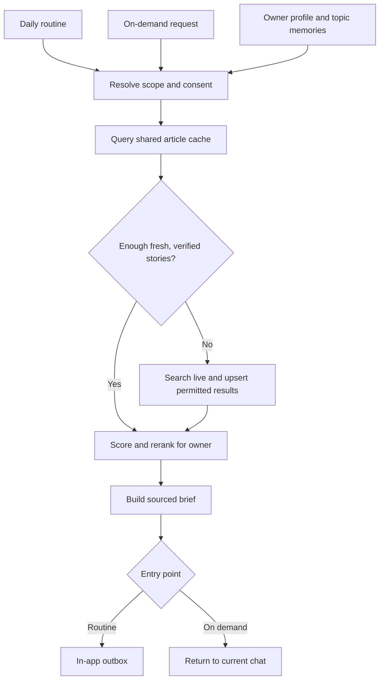

# Personalized Morning Brief

**Project:** Dubai-io AI Assistant · **Status:** proposed, headless first · **Path:** `docs/plan/morning-brief.md` · **Date:** 16 November 2026

Add an optional news section to the opt-in Morning Brief. When the routine runs, the assistant uses the owner's confirmed interests and existing profile summaries to select up to five fresh developments. An on-demand request such as “show me today's brief” uses the same retrieval and ranking pipeline. Public news discovered in either path can be reused for other users. Each user's profile, rank order, feedback and delivery history stay private.

## 1. Fit with the existing app

| Existing component | Feature responsibility |
|---|---|
| `apps/api/app/lab/` | Prototype the headless Know → Notice flow with fixture sources and frozen-clock runs. |
| `proactive`, `routines`, `consent`, `outbox` (§6, §12, Gate F) | Own activation, schedule, expiry, quiet hours, retry, and in-app delivery. Extend `GET/PUT /api/routines/brief` with optional news settings. |
| `reading.py` (§15, Gate D) | Reuse source policy and metadata filtering. Its current reading surface stays pull-only. The scheduled news section is a proposed extension gated on news opt-in, source rights and Gate F durability. |
| `user_profile`, `profile_facts`, `memory/`, `episodes` (§7) | Supply confirmed facts, owner-scoped temporal evidence and correction/Forget behavior. |
| `recommendations.py`, `profile_interests`, `recommendation_events`, `recommendation_runs` (§15) | Reuse the reviewed taxonomy, temporal scoring, feedback events and run tracking. |
| `app/db.py`, Supabase PostgreSQL 17 + pgvector (§4) | Keep data in private `dubaiio` schema. Run the SQLite fallback with subject and lexical retrieval, and test vector recall on Postgres. |

The existing deterministic Today/task section keeps its current FIN-08 contract. Render news as a separate section inside the consented in-app brief. It contributes zero items to Needs You or task counts. The server controls reading, writes and delivery. An optional model receives bounded evidence and proposes structured summaries only where the source register permits it. Where only metadata is licensed, render the publisher headline and link using templates. No email, external push, connector sync, or new Celery queue is needed.

## 2. Shared pipeline



- **Scheduled:** The routine holds explicitly chosen subjects, public region and language, time, timezone, and expiry. Empty subjects resolve to eligible general news unless the owner has enabled confirmed profile interests. Proposed default time is 08:00 Asia/Dubai. Keep the existing 07:00–22:59 Dubai window and 30-day opt-in renewal. A request to read a brief right now never activates the routine.
- **On demand:** Scope comes from the request (for example, “movies today”) and permitted owner context. Use a fresh cache hit immediately. A miss, stale coverage, or an explicit refresh can trigger bounded live search. Apply the same source and privacy rules. Reading or refreshing does not enqueue an outbox message. Record a story as seen only once it is actually returned or delivered, not when it is fetched.
- **Fallback:** If there is no usable profile, retrieve major eligible general news with Dubai/UAE as the app's default regional scope, plus major world stories as space permits. Politics remains opt-in under the reading policy. If enabled subjects have no verified updates, fill from general news only when the routine or request permits it. Return fewer items on quiet days. Distinguish “no verified updates” from “sources unavailable.”

## 3. Profiles and temporal memories

Use two layers. The names `profiles` and `profile_temporal_memories` are the proposed feature contracts. Back `profiles` with a generated, one-row-per-owner read projection (a view or rebuildable table if needed) over existing facts and summaries. Back `profile_temporal_memories` with owner-scoped memory/events and recommender signals, using a view or a narrowly scoped projection if indexed lookup needs it. Avoid a parallel source of truth. Use a stable `owner_id` from the session, never a username for joins or isolation. A display name is optional and stays outside the ranking input.

| Contract | Suggested fields and keys |
|---|---|
| `profiles` | `owner_id` PK, `updated_at`, `profile_revision`, `main_brief_summary`, `subject_summaries` (JSONB keyed by taxonomy path), and internal `evidence_refs`/watermarks per summary. Backed by `user_profile`, eligible `profile_facts` and existing summary artifacts. |
| `profile_temporal_memories` | `memory_id`, `owner_id`, `subject_path`, `kind`, `signal`, `summary`, `provenance`, `confidence` where applicable, `observed_at`, `source_event_at` when known, `source_kind`, `source_ref`, `evidence_limit`, and validity/supersession fields. Index `(owner_id, subject_path, observed_at DESC, memory_id)`. Link to canonical evidence so correction and Forget propagate. |

**Quest-style evidence records.** The supplied examples bundle a source, when it was read, dates for what was observed, and a note about what's uncertain. Preserve each of those separately. A calendar block can show time reserved for an activity. A search shows a topic was checked. A direct statement can establish a preference. A source ingest time means when the evidence was read. Use short, dated entries with evidence links instead of storing a single transcript or treating a multi-source biography as truth. The examples below are fictional fixtures. The supplied personal records are useful as a schema reference and are outside this feature's storage and search scope.

| Subject path | Example memory | Provenance and effect |
|---|---|---|
| `sports.football` | Looked up Argentina's new squad players | An observed lookup. Weak interest signal. |
| `sports.rugby` | Searched for a transfer | An observed lookup. Country, team and long-term interest remain unconfirmed. |
| `sports.olympics.gymnastics` | Said to exclude gymnastics updates | A confirmed exclusion if explicitly stated. Otherwise record only the observed behavior. |
| `movies.action` | Looked up Avengers release news | An observed lookup. If the user separately confirms “follow Marvel releases,” that is eligible for scheduled personalization. |

Example generated `profiles` row after the user confirms the respective preferences:

```json
{
  "owner_id": "demo-owner-01",
  "updated_at": "2026-11-16T04:00:00Z",
  "profile_revision": 12,
  "main_brief_summary": "Prefers an English briefing with UAE coverage.",
  "subject_summaries": {
    "sports": {
      "summary": "Exclude Olympic gymnastics updates.",
      "excluded_paths": ["sports.olympics.gymnastics"],
      "evidence_refs": ["fact-demo-10"]
    },
    "movies": {
      "summary": "Follows Marvel releases.",
      "followed_public_entities": ["marvel"],
      "evidence_refs": ["fact-demo-11"]
    }
  }
}
```

The football, rugby and Avengers lookups remain separate dated temporal rows. They don't become confirmed preferences in the profile projection.

### Topic context for a run

For a routine scoped to `movies`, load the owner's existing brief-safe **main summary**, their saved **movies summary**, and **up to 100 eligible recent rows** from `movies` and authorized descendants, newest first with a stable ID tie-break. Apply ownership, consent, source, validity and sensitivity filters before the limit. Fetch only evidence fields the feature needs, with a per-row text cap and a total context budget. Run that bounded topic pass once per subject, rather than loading the full memory store for every candidate. The 100-row cap bounds memory retrieval, separate from the article result cap.

Derive a compact **current movies digest** from the evidence. The previous movies summary helps preserve context when its sources are current. The main summary provides broader confirmed preferences such as language and region. The output is typed: allowed and excluded subject paths, public entity IDs, confirmed preferences, applicable weights, and evidence IDs. If no eligible evidence changed, reuse the saved digest. Rebuild from valid evidence when the input watermark changes or the user edits, revokes or forgets a source. A prior summary can guide phrasing but contributes zero weight without live supporting evidence. It cannot confirm a preference, refresh its own timestamp or restore forgotten data.

**For scheduled news,** the user's explicit topic selection or confirmed profile facts set personalization scope and influence rank. Recent memory supplies confirmed, in-scope evidence and context. Hold inferred signals out of scheduled personalized selection until confirmed. **For on-demand news,** use only architecture-approved inferred signals for bounded reranking inside the requested scope, with a visible, accurate “Because…” reason. Reuse the existing temporal rules and two-visit qualification where applicable. A search can be retained as approved temporal evidence under existing memory policy but must never auto-confirm a taste. Confirmed facts do not decay. Faded inferred signals lose influence under §R-ND and remain available for permitted recall until forgotten. Sensitive traits, private third-party facts and Workspace-derived personal data stay out of news recommendation and search.

## 4. Search on demand and public storage

### Providers

| Adapter | Use in this feature |
|---|---|
| **Tavily Search API** | Primary live retrieval. Send reviewed public subject/entity labels with `topic="news"`, `time_range="day"` (or explicit dates) and bounded `max_results`. Disable generated answers, raw content and images in the MVP. Treat reported dates as discovery hints until checked against the publisher or an authorized feed. |
| **SerpApi Google News** | Google-powered fallback that fits the project's existing SerpApi integration. Use `engine=google_news` with a public query plus supported region/language options. Flatten story groups and resolve valid publisher links. Enable only when the source register permits the planned use and retention. |
| **Google's direct APIs** | Google Custom Search JSON API is closed to new customers and existing customers must migrate by 1 January 2027. For a first-party Google option, evaluate Vertex AI Search over approved domains or request access to Google's full-web offering. Gemini with Google Search Grounding has display and reuse restrictions. Exclude its output and links from this shared cache and background ingestion path. |
| **Approved RSS or publisher APIs** | Optional retrieval input for reliable general headlines and topic-specific first-party announcements. Use the same validation, source register and article contract. |

Keep each adapter behind `search(public_query, locale, window, limit) -> Candidate[]`. Example queries: “Marvel Avengers film release official announcement” or “Dubai UAE top news”. Derive them from reviewed topic labels and public entity IDs only. No owner identifiers, raw user queries, personal summaries, imported text or memory rows go into provider requests or the shared cache. If a requested term can't be mapped safely, fall back to a public parent subject or ask for a public topic in the on-demand experience. Provider configuration and keys stay server-side.

### Cache and indexes

| Store | Suggested contract |
|---|---|
| `news_subjects` | Canonical taxonomy path, parent, allowed aliases/public query templates and config version. Reuse reviewed taxonomy IDs where available. |
| `news_articles` | `article_id`, unique `canonical_url`, publisher, title, language, region, `published_at`, optional `updated_at`, `fetched_at`, `verified_at`, rights/source policy, `story_id`, `story_revision`, and permitted snippet and embedding fields. Rows are public-content only, in the private server schema. |
| `news_article_subjects` | `(article_id, subject_id)` PK plus tag provenance. Index subject → articles. One article may belong to multiple subjects. |
| `news_query_cache` | Public key: normalized public subject/query variant + region + language + resolved date window/time bucket + provider + query policy version. Store status, permitted result IDs in rank order, fetch time, expiry and refresh lease. No user ID or individual search history. |
| `brief_runs` / `brief_story_history` | Reuse or extend `recommendation_runs` for owner-scoped news runs. Keep owner, local brief date, routine/profile revisions, cache health, ranker version and delivery outcome. Store story ID and revision on actual display/delivery for repeat suppression. Add an owner-scoped index on story history. |

1. Query locally first. Reuse a fresh result set when it has enough eligible stories for the request. Default tuning: fresh cache for 15 minutes, consider stories from the last 24 hours, allow a labeled expansion to 48 hours for sparse topics. Publication freshness is independent of cache TTL. An old story whose snippet was refreshed is still old.
2. On miss, thin coverage or stale cache, claim one refresh lease per public query key and call Tavily within a shared budget. Followers reuse the result or return currently eligible cached items. Call the Google-powered fallback only if the primary fails or yields too few eligible items. Start with 10 results per provider call, a global provider ceiling and per-owner/run budgets (for example, at most four provider requests and at most 100 merged news candidates per run). Cache verified empty results briefly. A timeout or 429 records an error/backoff, not “no news.”
3. Validate publisher identity, URL, rights, date and subject. Use an approved feed or publisher metadata to establish freshness. Check evidence for a claim before generating prose. Normalize links, strip tracking parameters, and upsert canonical URLs and topic mappings. Consolidate syndication and near-duplicate headlines into a story. A new URL or changed timestamp alone does not create a new story revision. Require a verified material development or an explicit correction.
4. Store permitted metadata only. The reading source register records bounds for fields, retention, indexing/embeddings, summarization, scheduled display and images per provider/publisher. Provider terms and publisher rights are separate. For unsupported retention or indexing, omit those fields or keep the source out of the shared corpus. Start with no stored article bodies, images or unreviewed snippets. Add short original summaries and image references only when rights and the product contract allow. Apply expiry/purge to public cache contents independently of profile-memory decay.

## 5. Hybrid retrieval and personalized ranking

The MVP is a **content-based recommender**. Everyone can share the article corpus. Each owner has a different feature vector derived from the approved profile and routine, so selection and ordering can differ even on the same cache hit.

| Stage | Method |
|---|---|
| **Subject retrieval** | Filter the permitted time, region, language and subject scope using normalized taxonomy paths and child mappings. Rank matches on specificity, then freshness. Use a B-tree for subject/date lookup paths. |
| **Lexical retrieval** | Use Postgres full-text search over permitted title and description fields with a GIN index. Exact entity aliases and terms such as “Avengers” can win even if a semantic match scores lower. |
| **Semantic retrieval** | Embed an approved public topic/entity query and the permitted public article fields with the same model/version. Use pgvector cosine similarity to surface related wording such as “Marvel theatrical release slate.” Keep model/version on the embedding; don't compare vectors across models. For the MVP, score within the scoped recent set. Add an approximate index only after measuring latency and recall. Personal notes and private profile summaries never enter the shared vector store or an external query-embedding call. |
| **Merge** | Combine the independently ranked lists by article ID with reciprocal rank fusion, `sum(1 / (60 + rank_in_list))`, using zero contribution for missing ranks. Apply provenance, source eligibility and freshness before truncating. SQLite can use the subject and lexical lanes with the same downstream ranking contract. |
| **Score for owner** | Reuse `profile_interests` and the permitted topic digest. Starting weights over features normalized to [0, 1]: 35% fused retrieval relevance, 25% subject/entity affinity, 20% freshness, 15% source quality, 5% novelty. Reweight available features for a cold start. Store the ranker version and aggregate diagnostics. |
| **Rerank and select** | Enforce confirmed exclusions, collapse duplicate story IDs, suppress already displayed unchanged revisions, prefer primary sources for the same story, and add source/subject diversity. Use a stable tie-break. A single-topic request doesn't require cross-subject diversity. Return up to five verified stories. |

Freshness, permission and evidence are eligibility checks before ranking. A large profile weight cannot make an old, disallowed or unverified article eligible. Label a materially updated story and identify what's new. Use an internal “Because…” reason tied to an actual eligible signal, for example “Because you follow Marvel releases.” Never display sensitive evidence or claim “you like this” based on a single click.

Explicit feedback writes through the existing owner-scoped recommender: **Follow topic** can confirm a preference, **Save** records a positive interaction, **Less like this** reduces similar-item weight, and **Hide this story** affects the story only. Feedback on one brief does not silently broaden the routine. Measure the recommender's value against a fresh-first, trusted-source baseline using a small labeled replay. Review precision@5, distinct stories, repeated-story rate, cache hit rate, provider requests per run, and p95 runtime. Use those results to tune weights before adding a learned ranker.

## 6. Cron, delivery, and recovery

1. A deterministic scheduler sweeps due `routines` in bounded batches. Claim one logical run using a unique owner + routine + local date key, a renewable lease and a fencing token. Advance the next due time transactionally with the durable claim. Reclaim expired leases and recover unfinished work without creating a second run.
2. Snapshot the routine and profile revisions plus current consent. Perform cache, provider and optional summary work outside database transactions. On return, recheck consent, expiry, cancellation, lease token and revisions. A stale worker can leave permitted public articles in the cache but cannot commit private results or enqueue delivery. Rebuild with fresh inputs if still eligible and inside the window.
3. Persist the validated brief and enqueue one owner-scoped outbox row in the same transaction. Use `morning-brief:{routine_id}:{local_date}` as the dedupe key. The outbox rechecks consent, expiry, revisions and story history immediately before in-app delivery. This catches a user who opened an on-demand brief while the scheduled brief was pending. If revision drift requires a rebuild, replace only the undelivered draft payload for the same run and dedupe key, guarded by the new revisions. Honor quiet hours and record story revisions idempotently with delivery. Re-evaluate freshness after deferral and expire a missed daily slot instead of backfilling a stale bulletin.
4. Stop provider retries at the budget or deadline. Report healthy-empty, partial coverage and failed-source states separately. Degrade to eligible verified cached stories or an honest empty state. Keep operational logs free of raw owner memory and credentials.

Each item has an evidence-derived headline, a short summary where permitted, why the update matters, and publisher links with publication and checked times. The renderer resolves source IDs supplied by the pipeline. Model output never supplies its own links or delivery instructions. Optional imagery can follow after rights review. Browser roles receive only authorized rendered records. Corrections and Forget invalidate affected private evidence, digests, in-flight rankings and cached reasons without deleting the unrelated shared article corpus.

## 7. Build sequence and acceptance

1. **Headless MVP:** Wire reviewed news subjects, fixtures, Tavily and the Google-powered fallback through the adapter interface. Add cache migration, source rules, date verification and an on-demand entry point. Replay the same query for two owners and confirm a warm cache hit requires no second provider call.
2. **Personalization:** Add the two profile projections, the bounded topic digest loader, hybrid retrieval and deterministic reranking. With a `movies` routine, test that at most 100 eligible movies memory rows, the movies summary and main summary are used. Test that two different profiles reorder the same article set, and that a search-only or forgotten interest cannot personalize scheduled delivery.
3. **Scheduled rollout:** After Gate D rights/freshness review and Gate F durability checks, add explicit news opt-in to the existing routine. Exercise duplicate sweeps, lost leases, worker restarts, mid-run revoke/Forget, expiry, quiet hours, and manual reads during a scheduled run. Verify one outbox item per owner/date, no post-cancel message, no cross-owner leakage, and unchanged FIN-08 behavior. Use fixtures for SQLite and exercise hybrid search and concurrency against PostgreSQL.
4. **Quality checks:** Replay cache miss/hit, provider outage, unverified publication dates, changed timestamps without new facts, real story updates, sparse profiles, injection in snippets, and cold-start general news. Verify every story has a publisher link and each generated factual summary has permitted supporting evidence. Capture recommendation quality and cost against the fresh-first baseline.

## 8. Proactive Memory Card Orchestrator & Scoped Retrieval Contract

**Visual references (`design/17-11-2026/`, founder-supplied 17 Nov 2026):**
- **Desktop 3-column layout:** `design/17-11-2026/Dubai‑io Morning Brief Dashboard.png` — Left rail (`Home`, `Chat`, `Do`, `Memory`, `Notifications`, `Quick Actions`); center hero (`"Good morning, Haitham"`) + category filter pills (`All`, `Career`, `Family`, `Gadgets`, `Health`, `Finance`) + 2-column `"Your morning brief — 6 things I noticed for you"` card grid; right inspector drawer showing the selected card's `"I noticed..."` explanation, `"Because..."` source rows (`Calendar`, `WhatsApp`, `Note`), AED gift carousel (`AED 420`, `AED 1,950`, `AED 180`), and 4-button action bar (`Remind me`, `Shop gifts`, `Not true`, `Forget`).
- **Mobile 3-screen flow:** `design/17-11-2026/Quest_ Thoughtful Memory Management.png` — (1) Category card feed with confidence pill, AED product suggestions, and `"Why am I seeing this?"` link; (2) `"Why am I seeing this?"` sheet displaying `Evidence` rows, `How I found it` (`ScopeGuard` scope chips: `family`, `person: Mom`, `window: Dec 2025`, `gifts`), `Signals` (`"I noticed she mentioned oud twice. Confirm?"` `Yes / Not really` two-visit confirmation prompt), and `Fact history`; (3) `Memory` controls screen with `Sources` toggles, `Keep memories` (`Career: Always`, `Family: Always`, `Health: Ask first` sensitive gate, `Finance: 2 years, then fade` per `§R-ND`), and `Never remember` (`forget_rules` chips for `Person`, `Chat`, `Phrase` + `Forget something...`).

Alongside public news/reading items, the nightly Notice orchestrator generates personal memory cards from the owner's audited memory store (`lab.sqlite` / Postgres 10-table memory schema). All proactive memory cards follow a strict **metadata-first, scoped-semantic-second** contract:

### 8.1 `ScopeGuard` & Query Audit Trail
- **No unscoped corpus scans:** Every semantic/hybrid retrieval call from a card generator passes through `ScopeGuard`, which validates that the query specifies at least one metadata pre-filter (`categories`, `entities`, or `people`) before vector ranking runs inside that subset.
- **Bounded 1-hop category expansion (`RELATED_CATEGORIES`):** When a primary category slice yields no hits, a generator may widen at most one hop to declared neighbour categories (e.g., `family -> [friends, finance]`, `career -> [finance]`, `gadgets -> [finance]`, `home -> [finance]`) while keeping the `person` or `entity` filter locked and recording `expanded_from` in the audit entry.
- **Per-run budget & provenance:** `ScopeGuard` caps semantic calls per orchestrator run (`max_queries_per_run = 60`) and appends `{text, categories, entities, people, statuses, start, end, expanded_from, hits}` to `card.queries` so the `/unified` *"Why am I seeing this?"* drawer renders both the cited source snippets (`card.evidence`) and the exact scoped queries that produced the card.
- **Evidence or nothing:** After applying `forget_rules` and source controls, any card with zero surviving non-forgotten evidence rows is dropped before ranking.

#### 8.1.1 Orchestrator Query Rewriter (AC-3)
Vague or conversational user questions (e.g., *"why am I not getting accepted"*) must neither fail `ScopeGuard` with `UnscopedQueryError` nor bypass `ScopeGuard` into a full-corpus scan:
- **Harness-side rewriter (orchestrator only):** Before hitting `ScopeGuard`, an orchestrator step invokes a cheap planner model (never the 1.5B local classifier) to rewrite the unscoped user question into a validated `ScopedQuery(text, categories, entities, people, start, end)`.
- **Acceptance contract (AC-3):** `"why am I not getting accepted"` maps deterministically to `category: career` / `job_search` (plus relevant entities such as `['linkedin', 'cv', 'application']` and a bounded lookback window); `ScopeGuard.recall()` executes strictly inside that scope and returns $\ge N$ relevant items without triggering a full-corpus scan.

### 8.2 Metadata-First Card Generators (`def generator(ctx) -> list[Card]`)
Each generator starts from deterministic SQL/catalog counts and selections (`category`, `status`, `person`, `entity`, `direction`, `since`/`until`, `fact_key`), and only calls `ScopeGuard.recall(ScopedQuery(...))` inside that narrow slice. All cards obey Dubai-io guardrails (`"I noticed..."` phrasing for inferences, AED currency, Amazon.ae / UAE portals, `§R-ND` never-drop decay floor instead of age deletion, and explicit confirmation gates on sensitive categories):

| Card Type | Metadata Pre-Filter | Scoped Semantic Step & Card Logic |
| :--- | :--- | :--- |
| `career.funnel` | Outgoing career emails/applications (`direction='outgoing'`), rejections (`status='rejection'`), and interviews (`status='interview'`) over the last `120` days (minimum 10 outgoing). | Computes interview conversion `rate = len(interviews) / len(sent)`. If `rate < 0.08`, runs a scoped query (`categories=['career']`, `entities=['linkedin', 'cv']`, window `360d`) to check whether recent threads mention an outdated profile/CV gap. Dedupe key: `career.funnel\|{YYYY-WW}`. |
| `family.birthday` | Confirmed/extracted birthday facts (`status='birthday'`, `fact_key='{person}\|birthday'`) occurring within the next `21` days (`birthday_horizon_days`). | Checks outgoing messages to `person` in `[last_year_bday, +2d]` to detect whether last year's birthday was missed (and incoming messages in `[+7d]` for fallout). Runs a scoped query (`categories=['family']`, `people=[person]`, window `730d`, with 1-hop fallback) on incoming messages to extract gift interests, linking to Amazon.ae search in AED under the configured gift budget. Dedupe key: `family.birthday\|{person}\|{year}`. |
| `gadgets.program` | Owned devices extracted from purchase receipts (`category='gadgets'`, `status='purchase'`) matched against service/recall/replacement programs announced in the last `45` days (`status='program'`). | Runs a scoped query (`categories=['gadgets']`, `entities=[device]`, window `730d`) to check if the owner previously mentioned a problem (screen, battery, flicker) with that device; boosts confidence (`0.92` vs `0.75`) and urgency (`0.9` vs `0.6`) when prior issue evidence exists. Dedupe key: `gadgets.program\|{program_id}`. |
| `gadgets.price_drop` | Implied wishlist items (`category='gadgets'`, `status='wishlist'`, last `365` days) cross-referenced against `fact_history('{entity}\|price')`. | Triggers when at least 2 price facts exist, `new_price < old_price`, and the newer price was observed within the last `14` days. Cites `[new_price_id, old_price_id, wishlist_id]` in AED. Dedupe key: `gadgets.price_drop\|{entity}\|{new_id}`. |
| `health.overdue` | **Opt-in / confirmed health routines only** (rule 9 sensitive-category gate; e.g., `dentist: 180d`, `checkup: 365d`). | Queries confirmed calendar/memory items in `categories=['health']` over `3 * every_days`; surfaces an overdue notice when `(now - last_visit).days > every_days`. Never inferred without user confirmation. Dedupe key: `health.overdue\|{label}\|{YYYY-MM}`. |
| `{domain}.change` | Recent `superseded_by` chains across `finance`, `home`, `career`, and `travel` in the last `30` days (`fact_key='{subject}\|{attr}'`). | Surfaces material contradictions/changes (e.g., DEWA/Etisalat/Netflix subscription price changes, lease or employer updates) as `{subject} {attr} changed: {old_val} -> {new_val}`, keeping the older value as auditable history. Dedupe key: `change\|{fact_key}\|{new_id}`. |

### 8.3 Card Lifecycle State Machine & Honest Reminder State (AC-2)
- **App owns UI; backend owns lifecycle state:** Every `Card` carries an explicit `lifecycle_state` with deterministic transitions:
  $$\texttt{new} \longrightarrow \texttt{seen} \longrightarrow \texttt{actioned} \longrightarrow \texttt{dismissed} \longrightarrow \texttt{resolved}$$
  (with `wrong` and `forgotten` as terminal suppression states recorded via feedback/forget endpoints).
  - `new`: Generated by the orchestrator and not yet rendered in the owner's viewport.
  - `seen`: Rendered in the swipe feed or Morning Brief view.
  - `actioned`: Owner tapped a primary card action (e.g., opened source, launched task thread, saved reminder).
  - `dismissed`: Owner explicitly dismissed the card for the current cycle (`dedupe_key` prevents re-surfacing as `new`).
  - `resolved`: Underlying open loop or condition is closed by new evidence or explicit user completion.
- **Honest reminder label (Rule 1 & AC-2):** Until push notification delivery is built and verified, no card or action response may display `"reminder set"` or imply background push delivery. Saving a reminder must return and render the exact status label:
  **`reminder saved — delivery not yet enabled`** (stored in SQLite so the card resurfaces in-app when due, without claiming external delivery).

### 8.4 Ranking Formula, Dedupe Persistence & Bayesian Feedback Smoothing
- **Deterministic card ID:** `card.id = sha1(card.dedupe_key).hexdigest()[:12]`. Re-running the orchestrator updates the card payload in place while preserving `lifecycle_state` (`new | seen | actioned | dismissed | resolved | wrong | forgotten`) and `snooze_until` across runs.
- **Score formula:**
  $$\text{score} = \text{urgency} \times \text{confidence} \times \text{ev\_strength} \times \text{feedback\_weight} \times \text{fresh\_penalty}$$
  where:
  - $\text{ev\_strength} = \min(1.0,\; 0.4 + 0.2 \times |\text{evidence}|)$
  - $\text{fresh\_penalty} = 0.85$ if any cited evidence row is marked `superseded` (except for `*.change` and `*.price_drop` cards, where $\text{fresh\_penalty} = 1.0$)
  - $\text{feedback\_weight}(\text{card\_type}) = \frac{N_{\text{useful}} + 2}{N_{\text{not\_useful}} + 2 \cdot N_{\text{wrong}} + 2}$ (Bayesian-smoothed per card type: `1.0` neutral at cold start, `< 1.0` demotes noisy generators, `> 1.0` promotes valued generators).
- **Per-category cap & actions:** Keep top `per_category = 3` cards per category sorted by descending `score`. Feedback verdicts `wrong` and `not_useful` immediately hide the card; `forget` purges the underlying evidence and writes a persistent `forget_rules` blocklist entry so the topic/person/phrase is blocked at future ingestion.

### 8.5 Four-Tier Ingestion & Local Classification Pipeline (Gated Behind AC-1–AC-3)

| Tier | Component | Contract |
| :--- | :--- | :--- |
| **1. Rules** | Deterministic matcher | Known senders, receipts, unsubscribe headers → instant, free pre-tagging. |
| **2. Local Qwen (1.5B–3B fine-tune)** | Closed-set classification | Input: email/chat batch. Output: `{category, status, sender_cluster}` only (~0.07s/email vs 0.34s remote; ~93% accuracy on closed-set email triage). **No planning, no task creation, no query rewriting.** |
| **3. Hindsight (swappable backend)** | Temporal reasoning | `retain` absolute-dated facts & entities, `reflect` contradictions, supersession chains. |
| **4. Orchestrator** | Planning & routing | Task creation, query rewriting (§8.1.1), `ScopeGuard` enforcement, card generation & ranking. |

- **Constraints:** Fine-tuning requires a seed dataset (150+ real examples expanded synthetically). Borderline classification cases (target `<10%`) route to the durable human review queue (`blocked` state in `docs/plan/backfill-agent.md`). Raw email/chat classification stays local with zero per-email cloud calls.

## References

- Supplied `ARCHITECTURE.md`, especially §§4, 6–9, 11–16.
- [Tavily Search API](https://docs.tavily.com/documentation/api-reference/endpoint/search) and [Tavily on publisher rights](https://help.tavily.com/articles/4716869118-attribution-third-party-content-rights).
- [SerpApi Google News documentation](https://serpapi.com/google-news-api) and [Google Custom Search JSON API migration notice](https://developers.google.com/custom-search/v1/overview).
- [Gemini Google Search Grounding](https://ai.google.dev/gemini-api/docs/google-search) and [Gemini API additional terms](https://ai.google.dev/gemini-api/terms).
- [Supabase hybrid search with Postgres and pgvector](https://supabase.com/docs/guides/ai/hybrid-search).
- [Google recommendation systems overview](https://developers.google.com/machine-learning/recommendation/overview/types), [content-based filtering](https://developers.google.com/machine-learning/recommendation/content-based/basics), and [re-ranking](https://developers.google.com/machine-learning/recommendation/dnn/re-ranking).
