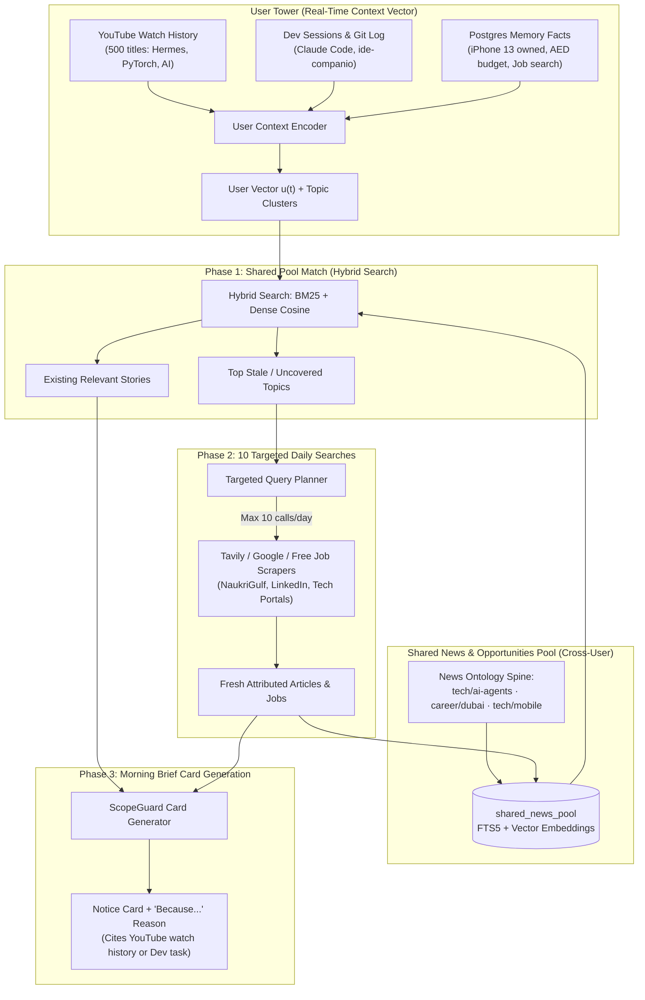

# Two-Tower Recommender & Shared News Engine

**Date:** 19 Nov 2026 · **Status:** Active Architecture for Contest Entry 1 (Best Personal AI Agent) · **Gate:** AC-2 / AC-3

---

## 1. Purpose & Strategy

The Two-Tower Recommender powers the **Notice** pillar of the **Personal AI Assistant** (Dubai Chambers Championship Category 01). It shifts the agent from a reactive chatbot into an autonomous personal advocate that:
1. **Understands current user direction** from rich multi-modal signals (YouTube watch history, dev transcripts, Gmail threads, memory facts).
2. **Maintains a central App News Database (`news_items` / Shared Pool)**: The news server reads from the **internal app database**, NOT directly from ad-hoc external APIs on every hit. News articles, tech updates, and localized deals are indexed and re-served again and again for similar users (e.g. AI engineers in Dubai, local tech buyers, gamers), ensuring zero API waste, instant sub-second retrieval, and collective intelligence.
3. **Executes 10 targeted daily searches** (via Tavily, Google, SerpAPI, and targeted portals like NaukriGulf & LinkedIn) only when the local database pool has gaps, immediately storing the new results back into the App DB pool for all matching users.

---

## 2. Two-Tower Architecture



---

## 3. The 3 Processing Phases

### Phase 1: Shared News Pool Check (Local First, Zero Tokens)
Before spending any external search quota, the engine checks the local shared pool:
* **The Shared Pool Table (`shared_news_pool`):**
  ```sql
  CREATE TABLE IF NOT EXISTS shared_news_pool (
      item_id TEXT PRIMARY KEY,
      title TEXT NOT NULL,
      url TEXT NOT NULL UNIQUE,
      publisher TEXT NOT NULL,
      published_at TEXT NOT NULL,
      category TEXT NOT NULL,          -- e.g. 'tech/ai', 'career/dubai', 'devices/mobile'
      ontology_id TEXT NOT NULL,
      summary_snippet TEXT NOT NULL,
      fts_tokens TEXT,
      embedding BLOB,                  -- nomic-embed vector
      fetched_by_user_id TEXT,         -- provenance (which run discovered it)
      first_seen_at TEXT NOT NULL,
      click_count INTEGER DEFAULT 0
  );
  CREATE VIRTUAL TABLE IF NOT EXISTS shared_news_fts USING fts5(title, summary_snippet, category);
  ```
* **Hybrid Candidate Retrieval:** Evaluates items using Reciprocal Rank Fusion (RRF):
  $$\text{Score}(u, i) = \frac{1}{60 + \text{rank}_{\text{BM25}}(u, i)} + \frac{1}{60 + \text{rank}_{\text{Cosine}}(\mathbf{u}_t, \mathbf{v}_i)}$$
* **Gap Analysis:** Identifies active user interests where existing items in the pool are either older than 48 hours or return zero hits.

### Phase 2: 10 Targeted Daily External Searches
For topics with insufficient coverage, the orchestrator triggers up to 10 specific searches per day:

| Search Slot | Targeted Domain | Example Query Construction | Provider / Fallback |
|---|---|---|---|
| **1–3: AI Engineering & Tools** | Cutting-edge LLM / Agent tools | `"Hermes Agent" OR "Honcho memory" tutorial updates` | Tavily (`topic=news`) / Google |
| **4–6: Dubai Tech Careers** | Active career pivot & hiring | `site:naukrigulf.com "AI Engineer" Dubai 2026` / `site:linkedin.com/jobs "AI Engineer" Dubai` | Tavily / Google Search |
| **7–8: Hardware & Gadgets** | Devices & trade-ins (phone leaf) | `"iPhone 18 Pro Max" release rumors price Dubai` / `Amazon.ae AED tech deals` | Google / Tavily |
| **9–10: Dubai Tech Meetups** | Community & social calendar | `"AI Tinkerers Dubai" meetup dates 2026` / `Dubai Chamber tech events` | Tavily / Google |

* **Ingestion Loop:** Every discovered headline is deduplicated against `shared_news_pool.url`, categorized under the news ontology, and stored with publisher attribution and publication date.

### Phase 3: Notice Card Synthesis with "Because..." Attribution
Matches are synthesized into Morning Brief cards ([design/references/quest/cards.jpeg](file:///g:/Haitham/VsCode/contest/design/references/quest/cards.jpeg)) requiring explicit provenance:
* **Headline:** *"Senior AI Engineer Opening at Dubai Future Foundation"*
* **Source:** `NaukriGulf` (published 4h ago).
* **"Because..." Evidence Pill:** *"Matched to your active craft pivot in `02-career-and-craft/ai-engineering-2026` and recent PyTorch/LLM research on YouTube."*
* **User Actions:** `[View Job / Remind me tomorrow / Dismiss / Not interested in this role]`

---

## 4. API Strategy (Free & Cost-Effective Tiers)

1. **Tavily Search API (`TVLY_API_KEY`):**
   * Free Tier: 1,000 searches/month (plenty for 10 searches/day = ~300/month).
   * Strengths: Returns clean markdown snippets, structured published dates, and deduplicated URLs.
2. **Google Custom Search JSON API:**
   * Free Tier: 100 free search queries per day.
   * Strengths: Perfect for site-specific searches (`site:linkedin.com/jobs`, `site:naukrigulf.com`, `site:khaleejtimes.com`).
3. **Curated RSS Feeds (Zero Quota):**
   * Direct parsing of admitted UAE media RSS feeds (Gulf News, The National, Wam.ae, Dubai Media Office) into `shared_news_pool`.

---

## 5. Scope Alignment & Roadmap

* **Contest Focus:** 100% focused on **Best Personal AI Agent**. The Societal Social mesh and Business Agent (`ide-companio`) are modular sister entries (like Meta's WhatsApp/Instagram) and share this underlying memory bank without blocking this track.
* **Acceptance Invariant:** No search result may be promoted to a card without passing through `ScopeGuard` to ensure it links to a confirmed user topic or qualified hypothesis.
